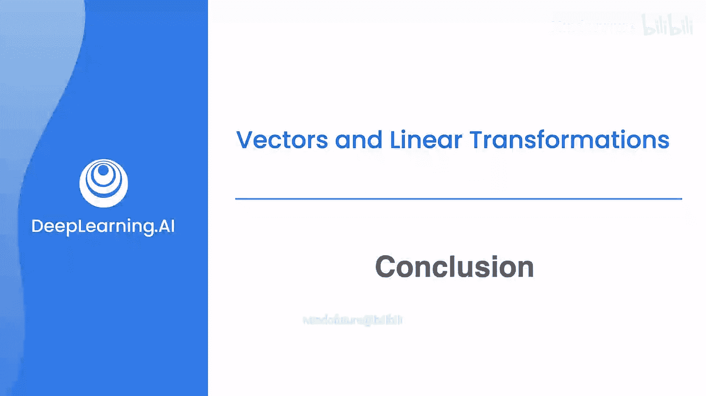
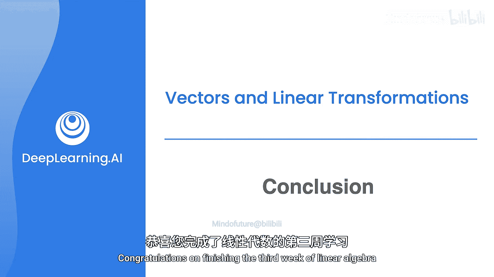

# 【Deeplearning】吴恩达：机器学习和数据科学线性代数1 ｜ Machine Learning Linear Algebra p40 P40_总结_03_03_01 -BV1Pp6VBjE29_p40-

Congratulations on finishing the third week of linearar algebra this week you work heavily with Mat and vectors and learn how to perform operations on them These operations led to a very useful way to visualize matrices called the linear transformation。

We are excited to see you apply what you've learned in these three weeks in the rest of your career with prepared interactive exercises for you throughout this course where you'll get further experience working with these concepts。

