# 【Deeplearning】吴恩达：机器学习和数据科学线性代数1 ｜ Machine Learning Linear Algebra p41 P41_第4周介绍_04_01_01 -BV1Pp6VBjE29_p41-

Welcome to week4 this week you'll continue learning some of the most important concepts of linear algebra through the lens of linear transformations First you'll see what some concepts such as determinants and singularity mean in terms of linear transformations and you'll be delighted to see how naturally they appear。

Then you learn one of the most powerful applications of linear algebra in the real world eigenvalues and eigenvectors。

 they are used extensively in many fields， including machine learning。

 in particular in a very important dimensionality reduction algorithm called principal component analysis or PCA Here's a quick explanation of principal component analysis。

 the topic will be covering at the end of this week。

 imagine that these points form your dataset set and you want to simplify your data set a bit。

 For example， even though the points are in space， it seems that all of them lie so close to this line over here。

Perhaps we can look at the data from the point of view of the line。

Perhaps we can look at the dataset from the point of view of the line。

PCA would be able to find this line and what it would do is to simplify the dataset by imagining this line to be the space and projecting all the points to the line now you have a simpler data that pretty much captures all the information of the original dataset right see what happened here is that PCA helped you go from a two- dimensional dataset to a one- dimensional dataset that carried almost the same amount of information that's why it's called a dimensionality reduction algorithm。

So in summary， principal component analysis is a technique that is used in data science applications to reduce the dimensions of a data while losing as little data as possible。

 you can imagine a dataset set with many columns of data which can sometimes be cumbersome to use or difficult to visualize the goal of PCA is to intelligently reduce the number of columns providing the benefits of a more compact dataset without losing all the useful information the original dataset contained here's a quick summary of the path will take to understand these concepts for lesson1 you will start with linear transformation represented by a matrix just as you learned in week3 and the goal is to be able to characterize this transformation。

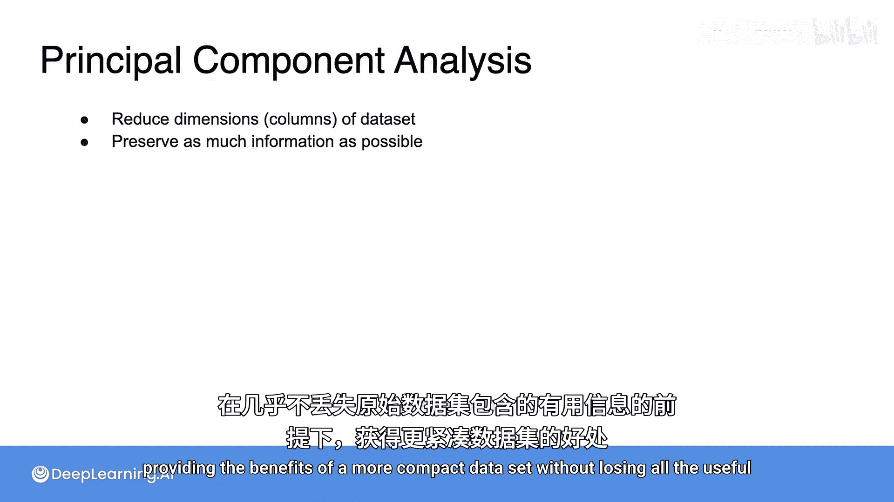

The first thing you'll learn is if the transformation is singular or not， for example。

 this first transformation of the plane is non singular。

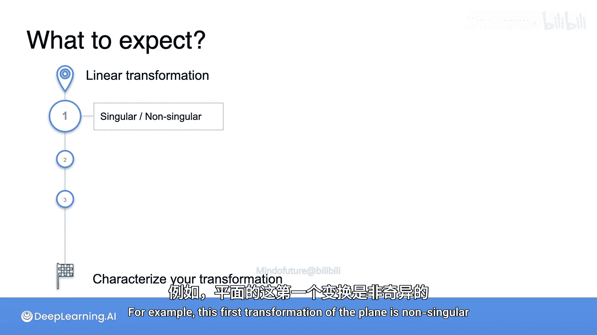

But this second one from the plane to a align is singular， as you might have guessed。

 these concepts are closely related to the singularity of a matrix which you studied earlier in the course。

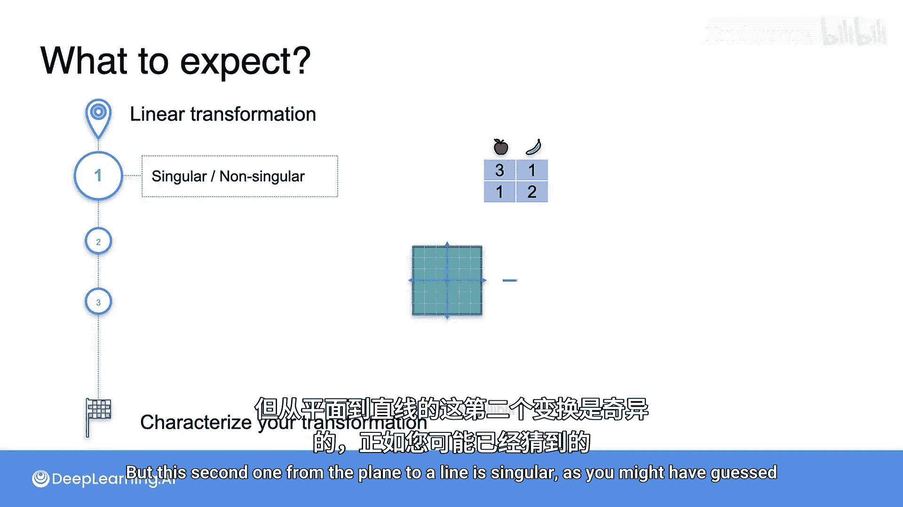

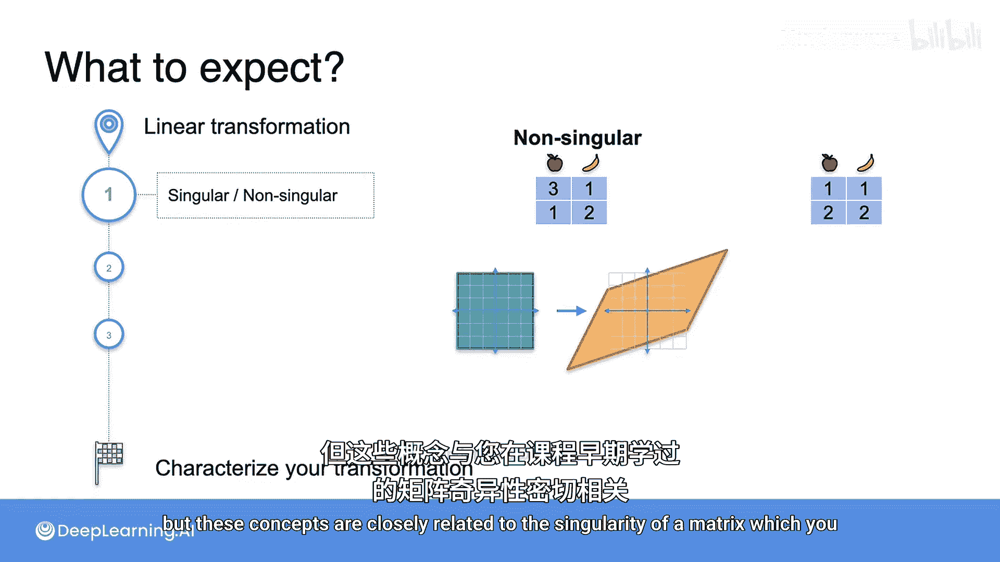

Next we'll return to the concept of the determinant this time with a geometric interpretation of its value。

 linear transformations can stretch or shrink space。

 and you'll see how the determinant helps quantify how much stretching or shrinking that particular transformation produces。

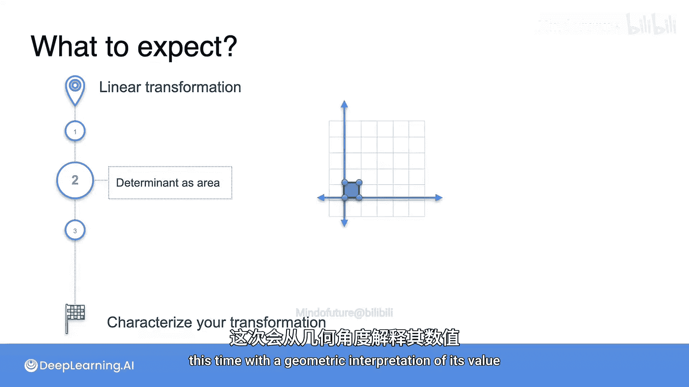

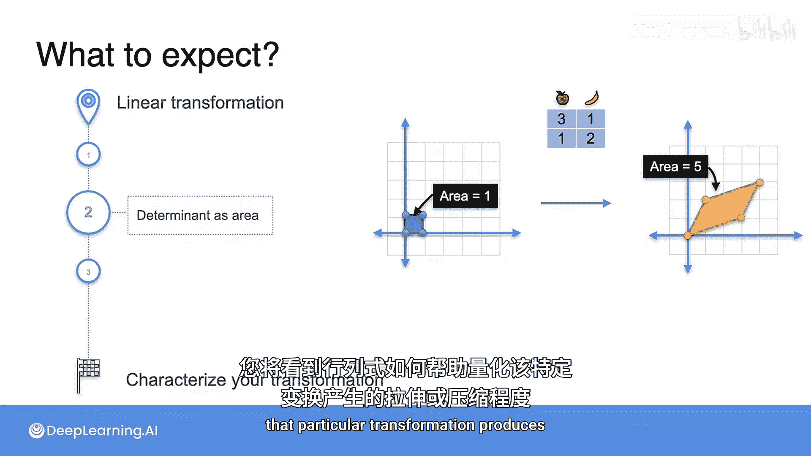

Finally， you will learn some properties of the determinant， for example。

 if you multiply two matrixrices or find the inverse of a matrix。

 there are some very intuitive properties of the determinant that arise。

 These are very useful when you want to analyze the inverse of your transformations or if you have a cascade of different transformations one after another so to sum up in the first lesson you will learn to characterize your linear transformation using the determinant Now let's take a look into lesson 2。

 which will conclude with an exploration of principle component analysis which we just described。

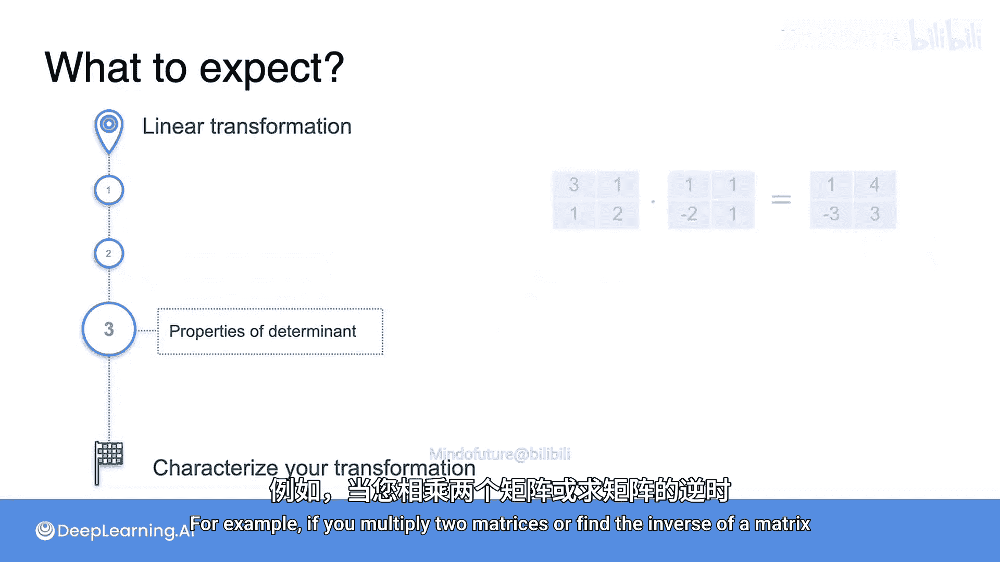

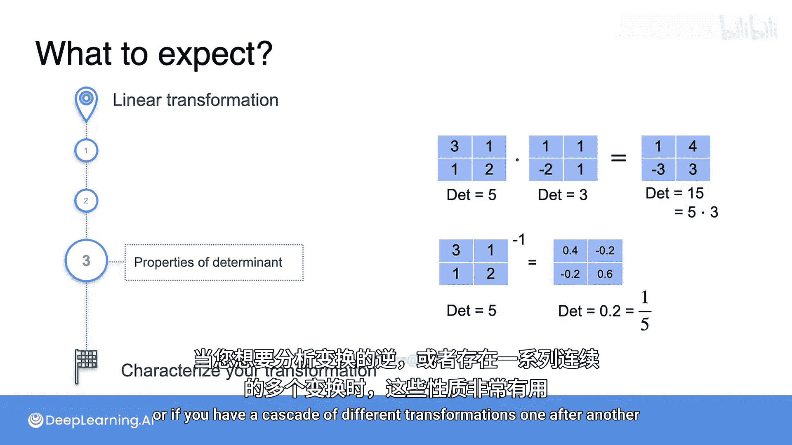

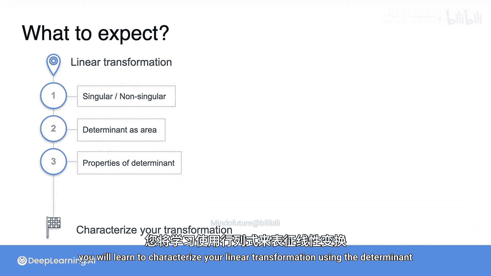

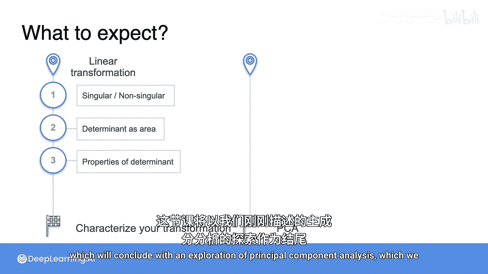

First thing we' will need to introduce is the definition of a basis。

 a basis is a group of vectors that define a space moving along the vectors that make up a basis allows you to move to any point in a space。

 for example， any of the combinations of vectors shown on the right is a basis for the plane。

Next we'll look at the concept of span this concept is super useful because it tells us which space can we access or generate with linear combinations of groups of vectors。

 for example， a single vector will always span a line two vectors which are not pointing in the same direction and also not pointing in completely opposite directions of 180 degrees will always span a plane。

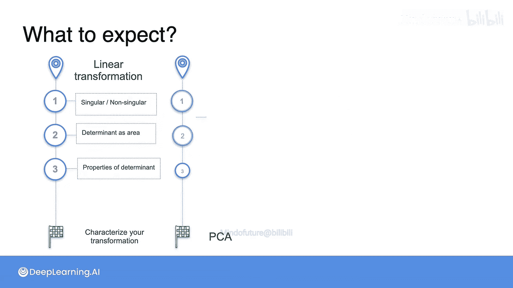

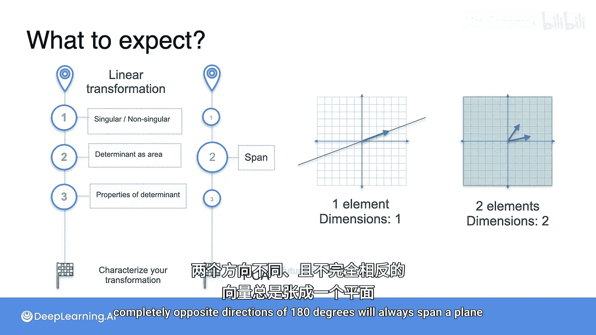

The last ingredient you will need to learn for PCA is the concept of eigenvectors and eigenvalues you will learn about these concepts in more detail。

 but for now you can kind of think of eigenvectors as the direction that a matrix points to applying a linear transformation to a point along its eigenve will just move the point to a different location on that same vector。

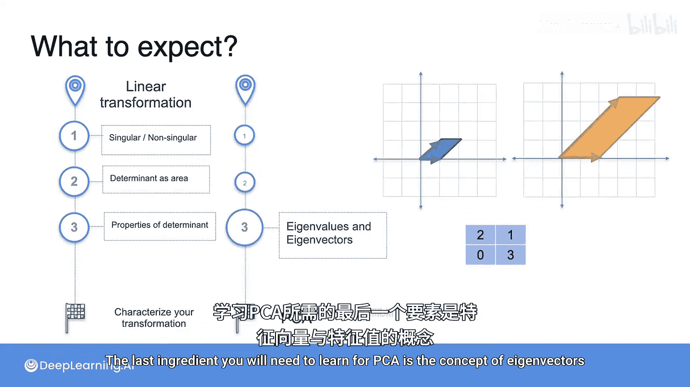

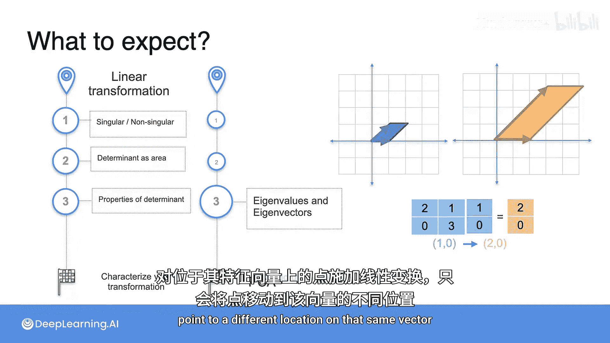

In other words， for points on these special vectorctors multiplying by a matrix is the same thing as just multiplying by a constant eigenvectors help us quickly characterize the linear transformations associated with a given matrix and are used in many machine learning applications。

 One of those is PC which will be the final topic we cover in this week Okay that's a quick summary of what you can look forward to Let's dive in。

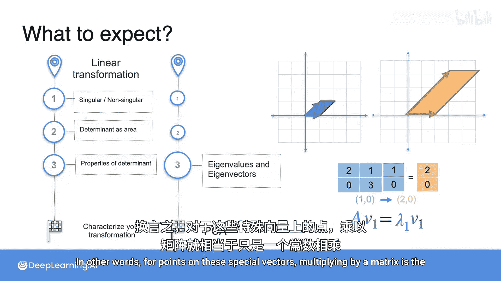

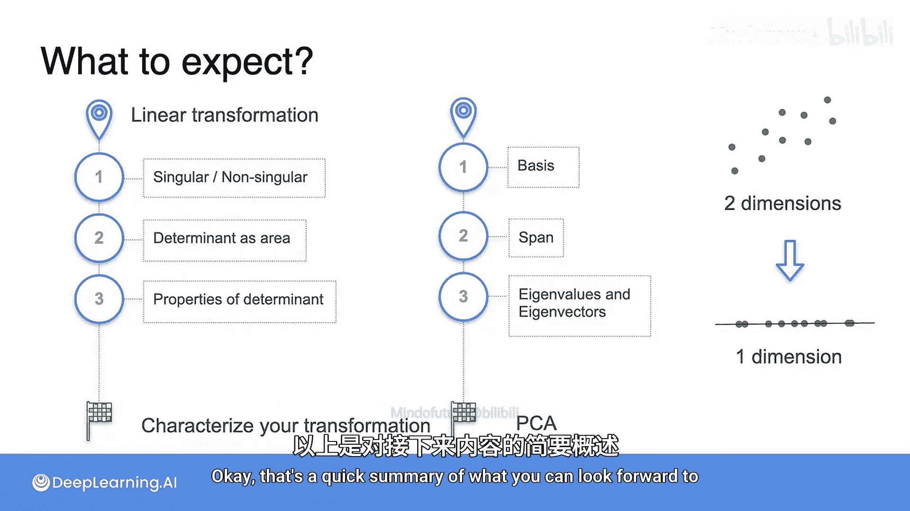