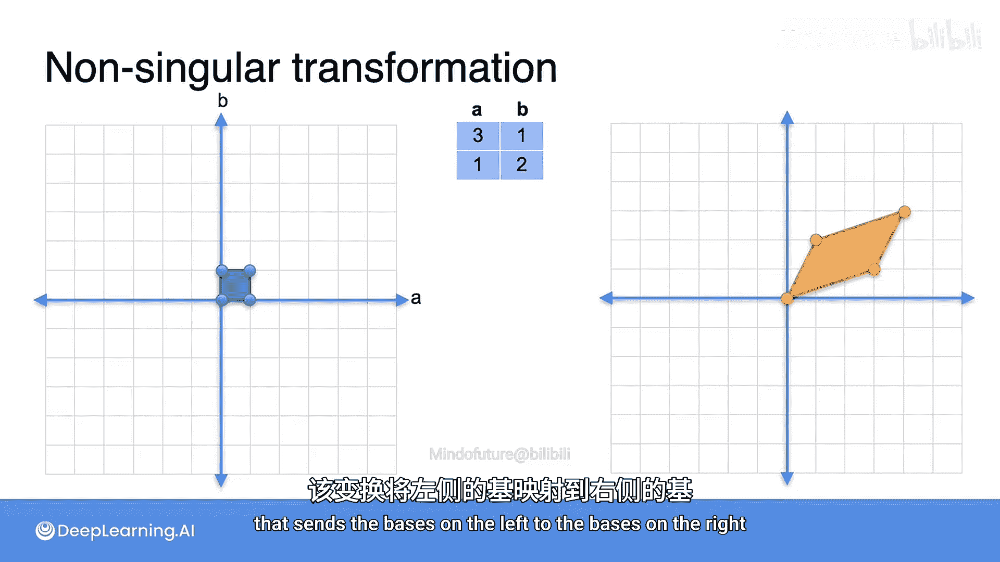
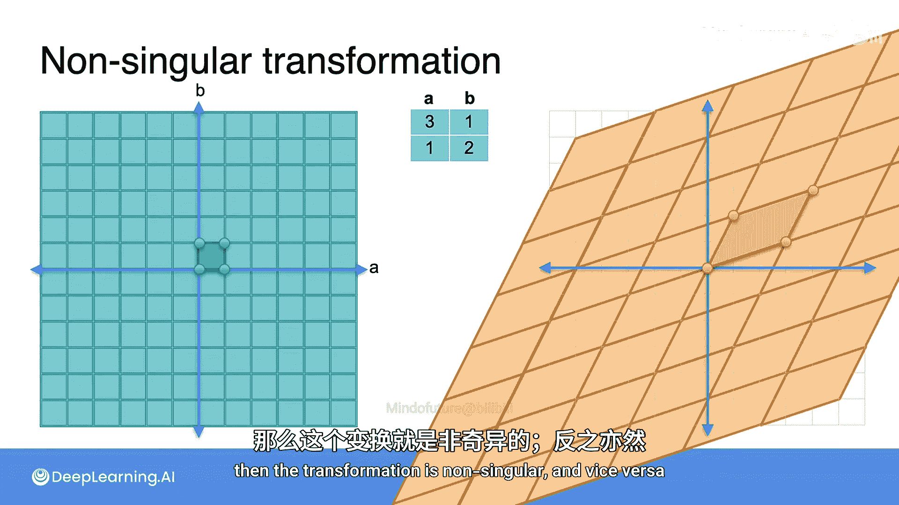
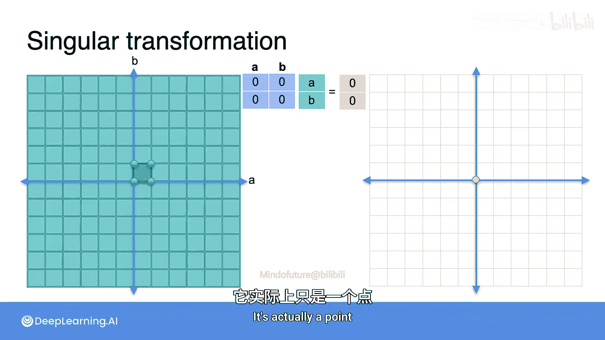
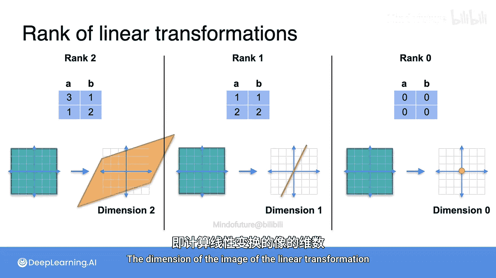

# 【Deeplearning】吴恩达：机器学习和数据科学线性代数1 ｜ Machine Learning Linear Algebra p42 P42_线性变换的奇偶性与秩_04_01_03 -BV1Pp6VBjE29_p42-

In week1 of this course， you' learn what singular and nonsing matrices are。

 since matrices correspond to linear transformations。

 then linear transformations can also be singular and non-sing。

 and you'll be pleasantly surprised to see that there is a very nice way to identify linear transformations that are singular and nonsingular。

Even the rank of a linear transformation can be identified easily。Let me show you how。

You already saw previously how the matrix with entries 3，1，1。

 and 2 corresponds to the linear transformation that sends the basis on the left to the basis on the right。

And equivalently sends this blue grid to this orange grid over here。

This is also called the change of basis Susan sends the blue square basis on the left into the orange parallelogram basis on the right。

 but one special thing is this， the orange grid covers every single point on the plane。

It turns out that this is precisely the trait of a non singular transformation。

 if the resulting points after multiplying the biometrictris cover the entire plane。

 then the transformation is non singular and vice versa。

The points that are covered in the right are called the image of the transformation。 So to see this。

 let's look at an example of a singular matrix such as this one， the matrix of entries 1，1，2，2。

Notice that if you multiply the matrix by the vector 00， you get 00 as usual。

If you multiply it by the vector 10， you get 12。Now notice what happens if I multiply by the vector 01。

I get。Again， one，2， and if I multiply it by 11， I get2，4。Which means。

That the square basis on the left doesn't go to a parallelogram or it does。

 but it's a degenerate parallelogram， it's actually a line segment。

 and there's a problem because the grid on the left doesn't get sent to the entire plane。

 it gets sent to this line。Because when we had a parallelogram， no matter how thin。

 it was able to cover the entire plane on the right。

 but if our parallelogram is flat and it's only one line segment。

 then that can only cover the orange line on the right， it cannot cover the entire plane。

So in summary， when a matrix is singular， this thing happens。

 you're not covering the entire plane on the right， you're only covering a small portion of it。

In this case， you're covering a line。Now let's look at a very singular matrix of entry 30000。

This matrix rec any vector with any coordinates into the vector 00， which is the origin。

 so the entire plane gets sent to that orange point in the origin。

So that matrix is definitely very singular because the image is not even a plane。

 it's not even a line， it's actually a point。

So here's a summary， the first matrix sends the whole plane to the whole plane。

 so it is non singular。The second one sends the whole plane to simply align， so it's singular。

 and the third one sends the whole plane to a point， so it's even more singular。

Notice that the dimension of the image of the first one is2 and that's precisely the rank of this matrix。

The dimension of the image here is 1 because it's a line and that's the rank of this matrix and the dimension here of the point is0。

 which is the rank of the third matrix so there's another way to calculate rank the dimension of the image of the linear transformation。

