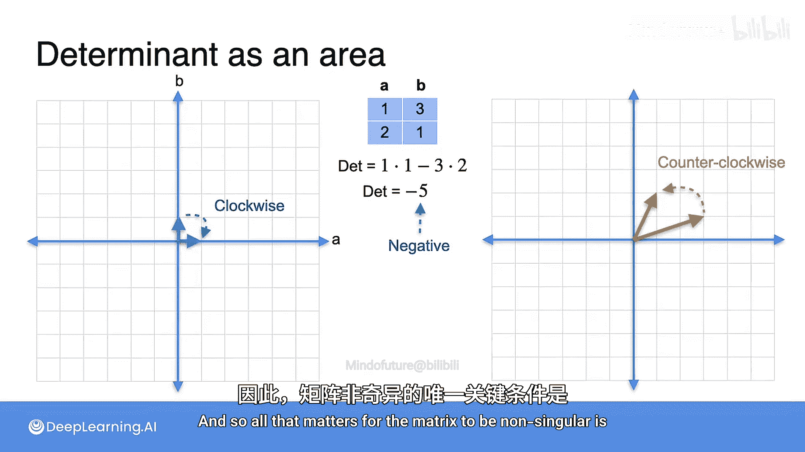

# 【Deeplearning】吴恩达：机器学习和数据科学线性代数1 ｜ Machine Learning Linear Algebra p43 P43_行列式作为面积_04_01_04 -BV1Pp6VBjE29_p43-

In the first week of the course， you learn what a determinant is and how it's related to the singularularity or non singularularity of a matrix。

You'll be pleased to see that in the linear transformation。

 the determinant is very nicely explained as an area or as a volume。And when this area or volume is0。

 then the matrix is singular， allow me to show you how。

Take a look at the matrix again with the entries 3，1，1 and2。

 its determinant is3 times 2 minus1 times1， which is 5。

Now recall that this matrix sends the blue square on the left into the orange parallelogram on the right。

Now take a look at the area of the square， it is1， the area of the parallelogram。

 I encourage you to calculate it by adding and subtracting areas of triangles。

 it turns out that this area is 5 which is precisely the determinant and that is always the case the determinant of the matrix is the area of the image of the fundamental basis formed by the unit square on the left。

So what happens with a singular transformation will recall that in this transformation over here with the determinant 1 times 2 minus 2 times 1 equals0。

 the fundamental square gets sent to a very skinny parallelogram。

It's so skinny that it's actually a line segment and the line segment has area0 which is precisely the determinant of the matrix and finally for the very singular transformation within 30000 and obvious the determinant of 0 the transformation says a fundamental unit square to the point00 This point has an area of0 corresponding to the determinant of 0 So in summary we got a a non-singular matrix with determinant5 which is precisely the area of the image of the fundamental square then another singular matrix with determinant 0 which is the area of the image of the fundamental square which is a line segment and another singular matrix again a determinant0 since the area of the image of the fundamental square this time is a point is also0 Now here's something you may be wondering what about negative determinants order that the matrix on the right that's formed by perming the two columns on the matrix on the left and for that reason it's got the negative determinant of negative 5 So here。

The small technicality， a parallelogram can have a negative area depending on what order we take to basis vectors as follows。

Notice that the matrix with entries 1，3，2 and 1 sends the vector with coordinates 10 to the vector of coordinates 12 and the vector of coordinates 01 to the vector of coordinates 31。

 so it's the same as the other matrix except in the opposite order。

So it turns out that by that small technicality， we say that the area of the parallelogram is negative if we take the vectors encounter clockwise order and positive if we take them in clockwise order。

 therefore the area of the square on the left is1， but the area of the parallelogram on the right is going to be minus5。

But notice that a determinant being positive or negative doesn't actually affect the singularity of the matrix and all that matters for the matrix to be non singular is that the determinant is different than0。

