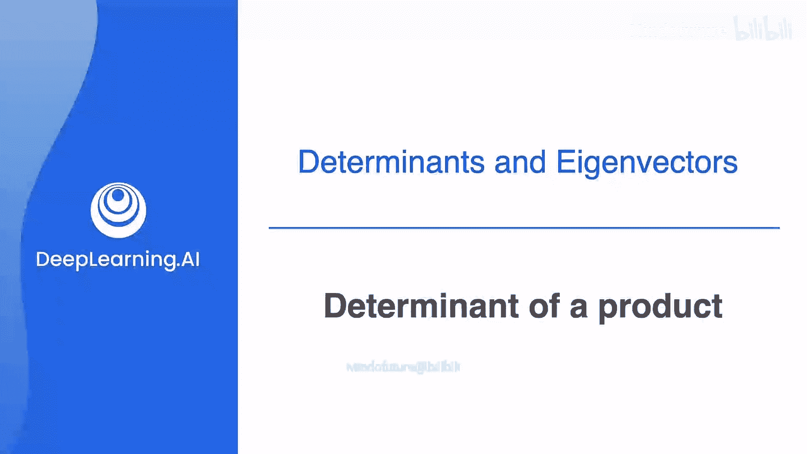
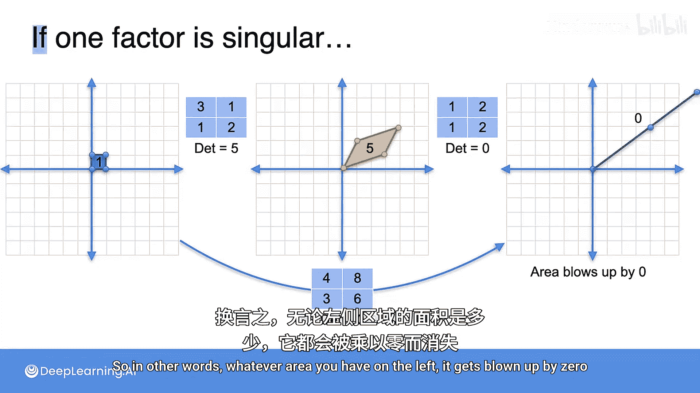

# 【Deeplearning】吴恩达：机器学习和数据科学线性代数1 ｜ Machine Learning Linear Algebra p44 P44_乘积的行列式_04_01_05 -BV1Pp6VBjE29_p44-

Now that you know what a determinant means in a linear transformation。

 you'll be able to see that the determinant of a product of matrices follows a really nice rule。

Check it out。So here's a product of matrices that I encourage you to check for yourself and make sure that it works Now what are the determinants of these mates。

 The first one has determinant 5 which is 3 times 2 minus1 times 1。

 the second one has determinant 3 which is 1 times 11 times -2。

And the third one has determinedmin 15， which is 1 times 3 minus4 times minus3。

Notice that 5 times 3 is 15， could that always be the case that the determinant of the product of matrices is equal to the product of the determinants？

And you be happy to see that this is always true， the determinant of A B is equal to the determinant of a to the determinant of B。

 Now if you try to work it out with matrices， it can be a little messy。

 I like to think of it in a much more simple way which is with linear transformations So the first matrix 3112 we've seen it already and is the matrix that sends fundamental basis to this basis over here。

And the5 is the area of the parallelogram that means that this transformation actually blows up the areas by 5 the second matrix has a determinant of3 and if you work it out is the one that sends this fundamental basis here into this parallelogram here that has area 3。

And the three correspond to the determine。That means that this transformation blows up the areas by3。

Now that happens with everything， so this parallelogram here goes to this parallelogram over here with area 15。

Because what the transformation does is no matter what area you have。

 it blows it up by a factor of the determinant， so if you consider the combination of these two linear transformations。

 first you're blowing up the areas by 5 and then you're blowing up the areas by 3 so you're blowing them up by 5 times 3 which is 15 and that is what this transformation does。

It blows up the area of the fundamental basis of area 1 into a basis of area 15 and therefore the determinant is 15 which is a product of the two determinants。

 so here's a quest to test your intuition What would you say about the product of a singular and a non singular matrix in any order would it be singular would it be non- singular or could it be either one。

Well， let's say that a is non singular and b is singular。

 so we know that determinant of AB is the determinant of a times the deter determinant of b。

 but determinant of b is 0 because b is singular， so determinant of AB has to be 0 because is determinant of a times 0。

Therefore， A B is singular， so if one matrix is singular。

 then that matrix multiplied with any other matrix in the world is also singular。

Now it's quite logical when you think of numbers， see if you have any number。

 doesn't matter which number let's say5， when multipplied by0， it becomes0。

 so if you have any matrix， when multipied by a singular matrix it becomes a singular matrix because whatever is determined it is when multiplied by0。

 it becomes 0。And geometrically this make sense if you multiply two matrix， for example。

 this one over here。Which is non singular with this one over here， which is singular。Well。

 the second matrix being singular means it sends everything into a part of a line。

 and that means that when you combine them， then it sends a fundamental basis into some segment so it has this determinant0 because this segment has area 0。

 so in other words， whatever area a hand left it gets blown up by 0。

