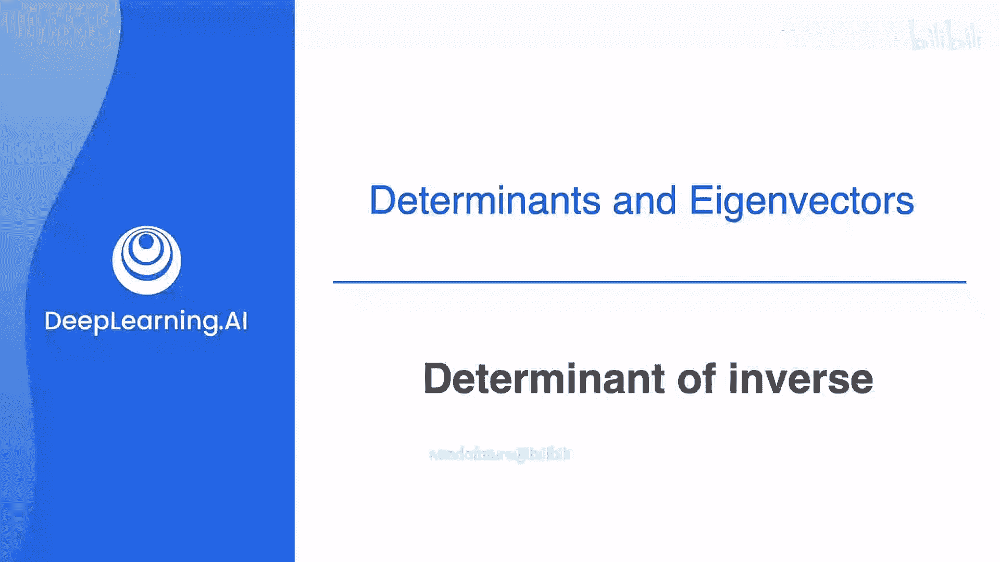
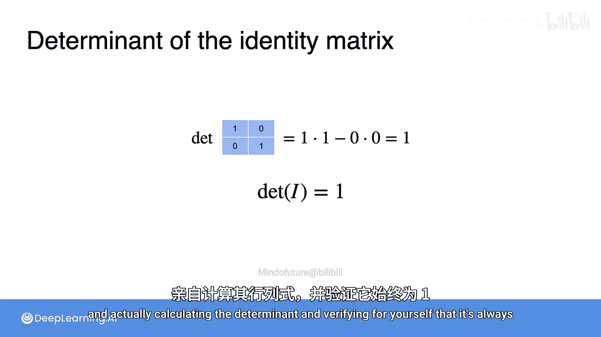

# 【Deeplearning】吴恩达：机器学习和数据科学线性代数1 ｜ Machine Learning Linear Algebra p45 P45_逆矩阵的行列式_04_01_06 -BV1Pp6VBjE29_p45-

And next I'm going to show you a pretty interesting rule for the determinants of imverseses。

 one that you may already be suspecting， and the way you can figure this out is with a quiz。

 so please find the determinants of these two matrices。And the determinants are 0。2 and 0。

125 Now recall that this matrix over here is actually the inverse of the matrix we've been using for most of the examples。

This matrix has determinant 5， and as you've recently calculated， this matrix has theminant 0。2。

 which is exactly 15 or the multiplicative numbers of 5。Now。

 the second matrix is the inverse of this one over here。

Wwhich has determinant8 and you've calculated this one to have determinant of 0。125。

 which is the multiplicative numbers of 8 precisely。And for the last one。

 if you recall from a few videos ago， this matrix over here doesn't have an inverse and it's actually a singular matrix of determinant0。

 and it has no inverse。And precisely0 has no inverse， so a nice coincidence is spot over here。

 which is that it seems that the determinant of an inverse matrix is the inverse of the determinant of the matrix。

And that is precisely the case， when the matrix is invertible。

 then the determinant of the inverse is one over the determinant of the matrix。And why is this well？

Let's check。We know by the product formula that the determinant of a product is equal to the determinant of a times the determinant of B Now let B be actually a inverse。

 so the determinant of a times a inverse is equal to the determinant of a times the determinant of a inverse Now Aa inverse is precisely identity matrix So the determinant of the identity matrix is determinant of a times determinant of a inverse Now the determinant of the identity matrix is always1。

And therefore， that means that the determinant of a inverse is precisely one over the determinant of a。

Now， why is the determinant of the identity matrix 1， well let's actually calculate it。

Notice that for a two by two matches is one times 1 minus0 times0， which is1。

And I'll give you the exercise of taking a big matrix and identity matrix and actually calculating the determinant and verifying for yourself that it's always going to be one。

