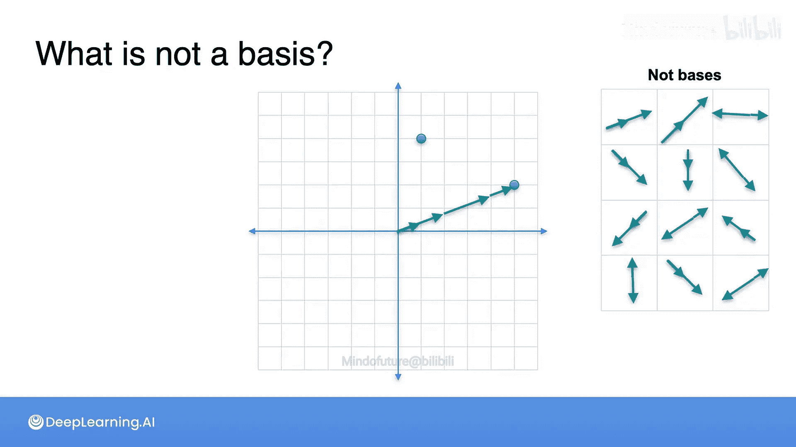

# 【Deeplearning】吴恩达：机器学习和数据科学线性代数1 ｜ Machine Learning Linear Algebra p46 P46_线性代数中的基_04_02_01 -BV1Pp6VBjE29_p46-

A fundamental concept of linear algebra is the concept of a basis。

 you've actually seen basiss many times through this course in several different ways。

 but this week you'll learn how to identify them and use them to your advantage so what do we mean by a basis in the previous week you learn that a matrix can be seen as a linear transformation from the plane to the plane which sends this fundamental square into this parallelogram and both were called basis。

Now why are they called basis Well in reality all that matters here is not the four points of the square or the parallelogram。

 but the two vectors that define it， namely those two vectors coming from the origin。

Those are the ones that I'll refer from now on as a basis。

The main property of a basis is that every point in the space can be expressed as a linear combination of elements in the basis what do we mean by that Well let's say we have these two vectors and I'm telling you that those two are a basis why well pick any point in space。

 say this one。Can we get to that point only walking in the two directions defined by the basis， Well。

 of course， we we can do it this way or this way or this other way。 There are many ways to do this。

 Actually， there's infinitely many since you don't have to take unit steps。

 you can walk in tiny fractions of steps and you can even walk backwards in that direction if you want。

 So this is one of the possible bases for the plane。Can you help me think of some more？Well。

 there are lots and lots， for example， look at this basis， I could get to any point， for example。

 this point using those two directions， here's one way I walk in this way and then in this one。

Remember that I can walk backwards if I want to。 So those two vectors also form a basis。

 do these two vectors form a basiss。 Yes they do。 I can walk like this and then like this to get to the point。

 So as a matter of fact， pretty much any two vectors form a basis。

 Now it's almost hard to think of what's not a basis。 What would be a non basiss。

 So here's an example， let's take the two vectors over here。These two vectors I can arrive for。

 for example， to this point over here， but I could not arrive to this point over here by walking in those two directions because I only have one direction so I really can only cover that line。

 I cannot cover the entire plane。So anything that comprises two vectors that go in the same direction and they could be opposites or they could go in the same direction。

 but as long as they belong to the same line， the two vectors do not form a basis。

 so that is what a basis is and what a non basiss is。

