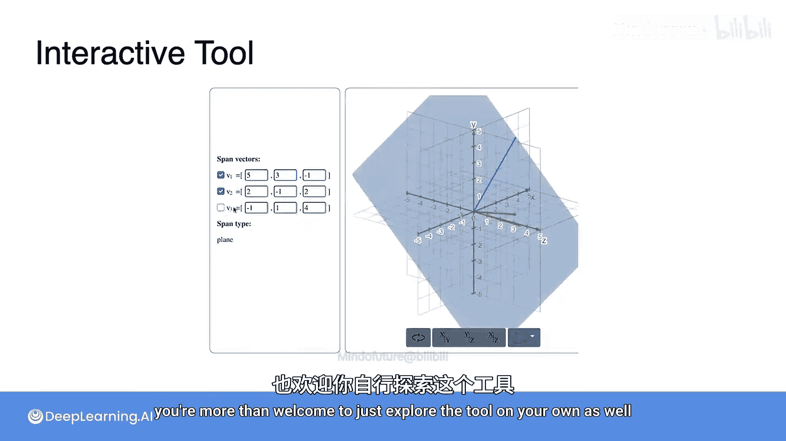

# 【Deeplearning】吴恩达：机器学习和数据科学线性代数1 ｜ Machine Learning Linear Algebra p47 P47_线性代数中的张成空间_04_02_02 -BV1Pp6VBjE29_p47-

Now that you know what a basis of the plane is， the following question arises。

 can something not be a basis of the plane but still be a basis for some other space？

What exactly constitutes a basis for this， let me introduce the concept of a span。

The span of a set of vectors is simply the set of points that can be reached by walking in the direction of these vectors in any combination。

For example， you've seen that the span of these two vectors is the plane as you can get to any point in the plane by walking in these two directions Likewise the span of these two vectors is also the plane it may be a while to get to many points but one can use only these two directions these two vectors however don't span the plane because as you saw before not every point can be reached by walking in these two directions they are the same direction So what said do they span Well any point in this line can be reached by walking in the directions of the vectors so the span of these two vectors is that line。

What about these two that are at an angle of 180 degree apart Well。

 the span is again the line that contains them。Because you can get to every point on that line by walking on these two directions。

What about this one vector what's the span of that one vector Well。

 the span is the line that contains it and goes through the origin because that's the set of points that you can reach by walking in that direction。

So here's a question， do these two vectors form a basis of this line， what do you think？

So the answer is actually no， and the reason is that a basis needs to be a minimal spanning set。

And here there are too many vectors see any one of those two vectors fans the line。

 so the two are one too many， a basis is a minimal spanning set。

 so each one of them separately is a basis of that line， but the two of them are not a basis。

They're a spanning set， but they're not a basis。Now is this a basis of something yep that is a basis of this line and as a matter of fact any vector that starts at the origin and goes in that same direction is also a basis for that line。

 so in summary a basis is a minimal spanning set so the vector on the left forms a basis of this line。

 but these two vectors don't， because they are too many。And this happens also for higher dimensions。

 so let's look at this set。This set forms a basis of the plane because it spans the plane。

Because we can get to any point by walking in those two directions， but if we will move any of them。

 they don't span the plane anymore now they just span one line。However。

 this set of vectors over here do not form a base of the plane。

 see they span the plane because any point in the plane can be reached by walking in some combination of these three directions。

 but they are too big to be a basis any subset of two of these three vectors is a basis but the third one is redundant。

 so that's not a base。Now notice something interesting and is that the length of the basis is the space of the dimension of the plane now notice something interesting which is that the length of the basis of a space is the dimension of that space。

So on the left， the line has a base length 1 and it has a dimension of  one because line has dimension  one。

And on the right the plane has a basis of length 2 formed by two vectors and the plane has a dimension of2 so this implies that any basis of any space actually has the same number of elements in as any other basis and I encourage you to take a look at for example a three dimensional space and imagine how would the basiss look there now that you have a good intuition of what basis are let's see the formal definition to do that we'll need trim introduce the concept of linearly independent and linearly dependent vectors。

A group of vectors set to be linearly independent if none of the vectors in the group can be obtained as a linear combination of the others if you consider just one vector in the plane。

 it is always going to be linearly independent。Now let's add another vector。

 notice that there is no way you can get the new vector as a linear combination of the first one simply because they point in different directions。

These two vectors are still linearly independent。 What if you added this other vector instead。

 In this case， the new vector in red is pointing in the same direction as the green one。

 but it's simply twice as long as the original vector。

 since one vector can be obtained as a linear combination of the others。

 this set of vectors is called linearly dependent。 noticeice also that even though we added a new vector to our set。

 the span of these vectors did not change。 it remained a straight line。

Now let's look at a different example， this time we'll keep the orange and green vectors that were linearly independent and we'll add a third one in red。

While none of these two vectors is a multiple of any other one， they are no longer independent。

That is because you can obtain the third vector by adding one times the green vector to three times the orange vector。

 a giveaway that this is the case is that once again we added a new vector to our set。

 but the span of the vectors did not change。 they still only span the plane。

 It turns out that any other vector you add can be written as a linear combination of the first two this result will hold in general if you have more vectors and dimension of the space you're trying to span。

 you will always have a linearly dependent group。This means having three or more vectors in the plane or four or more vectors in 3D space and so on let's see how we can check if a set is linearly dependent or not。

 let's use the example from the last slide。Let's call the orange vector V1 which coordinates minus 11。

V2 will be the Tl vector which has coordinates 21 and finally v3 will be the red vector which coordinates minus 53 to see that the set of vectors is linearly dependent。

 you need to find constants alpha and beta that satisfy that alpha times v1 plus beta times v2 equals v3 In other words you are looking for the coefficients of the linear combination that gives you v3 so alpha beta are actually numbers。

This gives place to a set of two equations with two unknowns。

 minus alpha plus 2 beta equals minus5 and alpha plus beta equals 3。

 In other words we have a system of equations which you already learned to solve earlier in this course。

 let's review one approach you could take let's call them equations1 and2 respectively。

If you sum equations 1 and 2， you get that 3 beta equals minus 2。

 which means that beta equals minus23。Using this result in equation 2。

 you get that alpha minus2 third equals 3， so alpha is 11 over 3。

Since you could find a solution for the system of equations。

 then v3 is a linear combination of V1 and B2 and this set is linearly dependent If you were to find that the system has no solution then that means the set is linearly independent Now let's do a quiz I'm going to view three vectors and you tell me if these vectors are linearly independent or not。

Actually， they are not because the first vector times 1 plus the second vector times minus1 equals the third vector。

 so in fact they are linearly dependent however， if you were to remove any of these three vectors。

 then you get a linearly independent set。But since each linear independent set only has two vectors and they live in three dimensional space because they have three coordinates。

 none of this is a basis for the three dimensional space。

 geometrically would mean that if you were to plot these three vectors in three dimensional space。

 they will all lie inside the same plane。Now that you've seen some examples of linear independence。

 let's come back to the formal definition of a basis。

A basis is a set of vectors that satisfies two conditions。The set must span a vector space。

 and the vectors in that set must be linearly independent。

Coming back to the examples you saw earlier， these first two span line or a one dimensional space and a plane or a two dimensional space。

 and they are linearly independent on they form a basis。

The last two are linearly dependent and they do not form a basis， as we see in these two examples。

 we need to be careful to remember that not all sets of n vectors will form a basis for an n dimensionsional space。

 Hopefully you're starting to feel more confident about the concept of span Next you'll get a chance to use a new interactive tool that will help you visualize the span of vectors in three dimensionsal space As always there are some suggested activities provided。

 but you're more than welcome to just explore the tool on your own as well。

