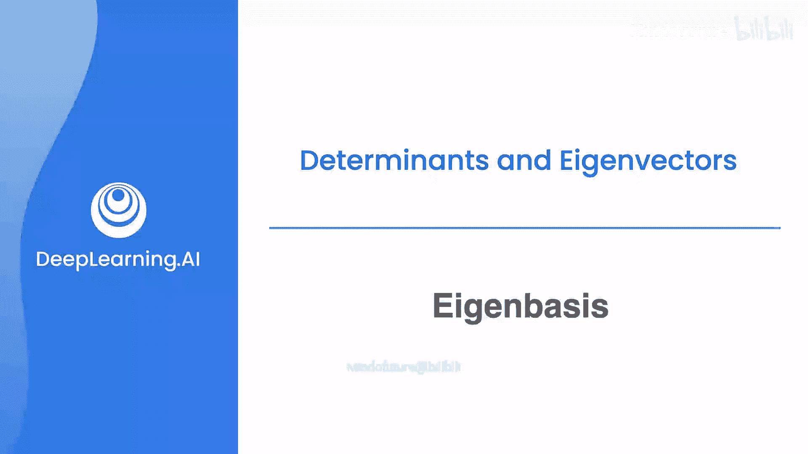
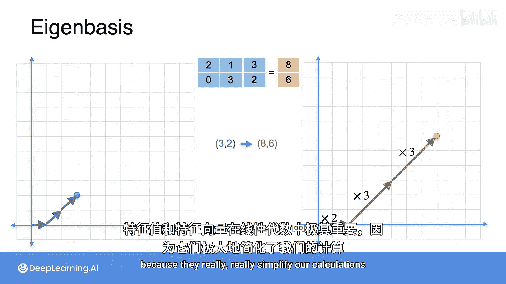

# 【Deeplearning】吴恩达：机器学习和数据科学线性代数1 ｜ Machine Learning Linear Algebra p48 P48_特征基_04_02_04 -BV1Pp6VBjE29_p48-

Now that you know what a basis is， you should know that some basiss are more useful than others。

 in particular there is one basis to rule them all called the eigenbas。

 the eigenba is tremendously useful in particular for machine learning applications such as principal component analysis as we mentioned before。

Here's how eigenbaasees work。So let's look at the linear transformation corresponding to the matrix with entries 21。

0 and 3， and we're going to see how it acts with respect to the fundamental basis。

 so this basis has two vectors， the vector 10 which will multiply by the matrix you see that it gets the vector 20。

And the vector is 01， which when you put in the product， you get the vector 1 through。

So this square on the left goes to this parallelogram on the right and the rest of the plane follows。

So this is also called a change of coordinates。Or a change of basis because that's exactly what you're doing。

 you're going from the square coordinates in the left to the parallelogram coordinates in the right。

 but that's something you've already seen。Now let's get to something more interesting the choice of the square was very arbitrary。

 let's actually pick a different basis and see what happens。

 so let's pick again the vector 10 that goes to the vector 20 and as a second element of that basis let's pick this vector 11 just to see what happens and that goes to the vector 33。

So this parallelogram goes to this parallelogram。Now what is special here will notice that the sides of the two parallelograms are parallel to the corresponding one on the other bases。

And that is very special and notice that the rest of the plane。Also follows。

So because these sites are parallel， then what we're doing to the plane is we're stretching by two in this direction。

 the horizontal direction， and stretching by3 in this diagonal direction。

 so this is a very special basis， it only consists of two stretchings。

That is what's called an eigenbas， it's a very， very special way of looking at a linear transformation with respect to a basis that sends a parallelogram to another parallelogram size parallel to the original one。

And why is that useful， well， let's say that you want to find the image of the 032 so you can multiply by the matrix and get 86。

 which is over here。But you can also express that point as a combination of e in the basis。

 what does that mean？That we find a path to get to that point using the two directions that we have。

 and now the linear transformations corresponds to stretching the horizontal vector by 2 and the vertical vector by 3。

And so this really simplifies the linear transformation， it just consists of two stretchings。

So the two vectors in the basis are going to be called the eigen vectors and the stretching factors。

 the two and the three are going to be called eigenvalue。

 and eigenvalues and eigenvectors are tremendously important in linear algebra because they really。

 really simplify our calculations。

