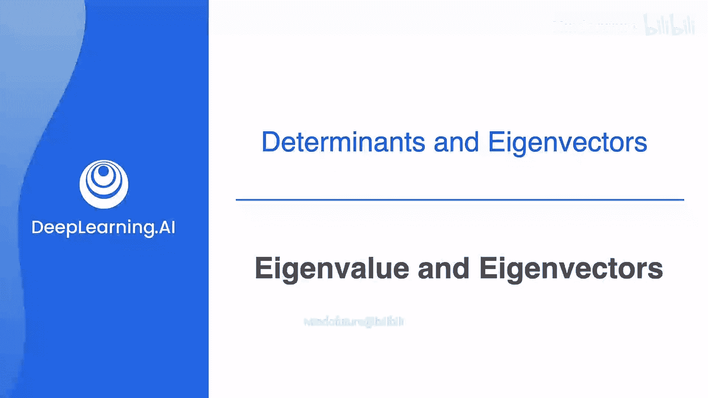
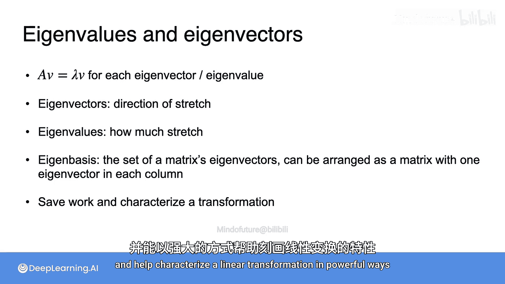

# 【Deeplearning】吴恩达：机器学习和数据科学线性代数1 ｜ Machine Learning Linear Algebra p49 P49_特征值与特征向量_04_02_05 -BV1Pp6VBjE29_p49-

Let's look a bit more closely why eigenvalues and eigenvectors are so special。

 I'm going to multiply the matrix 2，10，3 by the two vectorctors that are already shown you are eigenvectors and one that isn't The first vector 1。

0 is an eigenvector。 after the transformation， it becomes 2，0。

 noticeice that the vector is still pointing in the same direction。 If I want。

 I could write the result like this two times the original vector 1 comma 0。 The second vector 1。

1 is also an eigenvector After the transformation， it becomes 3，3。Again。

 it's pointing in the same direction and so I can rewrite the result as 3 times the original vector。

 The final vector minus 12 is not an eigenve After the transformation it becomes the vector 06 noticeice that it's no longer pointing in the same direction and there is no constant that I can multiply the original vector by to get the final vector 0 comma 6。

Let me formalize what these two equations are saying。

 I'll call our matrix here a and I'll call the first eigenve here V1。

 then this equation says that for this special vector v1 a times v1 is the same as multiplying V1 by the scalar lambda1 I'm using more formal notation。

 but in this case you already know V1 is the vector 10 and lambda 1 is the scalar 2。

 the second equation is nearly identical it says that a multiplied by v2 is equal to the scalar lambdada 2 multiplied by V2。

You already know that the vector V2 is 11 and the scalar is 3。

V1 and B2 are the matrix A's eigen vectors and lambda 1 and Lada 2 are the matrix A's eigen values。

Notice that eigenvectors and eigenvalues come in pairs。

 so v1 and Lada1 form a pair and v2 and Lada 2 form a second pair。

 you may still be wondering why eigenvectors are so special。

 let's look more closely at what this equation is saying on the left side of this equations you have a matrix multiplication and on the right side you have a scalar multiplication。

And one big difference here is that matrix multiplication is just a lot more work。

 even for this small two by two example， calculating the left side of the equation requires eight multiplications while the right side only takes two multiplications。

For matrices with hundreds or thousands of columns， the difference becomes astronomical。

 what this equation is saying then is that at least along a matrix eigenvectors。

 you can turn a large computation into a smaller one and if you apply what you know about basis you can actually use this shortcut everywhere。

Let me show you how this is the example I showed you earlier。

 the red vectorctor is not an eigenvector， so to find out where it was sent you needed to just complete the matrix multiplication as normal notice however that the two eigenvectors10 and 11 are linearly independent and span the plane。

 so they form a basis。This is actually the eigen basis of the matrix 2103。

 I will use this to rewrite the equation。Since the vectors 10 and 11 form a basis。

 then you know that you can write the vector minus12 as a linear combination of those base vectors in this case it's negative 3 times 10 plus 2 times 11 so you can simply replace minus12 by minus3 times 10 plus 2 times 11 this is the same vector minus12 you had before but rewritten as a linear combination of the vectors in your basis。

Now I' rearrange the equation slightly， all I did was move the matrix multiplication inside the brackets and move the minus3 and the2 forward。

And at this point， you are ready to use your eigenvector shortcut。 Look up here。

 you have already calculated these matrix multiplications and you can just substitute the scalar multiplications like this。

Now your equation is just scalar multiplications you have minus 3 times 2 times the vector 10 plus 2 times 3 times the vector 11 you can quickly multiply through these scalars and finally solve this equation to get the vector 06 which if you remember is the vector is solve 4 before only this time even though the red vectorctor is in an eigenvector you were able to solve this linear transformation without doing any matrix multiplication。

You just use scar multiplication the entire way。Okay， I need to admit I lied a little bit here。

Remember earlier where I just gave you the red vectors coordinates with respect to the eigenbas negative 32。

 perhaps you could haveball that answer in this simple case。

 but in general there's actually substantial worked involved in getting those coordinates。

I haven't taught you why this is the case， but to do this for every point in the plane。

 you need to calculate the inverse of your eigenbasis and then multiply that inverse by the red vectorctor。

 or in other words， kind of a lot of work and even a matrix multiplication so at least in this example a more accurate way of describing eenvectors is not that they remove all the work but they let you decide when you want to do the work in some machine learning context it may be worth to calculate this coordinates ahead of time so that when it's time to apply a transformation you can do it much more quickly youll see other powerful applications of eigenvectors in this course as well。

For now， here are the main takeaways about eigenvalues and eigenvectors。

 they are characterized by the equation Av equals lambda v for each pair of eigenvectors and eigenvalues。

As you just saw， this means that along that vector。

 a matrix multiplication just becomes a scalar multiplication。

Visually you can think of eigenvectors as telling you the direction in which a linear transformation is just a stretch and the eigenvalues tell you how much it is stretched。

 you can create a basis from the eigenvectors called the eigenbases You will often see the eigenbas represented as a matrix with one eigenvector in each column。

From the perspective of the secondan basis， the linear transformation A is just a collection of stretches。

And as you'll see， eigenvectors can save work and help characterize a linear transformation in powerful ways。

