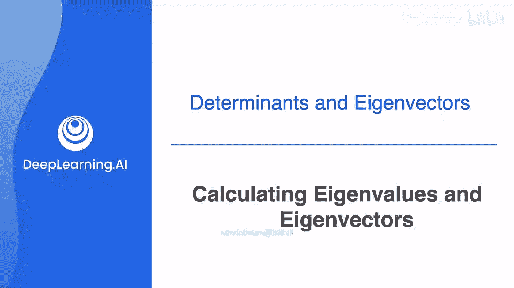
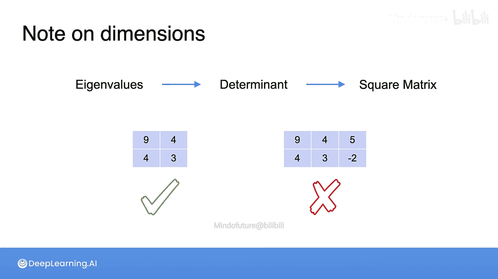

# 【Deeplearning】吴恩达：机器学习和数据科学线性代数1 ｜ Machine Learning Linear Algebra p50 P50_计算特征值与特征向量_04_02_06 -BV1Pp6VBjE29_p50-

Now that you know what an Ien basis is， you may be wondering how to find it。

 the process is actually not too difficult， it entails solving an equation with a determinant。

Here it is。First， take a look at the matrix with entries 21013 and take a look at how it acts on these points around the square。

 this should make the entire transformation clear。As you've seen before。

 the two horizontal vectors get stretched by 2 and the diagonals get stretched by3。

 and for the other points this happens Now compare this to another matrix。

 one that simply stretches the entire plane by a factor of3 in any direction。

This matrix has entries 300 and 3 and it's really 3 times the identity matrix notice one thing these two transformations are not the same transformation but they do coincide in many points In other words they act the exact same way for infinitely many points all the points in this line。

So to be more specific。In this diagonal， the two transformation will the exact same thing。

So they match in infinitely main points now that is strange。

 the transformation should only match at 1。 the 0。00 when they match at infinitely many points something non singularular is happening and what's happening well let's look at their difference。

If these two transformations match at infinitely many points。

 that means their difference is0 at infinitely many points。

 so if you apply the difference of these two matrix to any vector in any of these diagonals。

 you get the vector 00。In other words， this matrix times vector xy for infinitefinly met vectors is 00。

 now that is the trait of a singular transformation。

 recall that an nons transformation has a unique solution。

To the equation matrix stands vector equals 00 that's the vector 00。

 So if you have finite many solutions to this it means your matrix is singular and you can verify that this is indeed a singular matrix as a determinant is 0。

Now let's do something similar， but for another transformation on the right。

Our transformation does exactly as it did before。And now let's compare it to the transformation that stretches the plane by two in every direction。

These two are not the same， but they match in this entire line， so in other words。

Matrix of the left times Xy is equal to matrix of the right times Xy。For any vector X Y on this line。

 that's infinitely many points， so we can do the same procedure， take the difference。

And that matrix times a vector will00 for infinitely many vectors。That means that the matrix01。

01 or the difference between our matrix and2 times the identity。

Is a singular matrix and you can check indeed that it is singular matrix because the determinant is 0。

 So what is special about the eigenvalues。So what happened for the eigenvalue 2 and the eigenvalue 3。

 let's think about it in general if lambda was an eigenvalue。

 then the transformation given by our matrix and the transformation given by scaling the plane entirely by a factor of lambda are equal for infinitely many vectors xy。

 that means their difference times a vector is equal to 00 for infinitely many vectors in equation when you flew many solutions。

 therefore this matrix 2 minus lambda 103 minus lambda。

 has to be a singular matrix so is determinant is 0。

I determinant is given by this equation when we expand it。

 and that's called the characteristic polynomial。So basically to find the eigenvalue La that all we need to do is look at the characteristic polynomial and find the roots。

 the place where the characteristic polynomial is 0 are the eigenvalue。

 so in this case theyre going to be 2 and 3。So now that you have the eigenvalues。

 let's try to find the eigenvector so recall that the eigenvector is the vector that satis the equation matrix times vector equals eigenvalue times vector。

So if we expand this， we get these equations over here and the solution for these are x equals 1 y equals 0 or any multiple vector。

 so here is one of the eigenvalue vectors the one corresponding to the eigenvalue 2。

We do the same thing with 3， solve for these equations and get 11。

 so the eigenvector 11 is corresponding to the eigenvalue of 3。Now youre ready for a quiz。

 find the eigenvalues and eigenvectors of the Vi matrix。

 and the solution is that for the eigenvalues it's 111 and for the eigenvectors is 21 corresponding to the eigenvalue 11 and minus12 corresponding to the eigenvalue 1。

Why， well if you look at the characteristic polynomial。

 it is the matrix with entries 9 minus lambda 4，4 and 3 minus lambda。

 so that expands as lambda squared minus 12 lambda plus 11。

 which factors as lambda minus 11 times lambda minus1。

 therefore the eigenvalue are lambda equals 11 and lambda equal goes 1。

And I'll leave it as an exercise for you to solve the equations for the a vectorctors and verify that they are going to be 21 and-12 or some multiple of them right because all the matters is the direction the process of finding a vectorctors for a 3 by3 matrix is very similar。

 consider a equals 21-110 minus-3-1-30。 The characteristic polynomial。

 the determinant of a minus lambda times the identity matrix of whatever size you need In this case。

 lambda minus I will be a 3 by3 matrix that looks like this。

 The characteristic polynomial with the determinant of the difference of these two matrixrices using the diagonal method to calculate the determinant of a3 by3 matrix。

 you can construct a pieces of the characteristic polynomial。

 Then combine terms to get the polynomial negative lambda cubed plus 2 lambda squared plus 11 lambda minus-12 equals 0。

Factoring this polynomial， which I won't show in detail here， will give you these three factors。

And now it's easy to find the zeros of this equation， which are when lambda is minus3，1 or 4。

And so that gives you the three eigenvalues of this matrix。

Now that youve found the three eigenvalues for matrix a。

 let's find the eigen matrix associated to each eigenvalue。Let's begin with our last eigenvalue 4。

 remember that to find the eigenvalue you need to solve the equation， Av equals lambda v。

Then that means you need to solve this equation where x1 x to1 x3 are the three components of the eigen vectorctor。

Multiplying the4 by the vector gives a new vector 4x14x24x3。

 and completing this dot product on the left gives you this new vector now all you need to do is set these three vectors equal to one another and solve 4 x1x2 and x3。

I'll rewrite the system of equations up here now subtract the terms from the right hand side leaving just zeros。

 this gives the final system of equations you'll need to solve， which I'll label rows 1，2 and 3。

 you can use these equations to solve for x1x2 and x3。Adding rows 2 and 3。

 you get negative 7 x1 minus 7 x3 equals0， which simplifies to x2 being equal to negative x3。

Adding 3 times row 1 to row 3， you get negative 7 x1 minus7 x3 equals 0。

 which simplifies 2 x1 also being equal to negative x3。

 This is actually as far as you can get solving the system and the result is that there are infinitely many solutions Any vector that satisfies x1 equals k x2 equals k x3 equals minus k will be a solution for any value of k。

For example，11-1 works， but 2，2-2 would work as well。

 and this makes sense there are actually always going to be an infinite number of potential eigenvectors that lie along the same line In this case。

 though， let's just keep it simple and say the eigenvector is 11 minus-1 and that's it。

 You found the first eigenvector。If you want to find the other two eigenvectors。

 you can just repeat the process with the other two eigenvalues。

 You already found that the eigenvalue  force is associated with the eigenvector 11-1。

 And if you follow the same process for eigenvectors 1 and negative 3。

 you could find the eigenvectors here 11 and 2 minus-11。

 If you notice that two examples you worked on where two by 2 and 3 by 3 matrices。

 all of which are square matrices could you compute the eigenvalues and eigenvectors for any matrix of any shape。

 remember to get the eigenvalues you need to solve right termminant。

 But as you learn in previous lessons that determininate is only defined for square matrices。

 So for any square matrix you can find eigenvalues and eigenvectors。 However。

 the matrix is not squared like the one right here。

 then it doesn't have any eigenvectors or eigenvalues。

