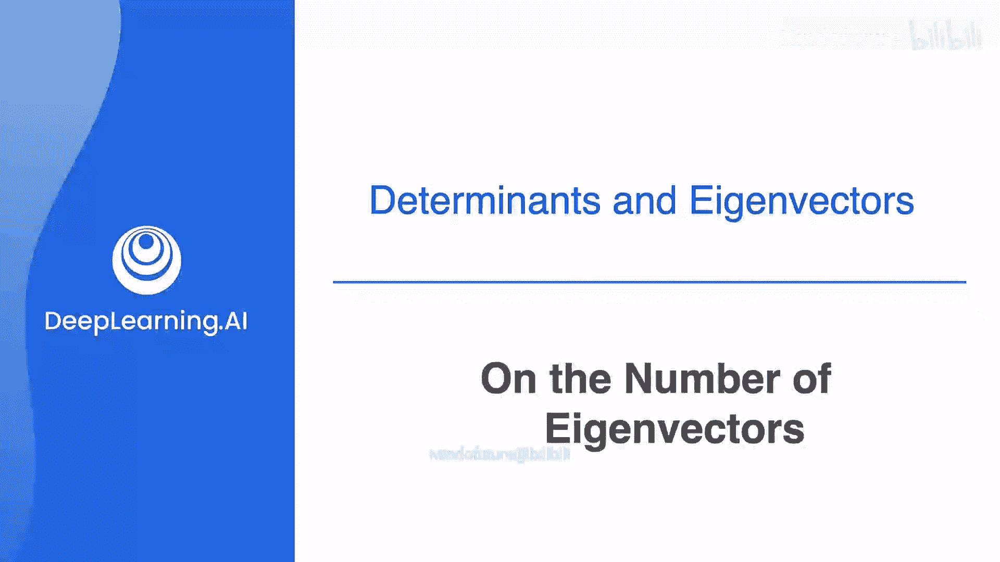
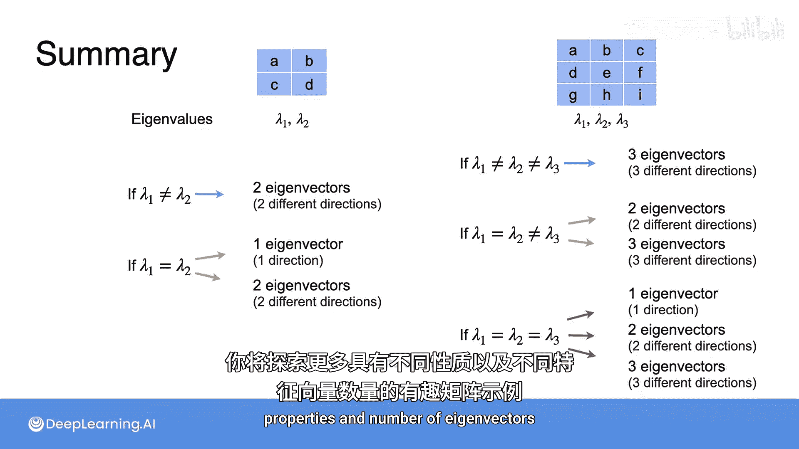

# 【Deeplearning】吴恩达：机器学习和数据科学线性代数1 ｜ Machine Learning Linear Algebra p51 P51_关于特征向量的数量_04_02_07 -BV1Pp6VBjE29_p51-

In the example from last video， you had a 3 by3 matrix which had three different eigenvalue and three different eigenvectors。

One for each of the eigenvalues Could it be that all three by three matrices always have three eigenvectors。

While it turns out that that's not always the case， let's look into some examples。

 consider this 3 by 3 matrix a with the values shown here。 Now find the characteristic polynomials。

 the determinant of a minus lambda I using the formula for the determinant for3 by 3 matrixrices。

 we get two minus lambda squared times minus 4 Lada。

 all the remaining terms are 0 due to all the zeros in the original matrix。

Now to find the eigenvalues， you need to find the zeros of this polynomial。

 which in this case is super simple， this gives the eigenvalues 4，2 and 2。

Notice that the number two is repeated twice now watch what happens when we find the eigenvectors associated with them。

Let's start with the eigenvalue 4 the eigenvector needs to satisfy that a times the vector x1 x2 x3 equals the vector 4 times x14 times x24 times x3。

 the product between the matrix and the vector can be expanded as the vector with entries 2 x1 minus x1 plus 4 x2 minus 0。

5 x3 and 2 x3。And we want this to be equal to the vector 4 x1， 4 x24 x3。

Which leads to this system of equations。This one can be written as。Negative 2 x1 equals0。

 negative x1 minus 0。5 x3 equals 0 and negative 2 x3 is equal to 0。

Notice that all I did here was moving everything to the left of the equal sign Now we can simplify a little bit and get that the first one is equivalent to x1 equals0。

 the third one is equivalent to x3 equals 0 and now since x2 doesn't appear in any of these equations at all then the second equation is 0 for free and x2 can be any number in order to satisfy these equations so to keep it simple we can set x2 to be equal to1 and you get the eigenvector010 associated to the eigenvalue 4。

Now let's repeat for the eigenvalue2。In this case， a dot product with the vector x1x2。

 x3 should be equal to the vector 2x1， 2x2，2 x3， and the dot product can be expanded with the same expression as before。

We again get a system of equations， 2x1 equals 2x1。Negative x1 plus 4 x2 minus0。

5 x3 is 2 x2 and2 x3 equals2 x3。 When we manipulate this by taking everything to the left of the equal sign。

 we get that the first equation is quite trivial。 It's 0 equals 0。

 The second one is negative 1 plus 2 x2 minus0。5 x3 equals 0。

 And the third one is again trivial It's 0 equals 0。

 You can rewrite the second equation as x1 equals 2 times x2 minus0。5 times x3。

 This equation has infinitely many solutions depending on what values of x2 and x3 you choose。

 So let's say that you choose x2 equals 1 and x3 equals 0。

 That means x1 has to be 2 for it to be an eigen vectorctor given the vector 210。

But you can also choose x2 to be 1 and x3 to be 2， which gives the eigen vector 112。

These two vectorctors point in different directions。

 so they are actually two different eigenvectors remember that you only care about the direction of the eigenvector since any scale version of it will still be an eigenvector to the same eigenvalue。

It is worth mentioning that you could have found different pairs of eigenvectors depending on the values of x2 and x3。

 but the important thing is that you can always find two distinct directions for the eigenvalue 2 to sum up this matrix a has the following pairs of eigenvalues and eigenvectors。

 the first eigenvalue lambda 1 which is 4 has an eigenvector 010。The second eigenvalue lambda 2。

 which is 2 has an eigen vector， the vector 210。And finally。

 the third eigenvalue lambda 3 also equals 2 and has an eigenvector 112 in this case。

 you are able to find three distinct eigenvectors even though you had a repeated eigenvalue。

Let's look into one more example where this doesn't happen。

Let's change this one value in the matrix and see what happens so the characteristic polynomial stays the same as before and once again we're going to have the values42 and again2 as eigenvalues。

Let's repeat the process from before to find the eigenvectors and start with the eigenvalue 4 the only equation that changes here is the last one where now you have 4 times x2 plus 2 times x3。

And that gives us this system of equations where the first two remain the same being negative 2 times x1 equals 0 and negative 1 minus 0。

5 x3 equals 0 and again， let's name them equations 12 and 3 respectively from equation 1 you get that x1 has to be 0 and combining equations 3 and 1 you get that x3 has to be0。

This leaves a x 2 to take on any value， just as with the previous matrix。

 you can choose the vector 010 as the eigenvector。And it's the same one for the previous matrix。

For the eigenvalue 2， the same thing happens。When you solve this equation。

 you get that 2 x1 is equal to 2 x1， that negative x1 plus 4 x2 minus 0。

5 x3 is 2x2 and that 4 x1 plus 2 x3 is 2 x3。Which gives rise to the following system of equations that can be simplified as 0 equals0 as negative x1 plus 2 x2 minus。

5 x3 equals 0 and finally4 times x1 equals 0。 this imposes the restriction that x1 can only be 0 Now from equations 2 and 3 you get that x3 must equal 4 times x2。

Now you only have one degree of freedom since x1 is always 0 and once you fix x2。

 the value of x3 gets fixed as well， for example， you can consider x1 equals 0 and x2 equals 1。

 which makes x3 equals 4 given the eigenvectors 014 What will happen if for example you choose x2 to be 12 the x3 must be 2 given the eigenvectors 01 half2。

However these two vectors lie on the same line， one is simply a scaling from the other。

 which means that they are actually the same eigenvector。 you can test it。

 you can't find any vector which satisfies equations 1，2 and 3 that spans a different line。

 This means that the number two is two times an eigenvalue。

 but you can only find one eigenvector associated with it。Then the eigenvectors are of the form 0。

 k4K， but there's only one direction which can be paired with eigenvalue 2。

 even though the number  two appears twice as an eigenvalue。

So ricap for the matrix entries 200 negative 14 negative 。

5402 you have an eigenvalue of 4 associated to the eigenvectors 010 then the eigenvalue of 2 associated to the eigenvectors 014 and again an eigenvalue of 2 which doesn't have an associated eigenvector that means that you can't create an eigen basis for the three dimensional space because you're lacking one vectorctor to span the whole space as a summary。

 if you have a two by two matrix with eigenvalues is lambda 1 and lambda 2。

 if the two eigenvalues are different then you always get two distinct eigenvectors。 However。

 the eigenvalues are the same then you can have either one or two eigenvectors。

If you have a3 by 3 matrix so that in valuess lambda 1 lambda 2 and lambda 3。

 then you get some more options to explore。If all the three eigenvalues are different。

 then you can always find three distinct eigenvectors if you have one eigenvalue repeated twice with the other being different then you can have either two or three eigenvectors these are the two examples you just explored。

However， if you have the same eigenvalue repeated three times。

 you can have any number of eigenvectors between one and3。In this week's programming assignments。

 you will get to explore many more interesting examples of matrices with different properties and number of eigenvectors。

