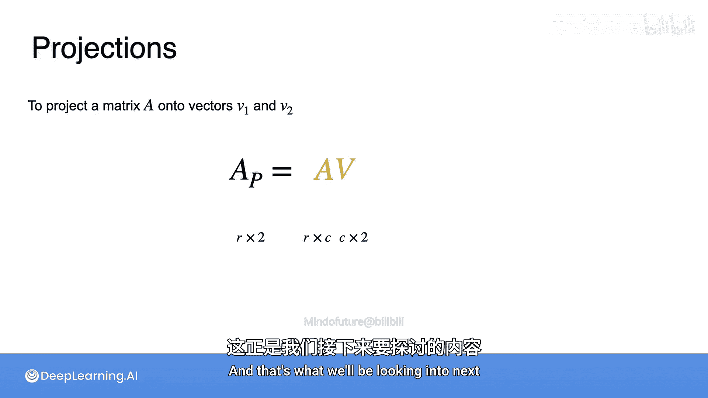

# 【Deeplearning】吴恩达：机器学习和数据科学线性代数1 ｜ Machine Learning Linear Algebra p52 P52_降维与投影_04_02_08 -BV1Pp6VBjE29_p52-

The final major topic of this course will be principal component analysis or PCA the goal of PC is to reduce the dimensions or number of columns of a data while preserving as much information as possible。

Put simply PC takes a large table or dataset set and converts it into a smaller one。

 Your original dataset set has many rows or observations and many columns or features that store useful information about each observation。

PCA will reduce the number of features in your table while maintaining the same number of observations。

Put another way， the dataset set will have the same number of rows and fewer columns。

 It will be just as tall， but it will get skinnier。

Here's an example dataset set collected by an online store about its customers。

 This table has four observations and five features。 customer age， account age。

 days since last login， total purchases and total money spent。

 There are two primary reasons you may want to reduce the dimensions of a dataset set。

The first is just that it's literally too big and you want to work with something smaller。

 In this example， you only have five features， but in some machine learning context。

 you could easily have hundreds or thousands of features。

 It is useful to be able to shrink data sets to a more manageable size。

 The second is to help with visualization， especially in exploratory analysis。

Many common charts like a scatter plot or bar charts really only help you visualize your data when looking at one or two features at a time。

 reducing the number of dimensions or columns you need to consider makes it easier to quickly visualize your data and look for patterns。

So you want to reduce your table's dimensions and the question is， how should you do it？

Well here's one easy approach， just start deleting columns。

 you could easily delete the last two that contain the total purchases and total amounts spent by each customer。

This dataset is looking easier to use already。 Unfortunately， however。

 you've also deleted a lot of useful information。 Your dataset set has fewer dimensions。

 but any insight you could have gained from those two columns is lost。

PCA is designed to address this problem。 It will allow you to still reduce the dimensions of your data。

 but it also preserves much of the information you might lose if you simply started thelet columns。

 The idea behind dimensionality reduction is to move your data points into a vector space with fewer dimensions。

 This is called a projection。You already have studied all those concepts underlying projections。

 so let me show you how they work with an example。 Suppose you have this table of data where you have four observations of variables x and Y。

Which on the plane looks something like this。Now imagine you want to move or project your data onto this line。

 which has equation y equals x。All the points move perpendicularly towards the line。

 except the point11 which was already on the line。But where do these points end up。

 I'll start with the easiest example， the point11， which didn't move at all。

Before I would have given this point location as 11。

 but those are actually two dimensional coordinates。

I can actually now give this point's location as one coordinate its distance along the line from origin。

 That is this distance here from some basic trigonometry。

 you can tell that the length of this segment is the square root of 2 with just this number。

 you could find the location of the point along the line。

 It might not seem super clear to you why you would want to do this。

 But notice that square root of two can bewritten as one plus one divided by the square root of 2 here。

 the coordinates of the original point are starting to show up Let's see why this happens。

Let's start by trying to get that one plus one。This will come from the dot product of the coordinates of the first point with some other vector shown here in orange to choose that orange vector note that the line ygle x is actually the span of the vector with coordinates 11。

 so let's use that vector 11。Now， if you take the dot product of that first row in the table and the orange vector。

 you are essentially saying take1 times the point x coordinate and1 times the point y coordinate。

To find a new location projected along the line。However。

 summing the two variables gives you a longer vector than expected， This vector's length is 2。

 but you know the final length of this new vector is supposed to be the square root of 2。

 in other words it overshot by a factor of root 2。So go ahead and divide by that。

 Now you get exactly the points you are looking for。

 Note that one over square root of 2 is actually one over the norm of the vector 11。

 and this is the main idea of a projection。 Multiplying by the vector projects the points along that vector and dividing by the vector's norm ensures that there is no stretching introduced。

Another way of thinking about this is that you're just changing your vector to have a new norm of one。

Now let's see what happens for the second row when you multiply the second row by the vector 11。

You end up getting the sum of 1。2 plus 1。6， which again you went too far。

If you scale it back by square root of two， however， you get exactly the point you were looking for。

Same thing happens for row 3， you will multiply it with vector 11。Just as before， you overshoot。

And again， dividing by root 2 will get you to the desired point。Finally。

 the same process holds for the fourth observation。

So this vector gives the final coordinates of each point after projecting each point on to the x equals y line。

So the four points with two variables each simpl to the vector， 1。4142， 1。9799， minus 0。

2121 and minus1。344。As you may have noticed， you now need only one column vector instead of a two column matrix in order to represent your points locations along these lines。

In general， if you want to project any matrix A onto the direction given by vector v。

 you first need to multiply matrix A by vector v。 however。

 as you just saw you need to scale vector v so that it has norm 1 so divide V by its own L2 norm。

And this is the projected matrix， which we are calling AP P。

 It is important to keep track of dimensions。 if a has R rows and C columns。

 then vector V must have length C。 you can also think of this as a C by one matrix。

 so the projection has r rows and one column。You can project onto multiple vectors at once。

 projecting onto two vectors is the same thing as projecting onto the plane those vectors span in this case。

 simply create a matrix of size c times 2 where each column is each vector v1 and V2 each divided by their norm。

Let's call this matrix V。The result will be a projection with R rows and two columns。

 which means you have the same number of data points， but now only two variables。In the end。

 the projection can just be represented by the simple equation AP equals A V Once you build your V matrix。

 all you need to do is multiply projections are a very useful way of reducing the amount of information you need to store in your dataset。

The question now becomes， how do you pick the vectors to project onto。

 and that's what we'll be looking into next。

