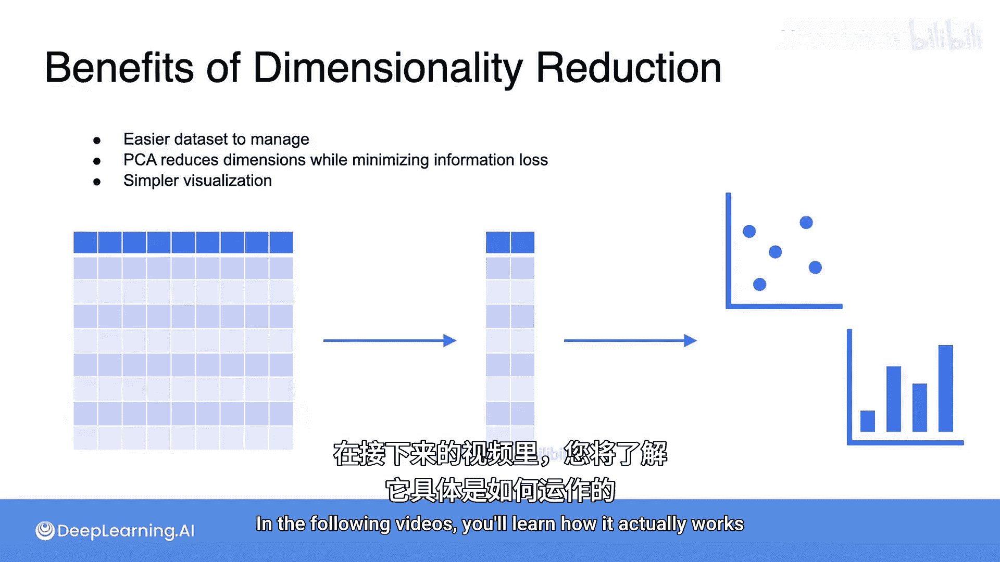

# 【Deeplearning】吴恩达：机器学习和数据科学线性代数1 ｜ Machine Learning Linear Algebra p53 P53_主成分分析动机_04_02_09 -BV1Pp6VBjE29_p53-

Now that you've seen the concept of a projection， let's see how it would be used by PCA to reduce the dimensions of a data set。

In this graph， each dot represents a different observation composed of two features graphed as their X and Y position。

Reducing the dimensions of this data means moving from two dimensional data graphed as points in the plane to one dimensional data graphed as points along the line。

 As you can see， the set is not centered around 00， so let's start by doing that。

 Now let's see what happens if you project onto the X axis。Let's save this projection for layer。

 now let's project onto the Y axis。You can already see that the points in this projection are less spread because the points are closer to each other。

 you can project into any line， for example， this one。

 which can be represented by the equation y plus x equals 0。

 which is equivalent to projecting onto the 1 minus1 vector since it spans a line。

Or you could also consider this other line that solves the equation 2 x minus y equals 0。

 which is projecting onto the 12 vector。Or even in this direction over here。

Notice that this line fits the data pretty well and the resulting projected points are still relatively spread out。

As you can see after these projections， the data points may be more or less spread out。

 and that's going to end up being very important。 The reason is that more spread out data points preserve more information from the original data。

In other words， preserving more spread means preserving more information Now Ill sort the projections from the one that has the points most spread out the least。

The projectionor at the top has the points most spread out。

 and therefore it preserves the most information from the original data。

And the projections at the bottom have the least spread and therefore preserve the least information。

 so the goal of PCA will be to find the projection that preserves the maximum possible spread in your data。

 even as you reduce the dimensionality of your dataset。And again。

 here are the main benefits of dimensionality reduction in general and in PCA。

Dmissionality reduction makes data sets that are easier to manage simply because they're smaller。

PCA in particular allows you to reduce dimensions while minimizing information loss thanks to this reduction in dimensions it is possible to analyze and visualize data in ways which might not have previously been easy or possible。

Now this was a really quick introduction to the concepts underlying PCA in the following videos。

 you'll learn how it actually works。

