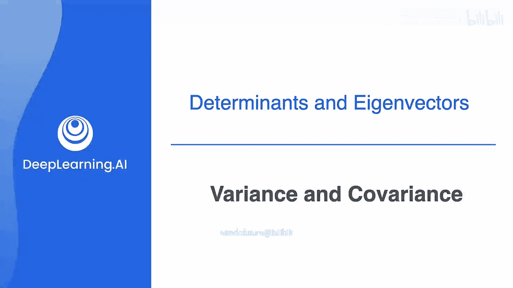
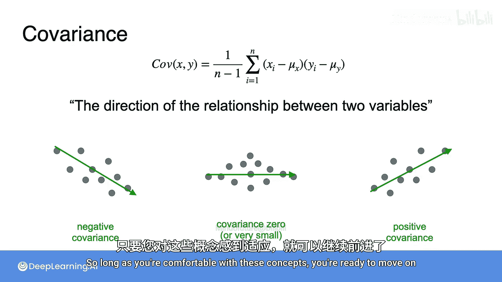

# 【Deeplearning】吴恩达：机器学习和数据科学线性代数1 ｜ Machine Learning Linear Algebra p54 P54_方差与协方差_04_02_10 -BV1Pp6VBjE29_p54-

PCA relies on a few concepts from statistics which I'll be introducing in this video if you study statistics in the past this will be a helpful review。

 and if not， you'll learn more about these ideas in the third course of this specialization。

With that， let's start with the first statistical concept， the me consider this data set。

 each point in the plot is an observation composed of two variables X and Y。

 each point is at a location X I， Y I。The mean of your data is simply the average value of all the observations which will be somewhere around this point。

 here's how you find it mathematically for the x variable， some all n values of x and divide by n。

 the mean of y works in the same way you just average the values of each feature。

This middle point therefore has to coordinates mean of x and mean of y。Next。

 you'll understand the concept of variance which describes how spread out your data is If you wanted to describe how the dots appear in the chart。

 you might say that the dots are more spread out or have a larger spread if we look at them along the horizontal axis and are more compact or have a smaller spread if we look at them along the vertical axis in statistics the spread is measured or described by the variance of a data a dataset set with no spread of values has a variance of0 and a dataset set with a large spread will have a large variance。

To see this more clearly I'm going to take our two dimensional chart and move every point to the horizontal axis like this again without yet worrying about how variance is calculated。

 we can see that this variance along the horizontal X axis is relatively large。

If we repeat the process along the Y axis， the values are spread out across a smaller range。

The y variance is relatively small， but still bigger than zero since there is some variation in the values。

Here's the equation for calculating the variance of a list of values to help you understand the different parts of this equation。

 consider a very simple data set with one column representing the variable x and 5 rows numbered 1 to5。

Each row is an observation X first you'll need to calculate the mean of x by simply adding up the values of X and dividing by phi。

This gives us a total of 45 and a mean of 9 Next find the difference between every value in column Xi and the mean you just calculated。

 or in other words， just subtract 9 from each row now square each of these differences placing the results in a new column。

The summation tells us to sum of these five squared values giving a total of 64。

 and finally divide this total by n minus1 since n here is 5 we divide by 4 giving you a variance of 16。

When this equation is written in formal notations， some of these terms are typically shortened。

 variance is often shortened of bar， and the Greek letter mu is used to represent the mean。

 Another way to think of variance is as the average square distance from the mean。

 the fact that it's the average square difference is a little odd but the most important takeaway here is that as your data becomes more spread out and on average is farther from the mean variance will increase。

Returning to the data set from earlier， you'd now refer to that average point as mu x mu y。

 and you could calculate the variance of x and y using the formula you just reviewed the x variance is larger than the y variance and from that formula it's clear y that's the case viewed along the x axis these points are further away from mu x so the average square distance will also be larger Meanwhile along the y axis。

 the average square distance from mu y is smaller。Vararianance helps us quantify how spread out your data is。

 but now consider a situation where variants alone wouldn't be helpful。

 these two data sets have three observations each they would have identical y variance and X variance and yet it's obvious that there's a significant difference in the patterns of these dataset sets。

The solution is now a measure called covariance， covariance helps measure how two features of a dataset varies and with respect to one another。

 notice that in the left data set the pattern within the data is down and to the right as x values increase y values decrease。

In the right dataset we have the opposite pattern as x values get larger。

 y values get larger too covariance quantifies this relationship resulting in the left data having a negative covariance and the right dataset having a positive covariance now that you have a high level understanding of what it's trying to measure。

 let's see how covariance is actually calculated。The equation for covariance looks like this。

 it can be a little complicated at first， so I'll break it down into pieces。As you can see， however。

 it looks pretty similar to the variance equation and if you expand out the square term at the end they're nearly identical。

 the only difference is that inside these circle items which now depend on the values of both the x and y variables as well as the average of these values mu X and mu Y Let's look at these three example dataset sets to understand how this equation works For the first data set we expect to calculate a negative covariance as the data is trending downwards In the second case。

 the trend line fitting the observation seems flat so we'd expect the covariance of 0 or a very small value。

And in the third case， X and Y seem to trend upwards together。

 which should result in a positive covariance to understand the impact of the circled items。

 you can draw the mean point new x new y on top of each dataset。

 subtracting new x from each x and new y from each y essentially recenters the data around this point And you can imagine it splitting the plane into four quadrants。

 Each point in the data lies in one of these quadrants and results in either a positive or negative contribution to the overall covariance in the first quadrant。

 both x and y are greater than their means， So the product in the circle term is positive In the second quadrant。

 x is less than its mean， but y is still greater。 The circle term is now the product of a negative and a positive number and the results are negative In this third quadrant。

 both x and y are less than their mean the circle term is now the product of two negative numbers so the result is positive And for dos in the final quadrant x is greater than its mean but y is smaller。

 The circle term is a product of a positive and negative number and the result is negative。

 recall that the first part of the covariance equation。

Is just asking to take a sum divide by the number of values minus 1。In other words。

 we're more or less averaging all these products， so in a somewhat simplistic way you can think of covariance as just asking on average。

 are there more dots in the positive quadrants or in the negative ones for the first data set more are in the negative quadrants so the covariance will be negative in the second the dots are about equally spread between positive and negative quadrants which results in a covariance close to0 and in the third most of the dots are in the positive quadrants leading to a positive covariance。

Whether you feel like you fully understand the covariance equation。

 what's most important at this point is to understand intuitively what it measures for now you can think of covariance as measuring the direction of the relationship between two variables。

A negative covariance indicates a negative trend， a small covariance indicates a flat trend or no relationship。

 and a positive covariance indicates a positive trend。

So long as you're comfortable with these concepts， you're ready to move on。

