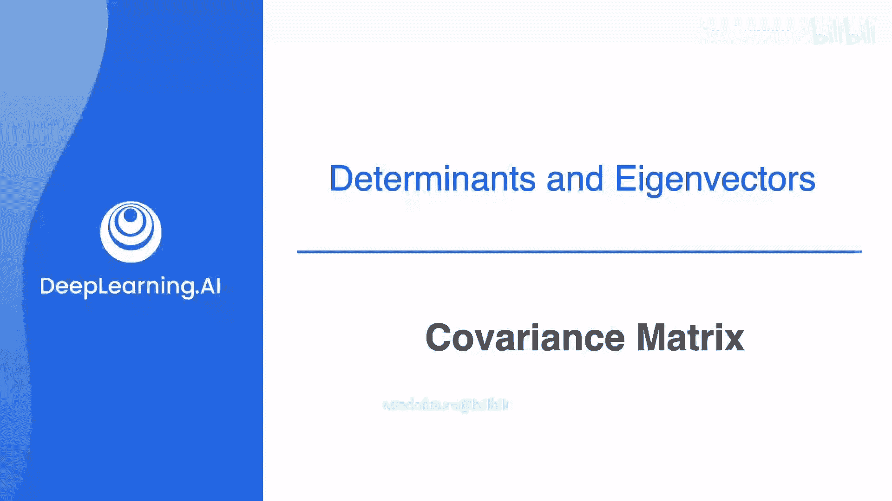
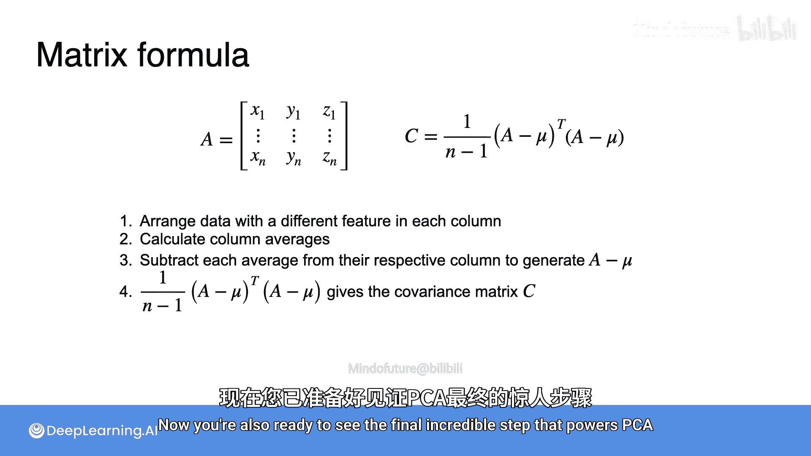

# 【Deeplearning】吴恩达：机器学习和数据科学线性代数1 ｜ Machine Learning Linear Algebra p55 P55_协方差矩阵_04_02_11 -BV1Pp6VBjE29_p55-

You've been learning a lot about variance and covariance because your ultimate goal will be to build a special matrix called the covariance matrix。

 It is a compact way of storing all the relationships between pairs of variables in your dataset to introduce this concept。

 let's look at three datasets。 All three x variables measured on the horizontal axis have more or less the same spread。

 I won't worry about calculating the variance here precisely。

 So I'll just say that each one has an x variance of three viewed along the vertical axis。

 these datasets also have more or less the same spread。

 though it's a bit smaller than the spread in the x direction here。

 I'll say they have a y variance of one Again， don't worry if these values are exactly correct。

It is clear， however， that the covariances are different。The first example has a downward slope。

 so I'll say it has a covariance of negative 2， the second one seems to have a flat slope。

 so I'll say the covariance is 0。And the last one has a positive trend。

 so I'll say it has a covariance of positive 2。Using these measures。

 I will now build a covariance matrix for each dataset set in the diagonal。

 I will put the X and y variances and in the off diagonal I will put the covariances。

 This is called the covariance matrix and it simply store the covariances and variances for each pair of variables。

 let's formalize the process a little bit more。 you first calculate the varianceance of each variable and the covariance of each combination of variables。

Here that's just the variance of x， the variance of y and the covariance of the two variables Next you build a square matrix which I'll refer to with a capital C with a row and column for each variable in your dataset set here we have just two so they are named X and y。

At every position in your matrix， you place the covariances of the variables of that row and column。

 So in these two positions， we place the covariance of x and y。

 notice that covariance of x Y is the same as the covariance of Yx。

 and you can verify this by using the formula you learned previously along the main diagonal you place the variance of each variable like this。

 Remember how similar the covariance and varianceance formulas were。

 It turns out that the covariance of a variable with itself， it's actually just the varianceance。

 So you could rewrite your covariance matrix like this。

 This truly is just a matrix of covariances between variables。

Normally you'll see it written with variance along the diagonal。

 but the important point here is that we're performing the exact same calculations at every cell in this matrix。

Finding the covariance of the variables in that row and column。

It is very common to see the covariance matrix expressed in matrix notation。

 which gives a straightforward and efficient way of computing the covariance matrix from your data or observations For this。

 you first need to store all your data points in a matrix Each row will be an observation of the variables X and Y and each column contains all the observations for a single variable。

 So let me call this matrix A。You will also need to define a matrix that has the same shape as a。

 and each column takes on the mean value for the variable。

 This matrix is called mu using these two matrixes。

 you can write the covariance matrix as 1 over n minus1 times a minus mu transpose times a minus mu。

Now let's begin by replacing a and mu by their expression here I'm just replacing the symbols with the matrices they represent Next you need to complete the calculation a minus mu in both terms。

 subtracting element wise gives this new expression。

Next you need to transpose the first matrix which gives this new expression。

 note that the first matrix is size 2 which is the number of variables by n。

 which is the number of observations。While the second matrix is size n by 2。

 this means that the product between the two matrices will be size2 by 2。

 which is precisely the size of the covariance matrix。This is a good sign that we're on track。Now。

 begin doing the matrix multiplication for the first element of the resulting matrix。

 you need to multiply the first row of the first matrix by the first column of the second matrix。

 which is simply x1 minus mu x times x1 minus mu x plus x2 minus mu x times x2 minus mu x。

And so on for all the n terms， which actually reduces to the sum of n terms of the square of the difference between each observation of variable x and the mean of that variable。

 if we incorporate the n minus1， then this is the expression for the variance of x。

Now let's complete the second element of the first row here you will multiply the first row of the matrix by the second column of the second matrix。

 which gives you x1 minus mu x times y1 minus mu y plus x2 minus mu x times y2 minus mu y， etc， etc。

 this expression can be simplified to this sum right here and again。

 if you include the1 over n minus1 term， you get exactly the expression for the covariance between x and y。

Notice that everything is really symmetrical in this matrix multiplication。

 so if you were to look into the product of the second row of the first matrix and the first column of the second matrix。

 then you would again get covariance of Yx and lastly the product between the second row of the first matrix and the second column of the second matrix gives you the variance of y this means you recover the original expression of the covariance matrix from much smaller simpler matrix operations。

Al right， that admittedly got somewhat complicated。

 but let's see what those two equations actually look like with a real dataset。

 The dataset has eight observations plotted on an X Y coordinate grid。

 given the distribution of the data， you would expect the x and Y variances to be about the same and the negative covariance because of the downward trend。

First， werite your data in a table of two columns， one for each feature。

 You'll need to calculate mu X and mu Y。 the average of each column。 In this case。

 the average values of these columns are 8 and 6。 Now。

 create the matrix A minus mu in which all the values have the column average subtracted。 Now。

 transpose that matrix and set up the matrix multiplication。 This table has8 observations。

 So add1 over n-1 or 1，7 to the front of this product。 Now， all you need to do is multiply。

 The result will be this two by 2 matrix， which is C。 The covariance matrix。 And as predicted。

 the x variance and the y variance which lie on the diagonal are fairly similar and the covariance is negative。

The examples you saw were all four dataset sets of two variables。

But this same process works for any size data set here。

 the same steps are shown with a new column Z added。 Here's what you do。

 Arrange the data with a different feature in each column。Calculate the column average is mu。

 Subtract the average from their columns generating the matrix a minus mu。

Multiply a minus mu transpose by a minus mu and divide by n-1。 given the covariance matrix C。 Again。

 this has been a technical look at the process underlying this very important matrix。

 and you'll have more opportunities to study these statistical concepts in more detail in the third course of this specialization。

 I think is' beautiful， though， that a complicated process that generates the covariant matrix can be so succintly expressed using matrix multiplication。

 Now， you're also ready to see the final incredible step that powers Pca。

