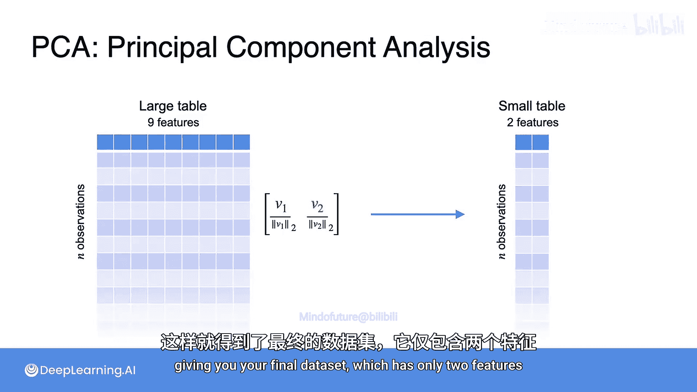

# 【Deeplearning】吴恩达：机器学习和数据科学线性代数1 ｜ Machine Learning Linear Algebra p56 P56_主成分分析概述_04_02_12 -BV1Pp6VBjE29_p56-

So let's trace the steps of PCA and finally put all the pieces together。

 remember at the start you had this data set， which you centered and the goal was to project your data onto the line that preserved the most information。

You learn that this best line is the one which preserves the most variance in your data。

 The big question then is how do you find this best line？

This is where everything you've been learning in this lesson comes together。

 so far you've learned about projections and how a simple matrix multiplication allows you to project data into a lower dimensional space。

You've also learned about eigenvalues and eigenvectors and how they capture the directions in which a linear transformation only stretches space。

 but doesn't rotate it or shear it， and in the previous video you got familiar with the covariance matrix and how it compactly represents relationships between the variables in your dataset PCA works by combining these three ideas in a clever way that helps reduce the number of dimensions in your data。

 So let's see how it works。I'll start again with the same data set。

 which have centered around its mean point。Let's begin by finding the covariance matrix C for your data points。

 suppose that the x variance is 9 and the y variance is 3。The covariance is 4。

 which makes sense as there's a positive trend line to this data。Now。

 heres the big leap of this entire process。 You find the eigenvalues and eigenvectors of the covariance matrix。

 This is how you'll find the line onto which you should project the data。 Remember。

 that eigenvectors and eigenvalues come in pairs with the eigenvector given a direction。

 and the eigenvalues giving a magnitude。 The first eigenvector is 2，1。

 and it has an eigenvalue of 11。 The second eigenvector is -1，2， and it has an eigenvalue of 1。

You may have noticed these two vectors are at a 90 degree angle to one another。

 which is also called orthogonal。This is not a coincidence。

 but it is true for the eigenvectors of every matrix that is symmetric around its diagonal。

 If you transpose this matrix， these two fours would just change spots。So， C is symmetric。In fact。

 every covariance matrix is symmetric， so the eigenvectors you calculate will always be orthogonal。

Now， you have two eigenvectors， or as they're called in PC principal components。

 and you want to project your data along one of them。

 you can probably tell from looking that there is much more variance along the red vectorctor than along the green  one。

 But how could you determine this mathematically。 It turns out that the eigenvector with the largest eigenvalue will always be the one that will give the greatest variance when you project your data。

 So in this case， the vectorctor 21 has an eigenvalue of 11， which is much larger than one。

So21 is the winner， that is the line you'll project your data along。

You can meanwhile discard the second eigenvector with its smaller eigenvalue。

 you can now draw the line that the vector 21 spans and all that is left to do is project your data onto this line。

Now that the points are projected along this vector。

 you no longer need to graft them in two dimensions。

 all that matters is their position along the vector。So I'll graph the projected data like this。

And just like that， you have reduced the dimensionality of your data and preserved as much variance as possible。

 which were the two goals of PCA。Visualally， you can see your data went from two dimensional to one dimensional。

Rather than storing an x and a Y variable， you can think of your data having been reduced to a single new value Z。

 which tells you where on this eigenvector each observation was projected to。

Your data has fewer dimensions and the maximum possible variance。

This process works for much larger dataset sets too， suppose you have a nine dimensional data set。

 so a table with nine columns or features and as many rows or observations as you like。

 So I'll just say there are n observations。Here's how you'd perform PCA on this data。

From your data you can get the covariance matrix， just like you saw in the earlier lecture。

 since you have nine variables， this will result in a 9 by9 covariance matrix。Next。

 you would need to find the eigenvalues and eigenvectors of this matrix and sort them according to the eigenvalue from biggest to smallest。

 Imagine you want to reduce your dataset set to just two variables。

Then you'll simply keep the two biggest eigenvalues and their associated eigenvectors and discard the rest。

Now you have the two vectors you wish to project your data onto V1 and V2。To project your data。

 create a new matrix where each column is one of the two eigenvectors scaled by its own norm。Finally。

 multiply the matrices to project your data into these two vectors， giving you your final data set。

 which has only two features。

