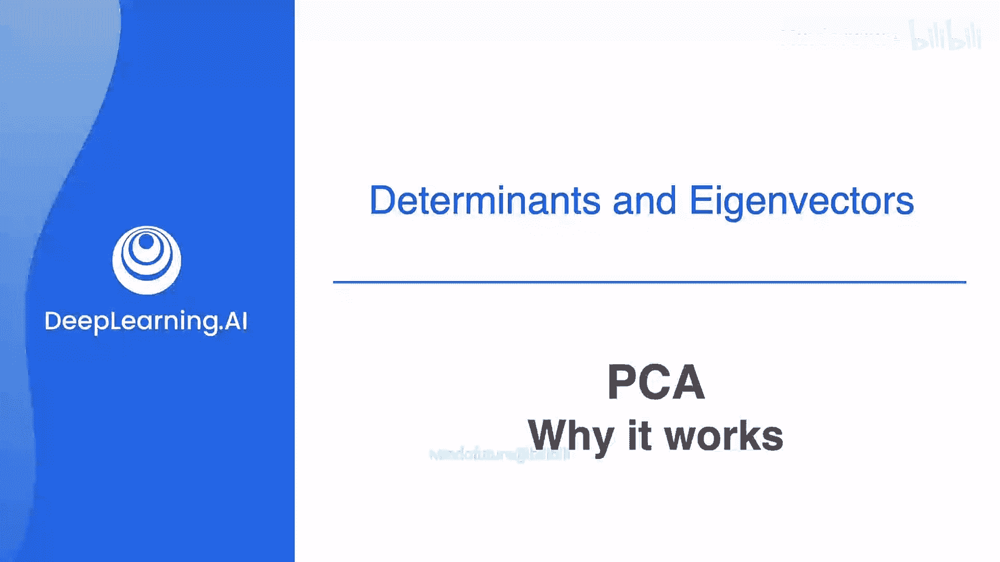
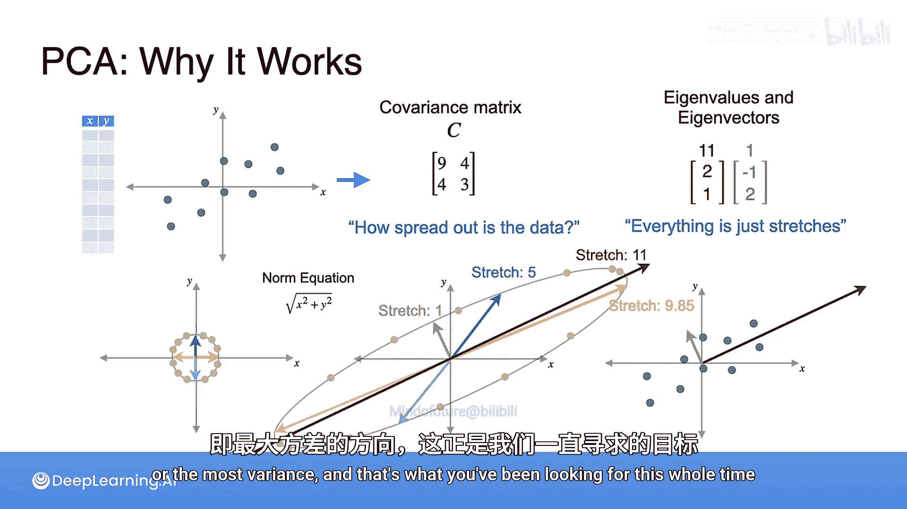

# 【Deeplearning】吴恩达：机器学习和数据科学线性代数1 ｜ Machine Learning Linear Algebra p57 P57_主成分分析原理_04_02_13 -BV1Pp6VBjE29_p57-

Okay， so now you might believe that this procedure works。

 but I haven't explained why a rigorous proof would be a little challenging to show here。 However。

 I can give you some of the intuition behind this process。

 Let's go back to the case of a data set with just two features， which I'll still call X and Y。

 which you can think of as both a table of data and points graph in space。

 So once you have your data， you can get the covariance matrix C。

 It contains information about how spread out the data is from the perspective of each pair of variables or maybe better yet。

 how spread out is the data。 This is easier to see if you think of C as a change of basis。

How would it transform space？Well， the fundamental vector 10 would be moved to 9，4。

And the fundamental vector 01 would be moved to 4，3。

You can also check that the vector minus10 moves to9-4 and the vector 0 minus1 moves to4 minus3。

 Can you already see what the transformation looks like？If you can't， that's okay。

 let's see what happens with multiple directions all around the circle of Radius 1。

Let's start by adding this point and seeing its transformation。And keep going all around the circle。

If you join all the dots in the transformed plane， you will see that they are mapping out an ellipse so that the circle of radius 1 is transformed into the ellipse。

 where you can see that all the points are stretched into different directions。

 Note that we consider the circle or radius 1， because we are only interested in the direction of the stretches。

 if you had chosen points of another bigger circle， you would still get the same ellipse only bigger。

 Looking at the transformed points， which would you say is the direction of the biggest stretch。😊。

I would say that is this red line right here， which aligns with the major axis of the ellipse。

If you cut the ellipse in any other direction， you will get a shorter line。

 Here's where eigenvalues and eigenvectors come in。

 Remember that this covariance matrix has two eigenvectors，2，1 with eigenvalue 11， and-1。

2 with eigenvalue 1。 together， these two vectors form an eigen basis。

 And from the perspective of these eigen basiss， the transformation C just stretches the plane。Now。

 it looks like the direction of greatest stretches along the greatest eigenvector， which is true。

 Let me help you understand why that makes sense based on what you've learned about eigenbases。

 The whole point of getting the eigenvalues and eigenvectors was to reframe a linear transformation as two stretches。

Any point along the vector 21 will be stretched by a factor of 11， its eigenvalue。

 any point along the vector minus 12 will get stretched by a factor of 1， which is its sigenvalue。

And any other vector in the plane would be stretched by a factor somewhere between 1 and 11。

 Let me show you a couple of examples to demonstrate that this is the case。

I'll calculate the norm of the vector before and after the transformation using the norm equation and find the ratio between them。

I'll start with vector 01 in Tl， which you already saw is sent to the vector 43。In this case。

 the vector starts with a norm of 1 and ends up with a norm of 5。

 so it gets stretched out by a factor of 5 Now consider the vector 10 in orange which you already saw was sent to the vector 94。

This vector also starts with a norm of one， and if you use the norm equation。

 you can calculate a final norm of about 9。85。 So again。

 that's how much this vector was stretched by。This time the stretch was closer to 11。

 but is still less than the maximum stretch， which will occur along the eigenvector 21。Again。

 this isn't a rigorousgos proof， but hopefully this helps build the intuition behind choosing the eigenvectors with the biggest eigenvalues。

Your covariance matrix C characterizes the spread of your data。

 The matrix C's eigenvectors tells you the direction in which the matrix can be viewed as just stretching。

 The largest eigenvalue tells you where that stretching is greatest。

 and any other direction will be stretched out less。

 So choosing the eigenvectors with the biggest eigenvalues will give you the directions with the biggest stretch or the most variance。

 and that's what you've been looking for this whole time。

