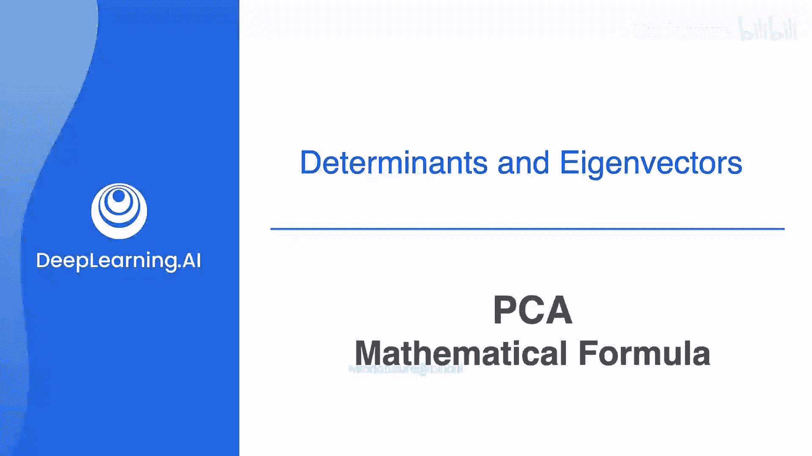
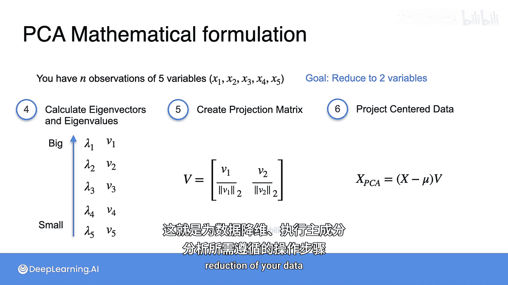

# 【Deeplearning】吴恩达：机器学习和数据科学线性代数1 ｜ Machine Learning Linear Algebra p58 P58_主成分分析数学公式_04_02_14 -BV1Pp6VBjE29_p58-

Now that you have understood the idea behind PC， let's formalize the steps one last time using all the different formulas you've studied in this example。

 there will be five variables， but it works the same for any number。

You start with a data set of points with n observations of five variables， x1， x2， x3， x4 and x5。

 your goal will be to reduce your data from 5 to two dimensions。First。

 construct a matrix of your data。 This matrix will have five columns。

 one for each variable or feature and n rows， one for each observation， and it will be called X。

 This is the same matrix you used earlier to get the covariance matrix。

 which at that point was called a。 We are using X to call this matrix because now all the variables are called X I。

Also， this is more standard notation Next， center your data to do this。

 calculate the column averages and subtract them from each column， giving you the matrix x minus mu。

Next calculate the covariance matrix， this is just a simple matrix multiplication using the matrix x minus mu you just calculated in this case you end up with a 5 by 5 matrix of covariances between each pair of variables。

Next， find the eigenvalues and eigenvectors for the covariance matrix。 Once you have them。

 sort them from smallest to largest by their eigenvalues。

Now you'll create a matrix to project your data Since your goal is to reduce your dataset to just two variables。

 you will only keep the first and second eigenvalue eigenvector pairs， create a matrix V。

 which has two columns where each is one of the eigenvectors you choose scaled by its norm。 Finally。

 projected data onto the vectorctors you choose by multiplying the center data by your projection matrix。

 The result is a new data X PCca， which will have just two columns of data representing the projection of your original data onto the two principal components you choose。

And that's it， this is the step by step operations you need to perform PCA for dimensionality reduction of your data。

