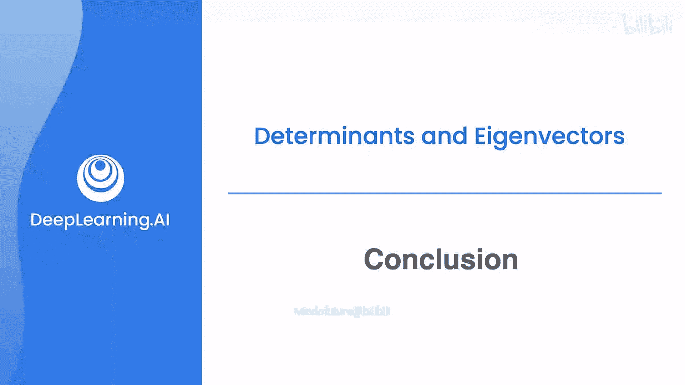

# 【Deeplearning】吴恩达：机器学习和数据科学线性代数1 ｜ Machine Learning Linear Algebra p60 P60_总结_04_03_01 -BV1Pp6VBjE29_p60-

Congratulations you finished the fourth week and with it you finished a full linear algebra course Now you know how to solve systems with linear equations。

 how to turn them into mates and vectors， how to consider these matrices as linear transformations and a lot more。

😊，I am so excited that you've taken the step in your machine learning journey and I am even more excited to see you in the calculus for Machine learning course。

