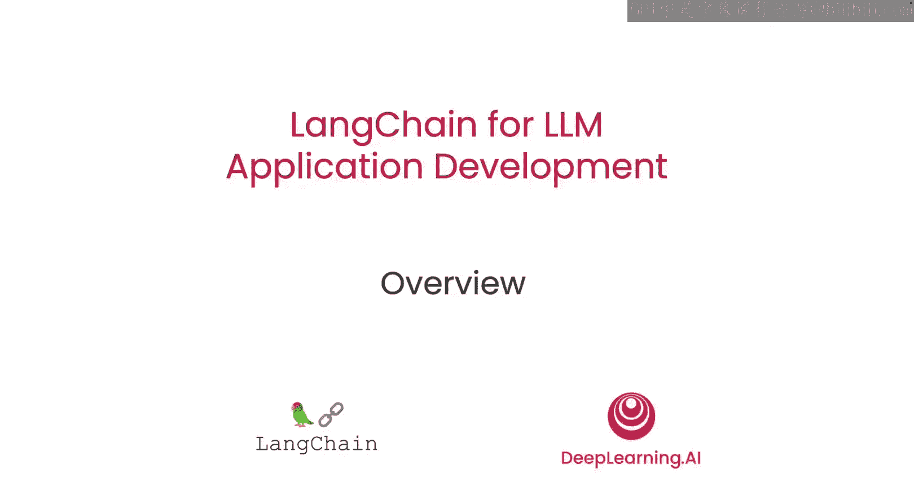
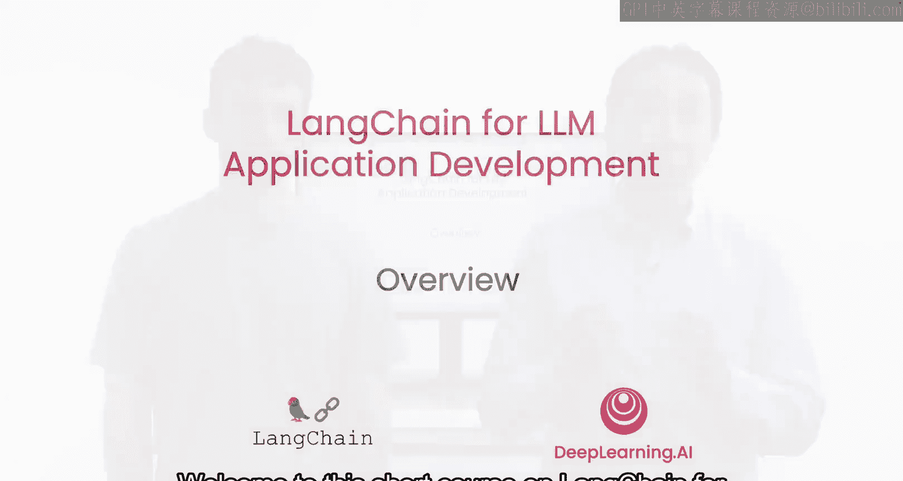
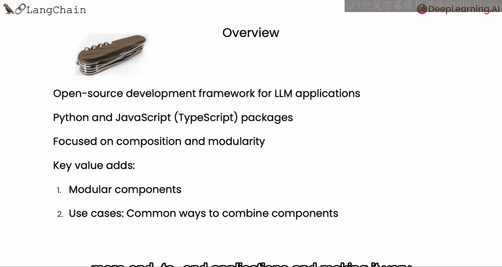
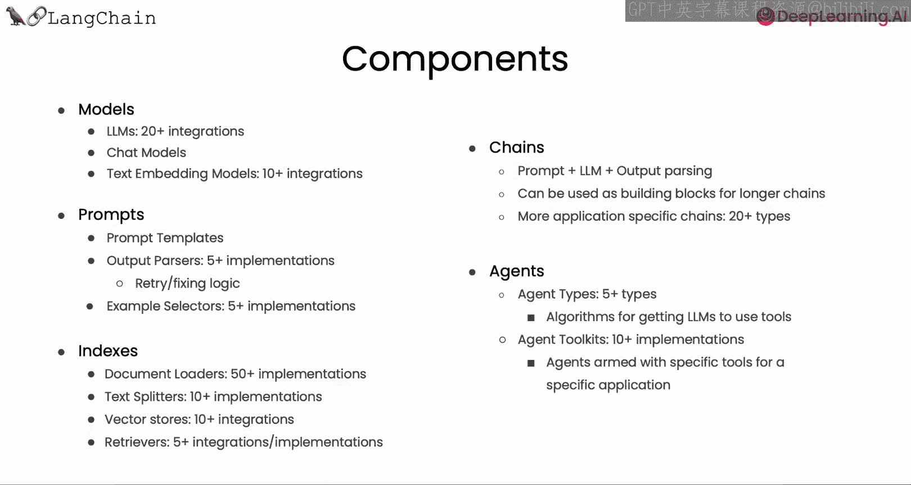
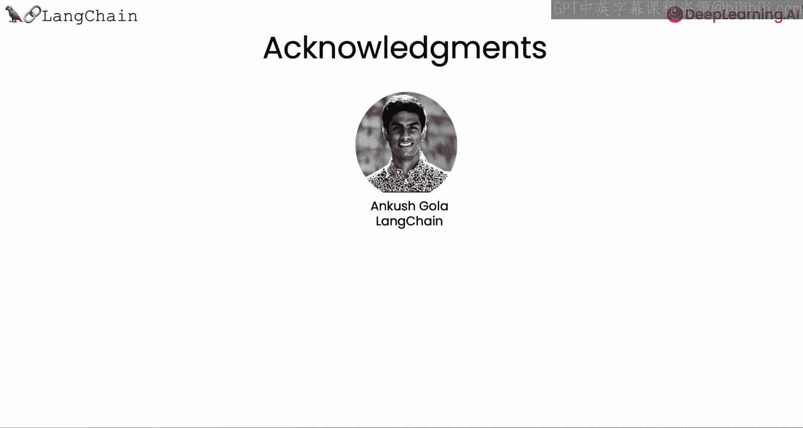
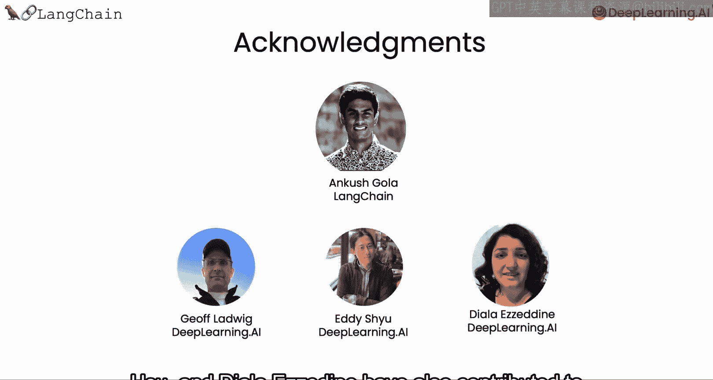
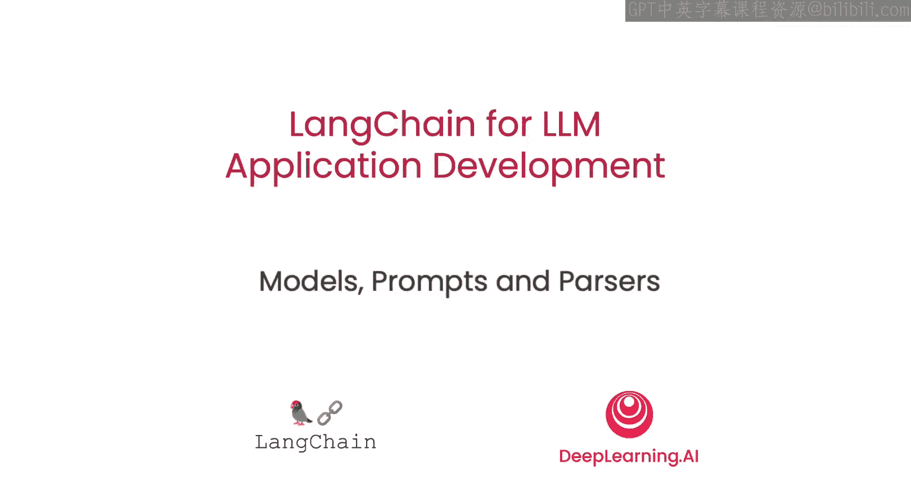

# LangChain应用开发：P1：1_LangChain简介 🚀

在本节课中，我们将学习LangChain这一用于大语言模型（LLM）应用开发的开源框架。我们将了解其核心价值、主要组件以及它能如何加速AI应用的构建过程。

通过提示（Prompting）大语言模型，现在开发AI应用的速度比以往任何时候都快。然而，一个完整的应用程序通常需要多次提示LLM并解析其输出，这中间需要编写大量的“胶水代码”。

由Harrison Chase创建的LangChain极大地简化了这一开发过程。LangChain最初是一个用于构建AI应用的开源框架。它的诞生源于观察到开发者在构建复杂应用时存在一些通用的抽象模式。该框架在社区中获得了广泛的采纳，并期待与大家分享，也期待看到人们用它构建出怎样的应用。

事实上，作为LangChain发展势头的证明，它不仅拥有众多用例，还有数百名开源贡献者，这推动了其高速的迭代开发。团队以惊人的速度发布代码和功能。希望在本短期课程结束后，你能够使用LangChain快速搭建出一些非常酷的应用。

LangChain是一个用于构建LLM应用的开源开发框架。它提供两个不同的软件包：Python版和JavaScript版。其设计核心是**组合性**与**模块化**。框架包含大量独立的组件，这些组件既可以相互结合使用，也可以单独使用，这是其关键价值之一。另一个关键价值是提供了一系列不同的**用例链**，即如何将这些模块化组件组合成更端到端的应用，并让用户能轻松上手这些用例。

在本课程中，我们将涵盖LangChain的常见组件。我们将讨论**模型**，讨论**提示**（这是让模型执行有用和有趣任务的关键），讨论**索引**（这是摄取数据以便与模型结合的方式），以及讨论**链**（这是一种更端到端的用例）和**代理**（这是一种非常令人兴奋的端到端用例类型，它将模型用作推理引擎）。

我们也很感谢Ansh Goel，作为Harrison Chase的联合创始人，他为这些课程材料投入了大量思考，并协助创建了本短期课程。在DeepLearning.AI方面，Jeff Ladwig、Eddihu和Dialla Eadin也为这些材料做出了贡献。

那么，接下来让我们进入下一个视频，开始学习模型、提示和解析器。

---

**本节课总结**：本节课我们一起学习了LangChain框架的概况。我们了解到它是一个旨在简化LLM应用开发的开源工具，其核心优势在于模块化设计和丰富的用例链，能够帮助开发者高效地组合不同组件来构建复杂的AI应用。