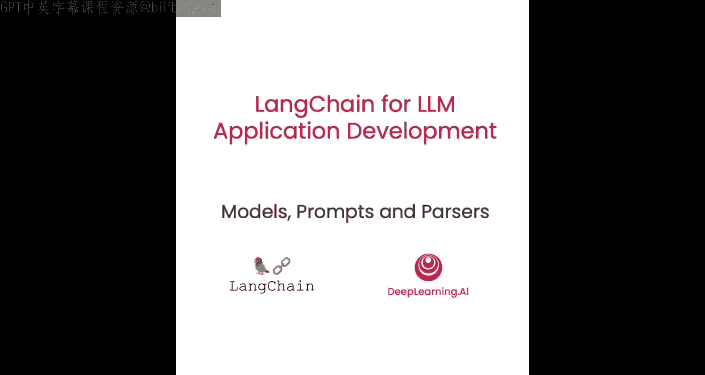
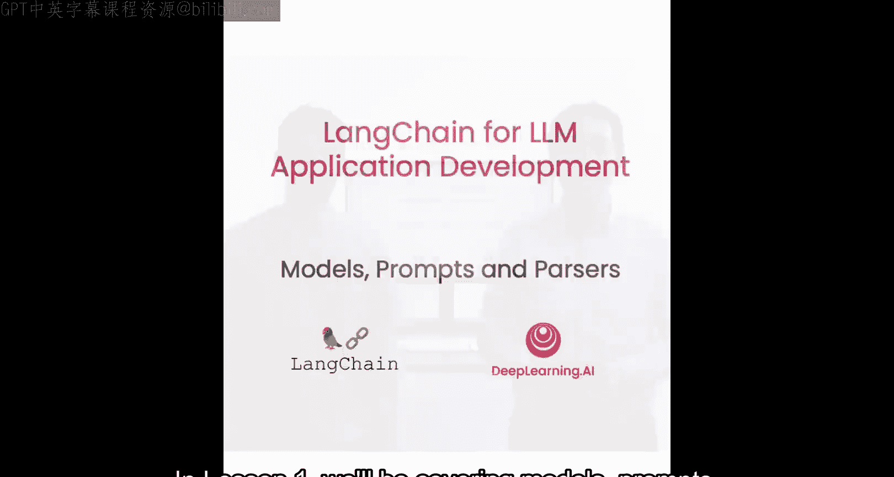
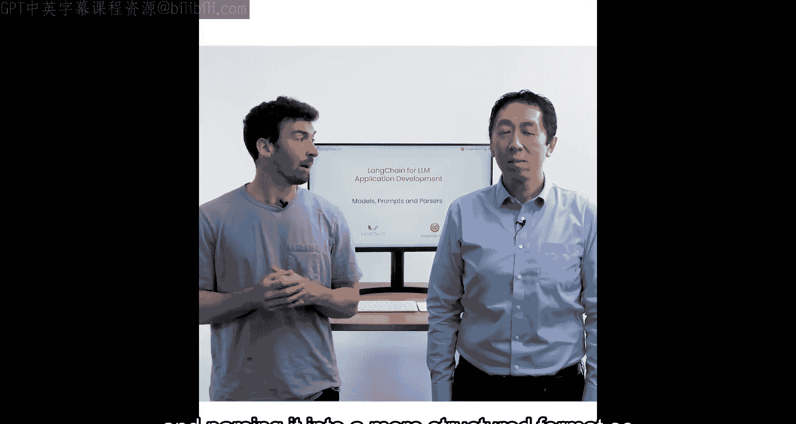
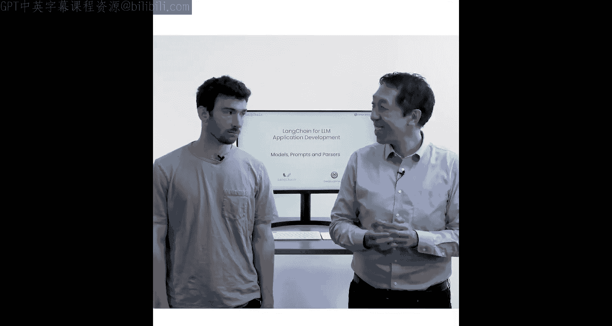
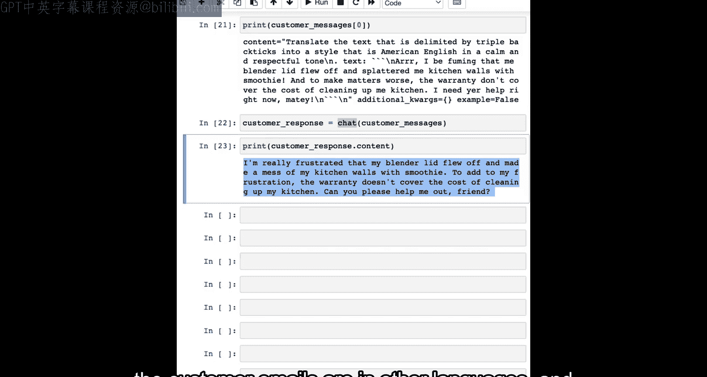
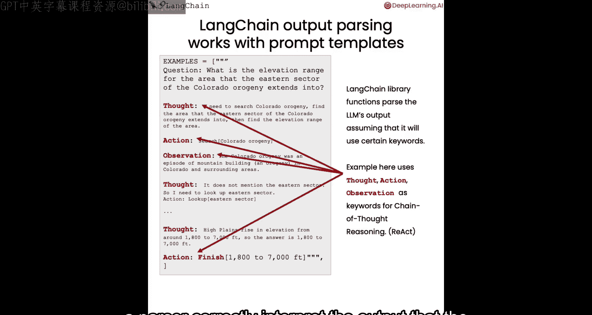
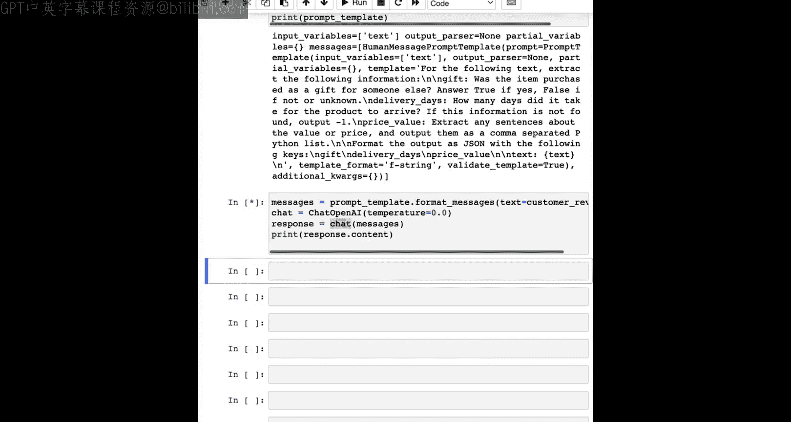
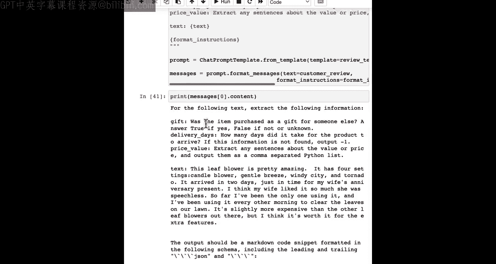
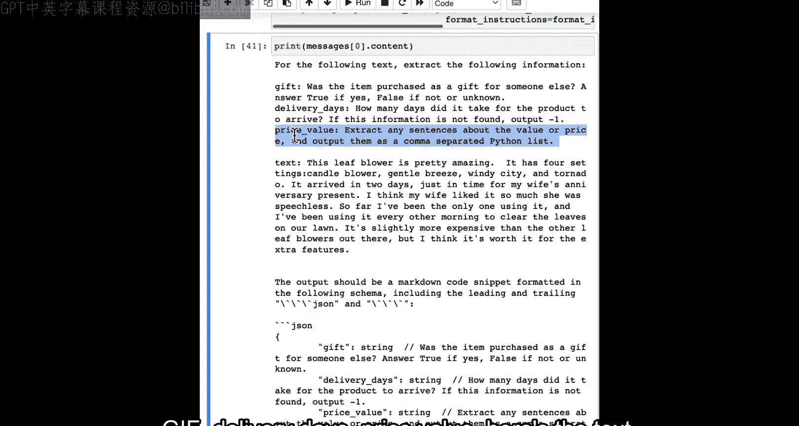
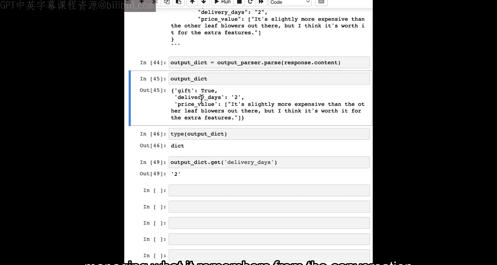

# LangChain for LLM Application Development：1：模型、提示与解析器



在本节课中，我们将学习LangChain的三个核心组件：**模型**、**提示**和**解析器**。模型是支撑许多应用的语言模型；提示是指创建输入以传递给模型的风格；而解析器则涉及接收模型的输出，并将其解析为更结构化的格式，以便进行后续处理。LangChain提供了一套简洁的抽象层，使这些操作变得简单易行。

## 模型、提示与解析器概述







上一节我们介绍了课程的整体目标。本节中，我们来看看如何开始使用LangChain。

首先，我们需要一些启动代码。以下是导入必要库和设置环境的示例：

```python
import os
import openai
openai.api_key = os.getenv('OPENAI_API_KEY')
```

如果你在本地运行且尚未安装OpenAI库，可能需要运行 `pip install openai`。

接下来，我们定义一个辅助函数来调用模型。这个函数类似于我在“ChatGPT Prompt Engineering for Developers”课程中使用的函数。

```python
def get_completion(prompt, model="gpt-3.5-turbo"):
    messages = [{"role": "user", "content": prompt}]
    response = openai.ChatCompletion.create(
        model=model,
        messages=messages,
        temperature=0,
    )
    return response.choices[0].message["content"]
```

使用这个函数，你可以通过 `get_completion("What is 1+1?")` 来获取模型的回答。

## 使用LangChain抽象层

为了理解LangChain在模型、提示和解析器方面的抽象优势，让我们考虑一个场景：你收到一封非英语的客户邮件。为了确保内容可理解，我们需要将其翻译成英语。

假设我们收到一封用“海盗英语”写的投诉邮件：

> I be fuming that me blender lid flew off and splattered me kitchen walls with smoothie! And to make matters worse, the warranty don't cover the cost of cleaning up me kitchen. I need your help right now, matey.

我们的目标是让语言模型将这段文本翻译成“平静且尊重语气的美式英语”。

以下是使用传统方式构建提示的示例：

```python
style = "American English in a calm and respectful tone"
text = "I be fuming that me blender lid flew off and splattered me kitchen walls with smoothie! ..."
prompt = f"""Translate the text that is delimited by triple backticks into a style that is {style}.
text: ```{text}```
"""
response = get_completion(prompt)
print(response)
```

运行后，模型会输出一个礼貌的翻译版本。然而，如果有大量不同语言的客户评论需要处理，手动构建每个提示将非常繁琐。

## 使用LangChain的提示模板

现在，让我们看看如何使用LangChain更便捷地完成这项任务。

首先，我们导入LangChain的ChatOpenAI类，这是对ChatGPT API端点的抽象。

```python
from langchain.chat_models import ChatOpenAI
chat = ChatOpenAI(temperature=0.0)
```

`temperature=0.0` 参数使模型的输出更少随机性，更具确定性。

接着，我们定义一个可复用的提示模板字符串：

```python
template_string = """Translate the text that is delimited by triple backticks into a style that is {style}.
text: ```{text}```
"""
```



然后，我们使用LangChain的 `ChatPromptTemplate` 来创建模板：

```python
from langchain.prompts import ChatPromptTemplate
prompt_template = ChatPromptTemplate.from_template(template_string)
```

这个模板识别出它有两个输入变量：`style` 和 `text`。

现在，我们可以指定目标风格和客户邮件内容，并生成最终的消息：

```python
customer_style = "American English in a calm and respectful tone"
customer_email = "I be fuming that me blender lid flew off and splattered me kitchen walls with smoothie! ..."
customer_messages = prompt_template.format_messages(style=customer_style, text=customer_email)
customer_response = chat(customer_messages)
print(customer_response.content)
```

这种方法使得处理不同语言的邮件变得非常高效。你可以轻松修改风格或文本来获得不同的输出。

## 解析模型输出

上一节我们介绍了如何使用提示模板。本节中，我们来看看如何解析模型的输出，使其更易于在后续程序中使用。

假设我们的客服人员用英语回复了客户，但我们希望将回复翻译成客户的原语言（海盗英语）。客服的回复如下：

> Hey there customer, the warranty does not cover cleaning expenses for your kitchen because it's your fault that you misused your blender by forgetting to put the lid on before starting it. Tough luck! See ya!

我们希望将其翻译成“礼貌的海盗英语”风格。

由于我们已经创建了提示模板，现在可以轻松地复用：

```python
service_reply = "Hey there customer, the warranty does not cover cleaning expenses for your kitchen..."
service_style_pirate = "polite tone that speaks in English Pirate"
service_messages = prompt_template.format_messages(style=service_style_pirate, text=service_reply)
service_response = chat(service_messages)
print(service_response.content)
```



你可能会问，为什么使用提示模板而不是简单的f-string？答案是，在构建复杂应用时，提示可能会非常长且详细。提示模板作为一个有用的抽象，可以帮助你复用设计良好的提示。

此外，LangChain还内置了许多常见操作（如总结、问答、连接数据库等）的提示模板，使用它们可以快速搭建应用，而无需自己设计提示。

## 输出解析器

LangChain提示库的另一个重要方面是支持**输出解析**。在构建复杂应用时，你经常需要指示语言模型以特定格式生成输出，例如使用特定的关键词。

以下是一个例子，我们让语言模型从产品评论中提取信息，并以JSON格式输出。

首先，我们定义期望的输出格式（一个Python字典示例）：

```python
{
  "gift": False,
  "delivery_days": 5,
  "price_value": "pretty affordable!"
}
```

然后，我们有一个客户评论和一个旨在提取特定信息（礼物、交付天数、价格价值）的提示模板。

以下是使用LangChain实现此功能的步骤。首先，我们导入必要的模块并定义响应模式：



```python
from langchain.output_parsers import ResponseSchema, StructuredOutputParser

gift_schema = ResponseSchema(name="gift", description="Was the item purchased as a gift for someone else? True or false.")
delivery_days_schema = ResponseSchema(name="delivery_days", description="How many days did it take for the product to arrive?")
price_value_schema = ResponseSchema(name="price_value", description="Extract any mentions of value or price.")

response_schemas = [gift_schema, delivery_days_schema, price_value_schema]
output_parser = StructuredOutputParser.from_response_schemas(response_schemas)
```

`output_parser` 可以生成精确的指令，告诉语言模型如何格式化输出，以便解析器能够处理。

```python
format_instructions = output_parser.get_format_instructions()
```

然后，我们将这些格式指令整合到提示模板中：

```python
review_template = """For the following text, extract the following information:
gift: Was the item purchased as a gift for someone else? True if yes, False if not or unknown.
delivery_days: How many days did it take for the product to arrive? If this information is not found, output -1.
price_value: Extract any sentences about the value or price.

Format the output as a JSON object with "gift", "delivery_days", and "price_value" as the keys.





Text: {text}

{format_instructions}
"""

prompt = ChatPromptTemplate.from_template(review_template)
messages = prompt.format_messages(text=customer_review, format_instructions=format_instructions)
response = chat(messages)
```

最后，我们使用输出解析器将模型的字符串响应解析为Python字典：

```python
output_dict = output_parser.parse(response.content)
print(output_dict)
print(type(output_dict))  # 输出: <class 'dict'>
print(output_dict.get('gift'))  # 输出: True
```

这样，我们就可以轻松地在下游处理中使用提取出的结构化数据了。

## 总结



本节课中，我们一起学习了LangChain的三个核心组件：**模型**、**提示**和**解析器**。通过使用提示模板，你可以轻松地复用和分享提示。LangChain内置的提示模板通常可以与输出解析器结合使用，指示模型以特定格式输出，并由解析器将输出解析为Python字典等数据结构，便于后续处理。希望这些工具能在你的应用中发挥作用。在下一节视频中，我们将看到LangChain如何通过更好地管理对话记忆，来帮助构建更高效的聊天机器人。