# LangChain for LLM Application Development： 3： 记忆（Memory） 🧠

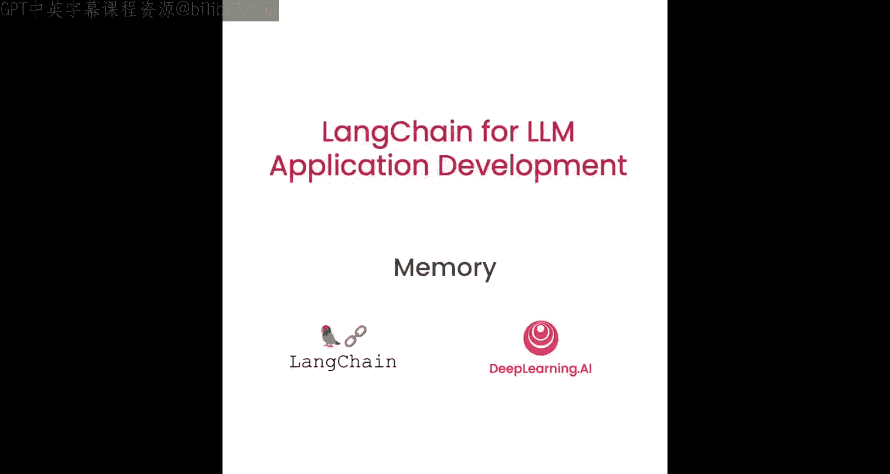

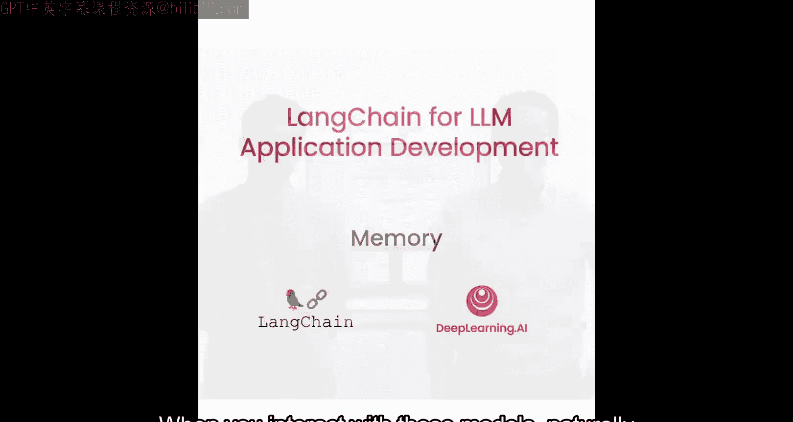

在本节课中，我们将要学习LangChain中的“记忆”（Memory）功能。大型语言模型（LLM）本身是无状态的，这意味着它们不会记住之前的对话内容。这对于构建聊天机器人等需要连续对话的应用来说是一个问题。本节将介绍如何使用LangChain的记忆模块来存储和利用对话历史，使LLM能够进行连贯的对话。

---

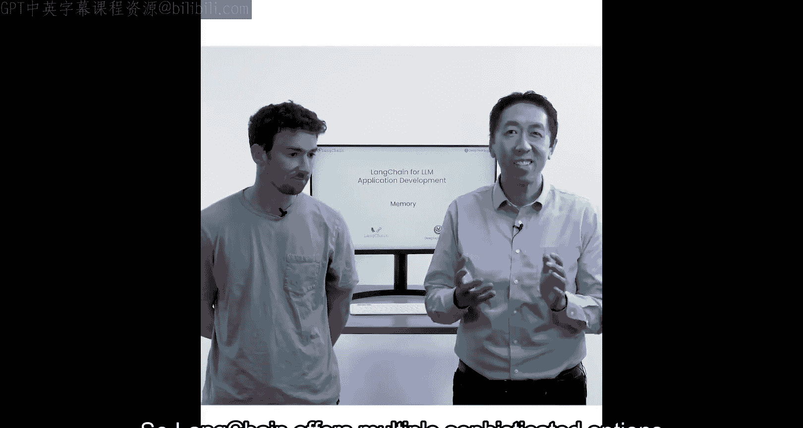

## 导入与基础设置

首先，我们需要导入必要的库并设置环境。

```python
import os
from langchain.chat_models import ChatOpenAI
from langchain.chains import ConversationChain
from langchain.memory import ConversationBufferMemory
```

上一节我们介绍了如何与LLM进行单次交互，本节中我们来看看如何让对话具有连续性。

## 对话缓冲记忆（Conversation Buffer Memory）

`ConversationBufferMemory` 是最简单的记忆类型，它会完整地保存所有对话历史。

以下是创建对话链并启用记忆的步骤：

```python
# 1. 初始化LLM
llm = ChatOpenAI(temperature=0)

# 2. 初始化记忆
memory = ConversationBufferMemory()

# 3. 创建对话链
conversation = ConversationChain(
    llm=llm,
    memory=memory,
    verbose=False  # 设置为True可查看内部提示词
)

# 4. 开始对话
response = conversation.predict(input="你好，我叫安德鲁。")
print(response)  # 输出：你好安德鲁！很高兴认识你。

response = conversation.predict(input="一加一等于几？")
print(response)  # 输出：一加一等于二。

response = conversation.predict(input="我的名字是什么？")
print(response)  # 输出：你的名字是安德鲁，你之前提到过。
```

通过设置 `verbose=True`，你可以看到LangChain在每次调用时生成的完整提示词，其中包含了所有历史对话。

要查看当前记忆存储的内容，可以打印记忆缓冲区：

```python
print(memory.buffer)
# 输出：Human: 你好，我叫安德鲁。\nAI: 你好安德鲁！很高兴认识你。\nHuman: 一加一等于几？\nAI: 一加一等于二。\nHuman: 我的名字是什么？\nAI: 你的名字是安德鲁，你之前提到过。
```

你也可以手动向记忆中添加内容：

```python
memory.save_context({"input": "嗨"}, {"output": "最近怎么样？"})
print(memory.buffer)
```

---

## 对话窗口缓冲记忆（Conversation Buffer Window Memory）

随着对话变长，完整的缓冲记忆会占用大量令牌（Token），增加调用成本。`ConversationBufferWindowMemory` 只保留最近 `K` 轮对话。

以下是其使用方法：

```python
from langchain.memory import ConversationBufferWindowMemory

# 只记住最近一轮对话（K=1）
memory = ConversationBufferWindowMemory(k=1)

conversation = ConversationChain(llm=llm, memory=memory, verbose=False)

conversation.predict(input="你好，我叫安德鲁。")
conversation.predict(input="一加一等于几？")
response = conversation.predict(input="我的名字是什么？")
print(response)  # 输出：抱歉，我无法访问该信息。
```

因为 `k=1`，模型只记得最后一轮（关于“一加一”的问答），而忘记了第一轮中关于名字的对话。

---

## 对话令牌缓冲记忆（Conversation Token Buffer Memory）

`ConversationTokenBufferMemory` 根据令牌数量而非对话轮次来限制记忆长度，这更直接地与LLM的调用成本挂钩。

以下是其使用方法：

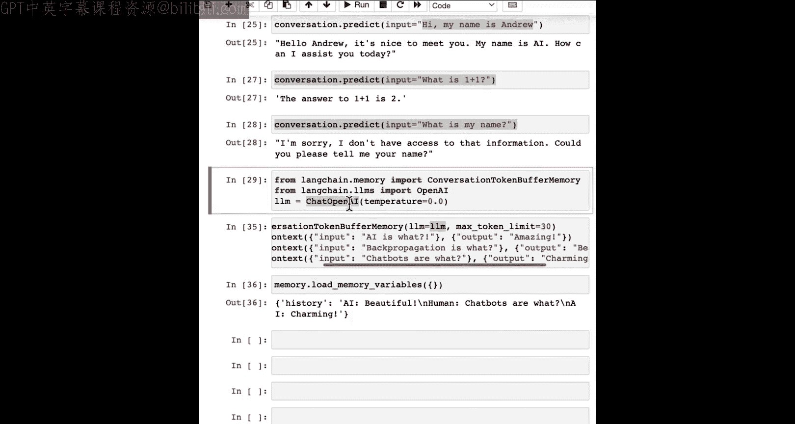

```python
from langchain.memory import ConversationTokenBufferMemory
from langchain.llms import OpenAI

llm_for_counting = OpenAI()  # 用于令牌计数
memory = ConversationTokenBufferMemory(llm=llm_for_counting, max_token_limit=50)

# 添加一些对话
memory.save_context({"input": "AI是什么？"}, {"output": "AI很神奇。"})
memory.save_context({"input": "后印象派是什么？"}, {"output": "是美丽的艺术。"})
memory.save_context({"input": "教堂是什么？"}, {"output": "是迷人的建筑。"})

print(memory.load_memory_variables({}))
# 当令牌限制为50时，可能只保留了最近的部分对话。
```

你可以调整 `max_token_limit` 的值，观察记忆内容如何被截断以符合令牌限制。

---

## 对话摘要缓冲记忆（Conversation Summary Buffer Memory）

这是一种更高级的记忆类型。它结合了两种策略：在令牌限制内，保存原始对话；超出限制后，则使用LLM自动生成对话摘要作为记忆。

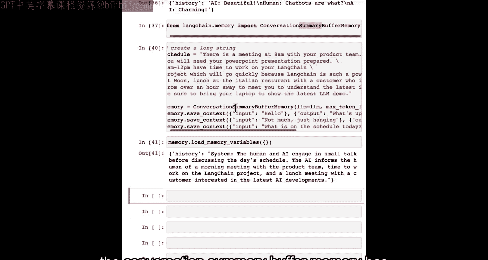

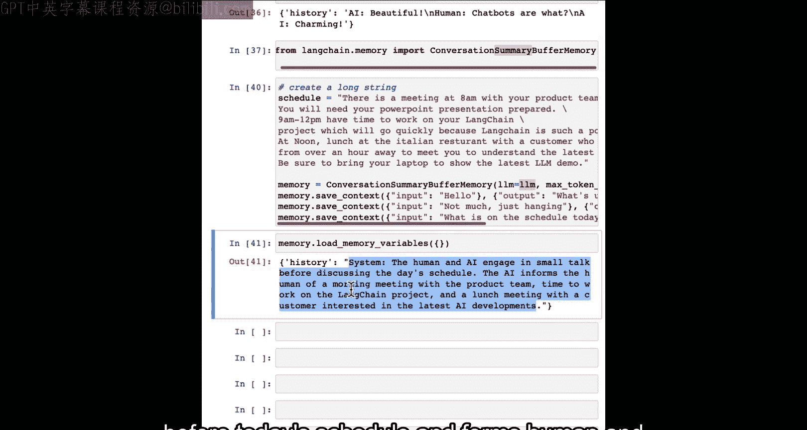

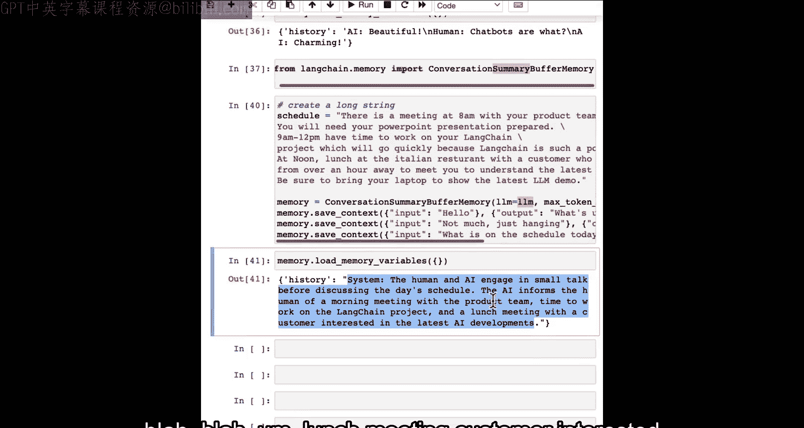

以下是其使用方法：

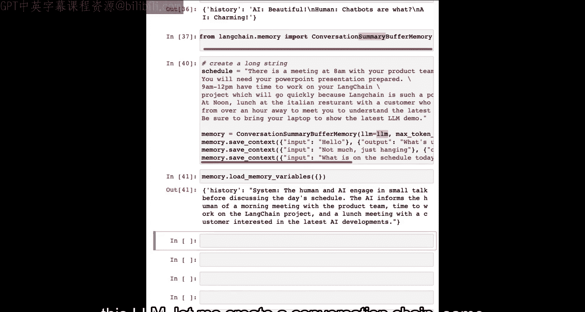

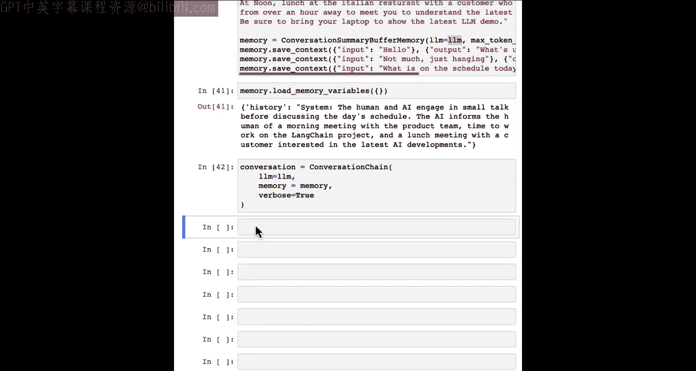

```python
from langchain.memory import ConversationSummaryBufferMemory

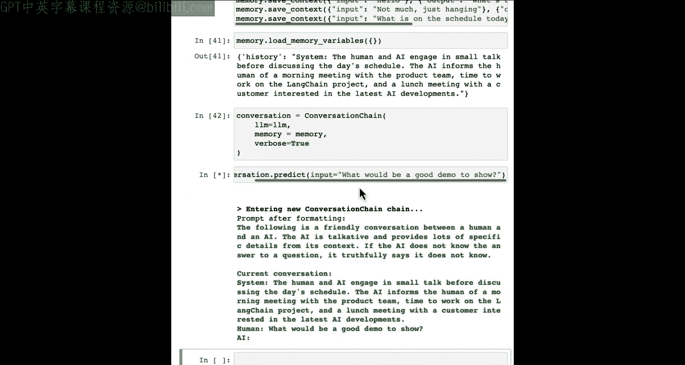

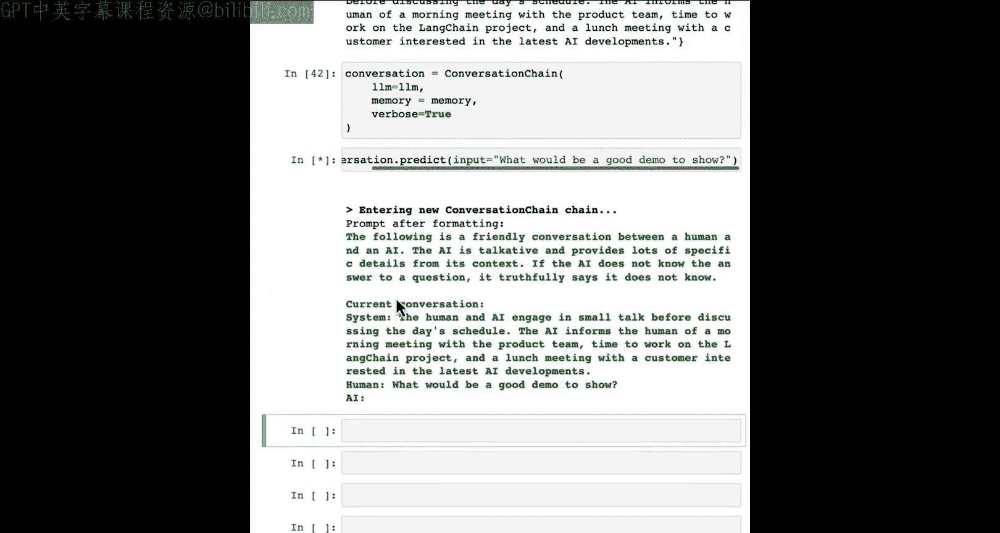

# 创建一个包含长文本的日程
schedule_text = """
早上9点：与产品团队开会。
10点30分：完善PPT演示文稿。
中午12点：在意大利餐厅与客户共进午餐，请带上笔记本电脑展示最新的AI演示。
"""

memory = ConversationSummaryBufferMemory(llm=llm, max_token_limit=100)

# 先进行一些闲聊
memory.save_context({"input": "你好，最近怎么样？"}, {"output": "没什么，就随便逛逛。"})
memory.save_context({"input": "酷。"}, {"output": "是的。"})

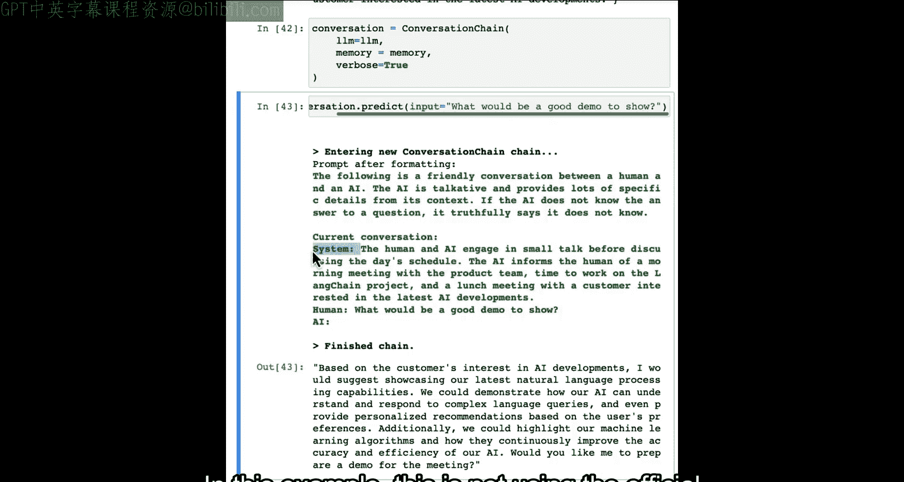

# 然后询问日程
memory.save_context({"input": "今天的日程是什么？"}, {"output": schedule_text})

print(memory.load_memory_variables({}))
# 输出会包含一个由LLM生成的对话摘要，而不是完整的原始长文本。
```

现在，如果我们基于这个记忆创建一个对话链：

```python
conversation = ConversationChain(llm=llm, memory=memory, verbose=True)
response = conversation.predict(input="展示什么演示比较好？")
print(response)
# 模型会根据摘要（提到“午餐会议”、“展示最新AI演示”）来生成相关建议。
```

当 `verbose=True` 时，你会看到发送给LLM的提示词中包含了生成的摘要，而不是全部历史记录。

---

## 其他记忆类型与应用总结

除了上述类型，LangChain还支持更强大的记忆系统：

*   **向量数据库记忆（Vector Data Memory）**：将对话内容转换为向量（嵌入）存储，并能智能检索最相关的历史片段。这适合处理大量信息。
*   **实体记忆（Entity Memory）**：专门用于记忆对话中提到的特定实体（如人物、地点）的详细信息。

在实际应用中，你可以组合多种记忆类型。例如，同时使用 `ConversationSummaryBufferMemory` 来维护对话主线，再配合 `EntityMemory` 来记住关键人物的具体信息。

此外，开发者通常还会将完整的对话记录存储在传统数据库（如键值存储或SQL数据库）中，用于审计或系统改进。

---

本节课中我们一起学习了LangChain中几种核心的记忆（Memory）类型：
1.  **`ConversationBufferMemory`**：保存完整对话历史。
2.  **`ConversationBufferWindowMemory`**：只保存最近K轮对话。
3.  **`ConversationTokenBufferMemory`**：根据令牌数量限制记忆长度。
4.  **`ConversationSummaryBufferMemory`**：在令牌限制内保存原始对话，超出后则使用LLM生成摘要。

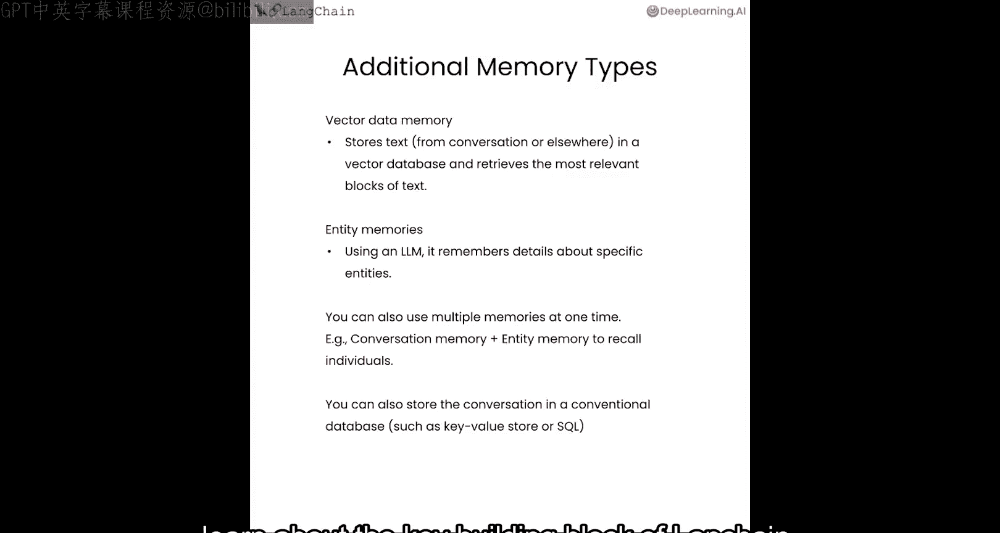

记忆功能是构建连贯、智能对话应用的基础。通过合理选择和使用记忆类型，你可以在保证效果的同时，有效控制上下文长度和API调用成本。现在，让我们进入下一节课，学习LangChain的另一个关键构建块——链（Chains）。