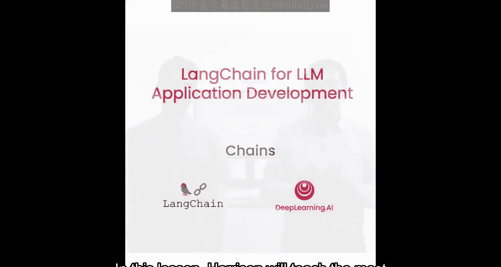
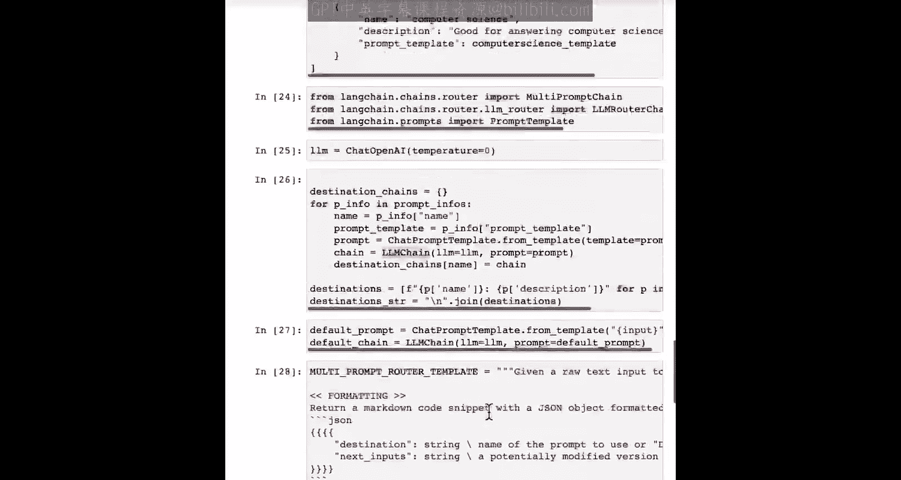
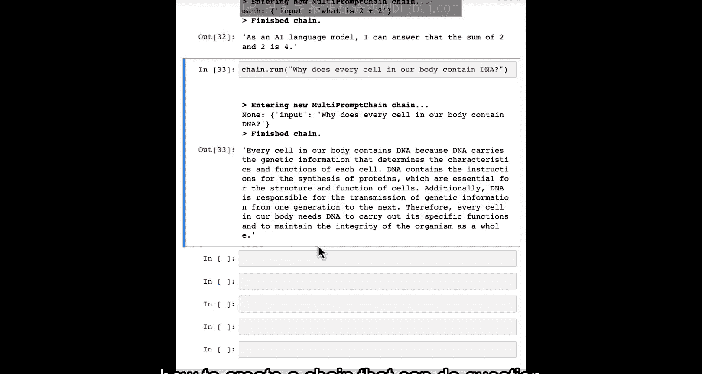

# LangChain应用开发：第4课：链（Chains）详解 🧩



在本节课中，我们将学习LangChain最核心的构建模块——链（Chain）。链能够将大型语言模型（LLM）与提示词（Prompt）组合起来，形成可执行的操作单元。通过将多个链组合，你可以对文本或其他数据执行一系列复杂的处理流程。

---

## 环境与数据准备

上一节我们介绍了LangChain的基础概念，本节中我们来看看如何具体使用链。首先，我们需要加载环境变量和一些示例数据。


```python
# 加载环境变量（例如OpenAI API Key）
from dotenv import load_dotenv
load_dotenv()

# 加载示例数据（一个Pandas DataFrame）
import pandas as pd
df = pd.read_csv('reviews.csv')
```

这个DataFrame包含两列：`product`（产品名称）和`review`（产品评论）。每一行都是一个独立的数据点，我们将用它来演示链的运行。

---

## LLM链：基础构建块

链的最基本形式是LLM链。它简单地将一个语言模型和一个提示词模板组合在一起。

以下是创建和使用LLM链的步骤：

1.  **导入必要的组件**：我们需要语言模型、提示词模板和LLM链本身。
2.  **初始化语言模型**：例如，使用OpenAI的Chat模型。
3.  **创建提示词模板**：定义一个包含变量的模板，用于生成动态提示。
4.  **组合成链**：将模型和模板组合成一个可执行的链。

```python
from langchain.chat_models import ChatOpenAI
from langchain.prompts import ChatPromptTemplate
from langchain.chains import LLMChain

# 1. 初始化语言模型
llm = ChatOpenAI(temperature=0.7)

# 2. 创建提示词模板
prompt = ChatPromptTemplate.from_template(
    “为生产{product}的公司起一个最好的名字是什么？”
)

# 3. 组合成LLM链
chain = LLMChain(llm=llm, prompt=prompt)

# 4. 运行链
result = chain.run(“Queen size sheet set”)
print(result)  # 输出可能是：“Royal Beddings”
```

这个链接收一个产品名称，然后要求LLM为制造该产品的公司起名。你可以尝试输入不同的产品，观察链的输出结果。

---

## 顺序链：串联多个操作

LLM链是基础，但真正的力量在于将多个链按顺序连接起来。顺序链（Sequential Chain）允许你运行一系列链，其中一个链的输出成为下一个链的输入。

### 简单顺序链

当每个子链都只有一个输入和一个输出时，可以使用`SimpleSequentialChain`。

以下是创建两个链并按顺序运行的例子：

```python
from langchain.chains import SimpleSequentialChain

# 第一个链：生成公司名
chain_one = LLMChain(llm=llm, prompt=prompt_company_name)
# 第二个链：生成公司描述
chain_two = LLMChain(llm=llm, prompt=prompt_company_description)

# 组合成简单顺序链
overall_chain = SimpleSequentialChain(chains=[chain_one, chain_two], verbose=True)

# 运行链
result = overall_chain.run(“Queen size sheet set”)
```

运行后，你会先得到公司名（如“Royal Beddings”），然后这个名称会自动作为输入传递给第二个链，生成一段公司描述。

### 通用顺序链

当处理流程涉及多个输入和输出时，需要使用更通用的`SequentialChain`。

以下是一个更复杂的例子，它处理一条产品评论：

```python
from langchain.chains import SequentialChain

# 链1：将评论翻译成英文
translation_chain = LLMChain(llm=llm, prompt=prompt_translate, output_key=“english_review”)
# 链2：总结英文评论
summary_chain = LLMChain(llm=llm, prompt=prompt_summarize, output_key=“summary”)
# 链3：检测原始评论的语言
language_chain = LLMChain(llm=llm, prompt=prompt_detect_language, output_key=“language”)
# 链4：用原始语言生成后续回复
followup_chain = LLMChain(llm=llm, prompt=prompt_followup)

# 定义整体顺序链
overall_chain = SequentialChain(
    chains=[translation_chain, summary_chain, language_chain, followup_chain],
    input_variables=[“review”], # 初始输入变量
    output_variables=[“english_review”, “summary”, “followup_message”], # 希望返回的输出变量
    verbose=True
)

# 运行链
result = overall_chain.run({“review”: “J’adore ces draps! Très confortables.”})
```

在这个例子中，我们处理了一条法语评论。链会依次执行：翻译成英文、总结摘要、检测原语言（法语）、最后用法语生成一个后续回复。**关键在于，每个子链的`input_variables`和`output_key`必须精确匹配**，以确保数据能正确地在链之间传递。

---

## 路由链：智能选择执行路径

有时，你需要根据输入内容的不同，将其路由到不同的专用链进行处理。这时就需要路由链（Router Chain）。

想象一下，你构建了多个链，分别擅长回答物理、数学、历史或计算机科学问题。路由链的作用就是先分析输入的问题，然后决定将其发送给哪个专业链。

以下是实现路由链的步骤：

1.  **定义多个专业提示词模板**：为每个学科创建一个。
2.  **创建目标链**：每个提示词模板对应一个LLM链。
3.  **定义路由提示词模板**：指导LLM如何根据问题内容选择链。
4.  **组装路由链**：使用`MultiPromptChain`和`LLMRouterChain`。

```python
from langchain.chains.router import MultiPromptChain
from langchain.chains.router.llm_router import LLMRouterChain, RouterOutputParser
from langchain.chains.router.multi_prompt_prompt import MULTI_PROMPT_ROUTER_TEMPLATE

# 1. 定义不同学科的提示词模板
prompt_templates = {
    “physics”: “你是一个物理专家。回答物理问题：{input}”,
    “math”: “你是一个数学专家。回答数学问题：{input}”,
    # ... 其他学科
}

# 2. 为目标链提供信息（名称和描述）
destinations = [
    {“name”: “physics”, “description”: “擅长回答物理问题”},
    {“name”: “math”, “description”: “擅长回答数学问题”},
    # ...
]

# 3. 创建目标链和默认链
destination_chains = {}
for p_name, p_template in prompt_templates.items():
    prompt = ChatPromptTemplate.from_template(p_template)
    chain = LLMChain(llm=llm, prompt=prompt)
    destination_chains[p_name] = chain
default_chain = LLMChain(llm=llm, prompt=default_prompt) # 处理其他问题的默认链

# 4. 构建路由链
router_template = MULTI_PROMPT_ROUTER_TEMPLATE.format(destinations=destinations)
router_prompt = ChatPromptTemplate.from_template(router_template)
router_chain = LLMRouterChain.from_llm(llm, router_prompt, output_parser=RouterOutputParser())

# 5. 组合成总的多提示词链
chain = MultiPromptChain(
    router_chain=router_chain,
    destination_chains=destination_chains,
    default_chain=default_chain,
    verbose=True
)

# 使用链
print(chain.run(“什么是黑体辐射？”)) # 应路由到物理链
print(chain.run(“2+2等于几？”)) # 应路由到数学链
print(chain.run(“老虎的生活习性是？”)) # 应路由到默认链
```

当你询问“什么是黑体辐射？”时，路由链会识别出这是一个物理问题，并将其传递给物理专家链来回答。如果问一个生物学问题，由于没有对应的专业链，它会被路由到默认链进行处理。

---



## 总结与应用展望

本节课中我们一起学习了LangChain中“链”这一核心概念。我们从最简单的**LLM链**开始，了解了如何组合模型与提示。接着，我们探索了**顺序链**，它能够将多个LLM链串联，实现复杂的多步处理流程。最后，我们介绍了**路由链**，它能够根据输入内容智能地选择最合适的子链来执行任务。

这些链是构建复杂LLM应用的基石。掌握了它们，你就已经具备了将简单模块组合成强大工作流的能力。在接下来的课程中，我们将利用这些链，学习如何创建一个能够对你自己的文档进行问答的系统。



---
**核心概念回顾**：
*   **LLM链**：`LLMChain(llm, prompt)`
*   **简单顺序链**：`SimpleSequentialChain(chains=[chain1, chain2])`
*   **通用顺序链**：`SequentialChain(chains=[...], input_variables=[...], output_variables=[...])`
*   **路由链**：`MultiPromptChain(router_chain, destination_chains, default_chain)`