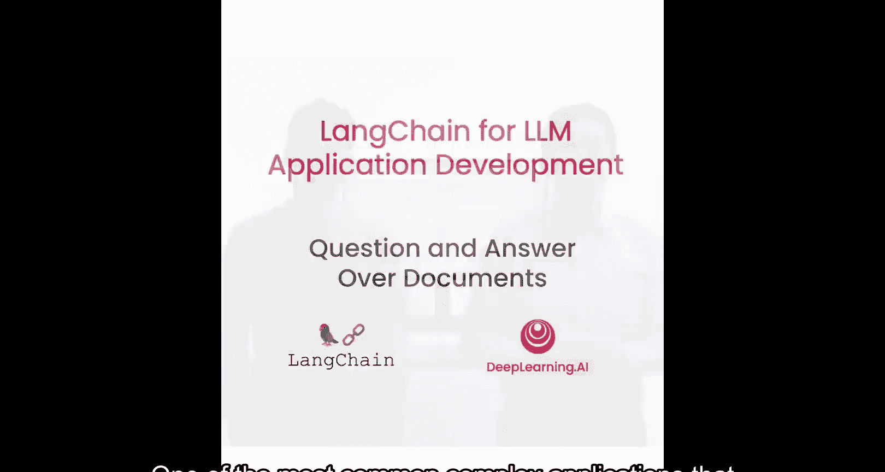
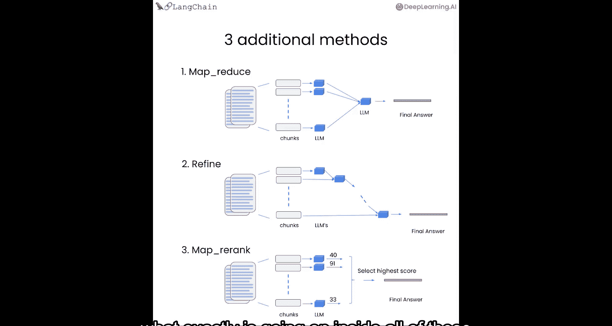

# LangChain应用开发：4：基于文档的问答系统

在本节课中，我们将要学习如何使用LangChain构建一个强大的应用：基于文档的问答系统。这种系统能够读取并理解您提供的文档（如PDF、网页或公司内部文件），然后像专家一样回答关于文档内容的问题。这极大地扩展了语言模型的能力，使其能够处理其训练数据之外的信息。

## 概述：文档问答系统的核心价值

人们使用大语言模型构建的最常见的复杂应用之一，就是能够基于文档或关于文档回答问题的系统。

给定一段可能从PDF文件、网页或某些公司内部文档集合中提取的文本，您可以使用语言模型来回答关于这些文档内容的问题。用户希望通过这种方式获得更深入的理解，并获取所需的信息。

这非常强大，因为它开始将这些语言模型与它们最初未经训练的数据结合起来，从而使它们对您的用例更加灵活和适应。

这也非常令人兴奋，因为我们将开始超越语言模型、提示词和输出解析器，并开始引入LangChain中一些更关键的组件，例如嵌入模型和向量数据库。

正如Andrew所提到的，这是我们目前最受欢迎的主题之一。

事实上，嵌入和向量数据库是一些最强大的现代技术。如果您还没有接触过它们，它们非常值得学习。那么，让我们开始吧。

## 快速上手：构建一个简单的问答链

我们将从导入环境变量开始，这是我们一贯的做法。

现在，我们将导入一些在构建这个链时会用到的组件。

我们将导入 `RetrievalQA` 链。这个链将在一些文档上进行检索。

我们将导入我们最喜欢的 `ChatOpenAI` 语言模型。

我们将导入一个文档加载器。这将用于加载一些专有数据，我们将把这些数据与语言模型结合。在本例中，数据将在一个CSV文件中。因此，我们将导入 `CSVLoader`。

最后，我们将导入一个向量数据库。向量数据库有很多不同的类型，我们稍后会详细解释它们是什么。但我们将从一个内存中的 `DocArrayInMemorySearch` 向量数据库开始。这非常好，因为它是一个内存中的向量数据库，不需要连接任何外部数据库，因此非常容易上手。

我们还将导入 `display` 和 `Markdown`，这是在Jupyter笔记本中显示信息的常用工具。

我们提供了一个户外服装的CSV文件，将用它来与语言模型结合。

在这里，我们将用一个指向该文件的路径来初始化一个加载器，即 `CSVLoader`。

接下来，我们将导入一个索引创建器，即 `VectorstoreIndexCreator`，这将帮助我们非常容易地创建一个向量数据库。

正如我们在下面看到的，只需要几行代码就能创建它。

要创建这个索引，我们需要指定两件事。首先，我们将指定向量数据库类。如前所述，我们将使用这个向量数据库，因为它特别容易上手。

创建之后，我们可以调用 `from_loaders` 方法，它接收一个文档加载器列表。我们只有一个真正关心的加载器，所以这就是我们传入的内容。

现在它已经创建好了，我们可以开始向它提问了。

下面我们将介绍底层到底发生了什么，所以现在先不用担心。

这里我们将从一个查询开始，然后使用 `index.query` 创建响应，并传入这个查询。

同样，我们稍后会介绍底层发生了什么，现在只需等待它响应。

完成后，我们现在可以看看它到底返回了什么。我们得到了一个Markdown格式的表格，列出了所有具有防晒功能的衬衫的名称和描述。

我们还得到了语言模型提供的一个很好的小总结。

## 深入原理：嵌入与向量数据库

我们已经介绍了如何对文档进行问答，但底层到底发生了什么？

首先，让我们思考一下总体思路：我们希望使用语言模型并将其与我们的许多文档结合起来。但有一个关键问题：语言模型一次只能检查几千个单词。所以，如果我们有非常大的文档，我们如何让语言模型回答关于其中所有内容的问题？

这就是嵌入和向量数据库发挥作用的地方。

首先，我们来谈谈嵌入。

嵌入为文本片段创建数值表示。这种数值表示捕获了它所处理的文本片段的语义含义。内容相似的文本片段将具有相似的向量。这让我们可以在向量空间中比较文本片段。

在下面的例子中，我们可以看到有三个句子。前两个是关于宠物的，而第三个是关于汽车的。如果我们查看它们在数值空间中的表示，我们可以看到，当比较关于宠物的两个句子的文本片段对应的向量时，它们非常相似；而当我们将其与谈论汽车的句子进行比较时，它们一点也不相似。这将让我们很容易地找出哪些文本片段彼此相似，当我们思考在传递给语言模型回答问题时希望包含哪些文本片段时，这将非常有用。

接下来我们要介绍的组件是向量数据库。向量数据库是存储我们在上一步中创建的向量表示的一种方式。

我们创建这个向量数据库的方法是，用来自传入文档的文本块来填充它。当我们收到一个大的传入文档时，我们首先会将其分解成更小的块。这有助于创建比原始文档更小的文本片段，这很有用，因为我们可能无法将整个文档传递给语言模型，所以我们希望创建这些小块，以便只将最相关的块传递给语言模型。

然后，我们为每个块创建一个嵌入，并将它们存储在向量数据库中。这就是我们创建索引时发生的事情。

现在我们已经有了这个索引，我们可以在运行时使用它来查找与传入查询最相关的文本片段。当查询到来时，我们首先为该查询创建一个嵌入。然后，我们将其与向量数据库中的所有向量进行比较，并选择最相似的n个。这些被返回后，我们可以将它们放入提示词中传递给语言模型，以获得最终答案。

## 分步构建：理解底层细节

上面我们用几行代码创建了这个链，这对于快速上手来说很棒，但现在让我们更逐步地来做，并理解底层到底发生了什么。

第一步与上面类似，我们将创建一个文档加载器，从那个包含我们想要进行问答的所有产品描述的CSV文件中加载数据。

然后，我们可以从这个文档加载器中加载文档。如果我们查看单个文档，可以看到每个文档对应CSV中的一个产品。

之前我们讨论过创建块，因为这些文档已经很小了，我们实际上不需要在这里做任何分块，所以我们可以直接创建嵌入。

要创建嵌入，我们将使用OpenAI的嵌入类。我们可以在这里导入并初始化它。

如果我们想看看这些嵌入是做什么的，实际上可以看看当我们嵌入一个特定的文本片段时会发生什么。

让我们在嵌入对象上使用 `embed_query` 方法，为一个特定的文本片段（例如句子“Hi, my name is Harrison”）创建一个嵌入。如果我们查看这个嵌入，可以看到有超过一千个不同的元素。每个元素都是一个不同的数值。结合起来，这就为这个文本片段创建了整体的数值表示。

我们希望为我们刚刚加载的所有文本片段创建嵌入，然后我们也希望将它们存储在向量数据库中。我们可以通过在向量数据库上使用 `from_documents` 方法来实现。这个方法接收一个文档列表和一个嵌入对象，然后会创建一个整体的向量数据库。

我们现在可以使用这个向量数据库来查找与传入查询相似的文本片段。

让我们看看查询：“please suggest a shirt with sun blocking”。如果我们在向量数据库上使用 `similarity_search` 方法并传入查询，我们将得到一个文档列表。我们可以看到它返回了四个文档，如果我们看第一个，可以看到它确实是一件关于防晒的衬衫。

## 组装问答链：从检索到生成

那么，我们如何使用它来对我们自己的文档进行问答呢？

首先，我们需要从这个向量数据库创建一个检索器。检索器是一个通用接口，可以由任何接收查询并返回文档的方法支持。向量数据库和嵌入就是这样一种方法，尽管还有许多不同的方法，有些比较简单，有些更高级。

接下来，因为我们想要进行文本生成并返回一个自然语言响应，我们将导入一个语言模型，并使用 `ChatOpenAI`。

如果我们手动操作，我们会这样做：将文档合并成一个单一的文本片段。所以我们会做类似这样的事情，将所有文档中的页面内容重新连接到一个变量中。然后，我们会将这个变量（或问题的变体，例如“请用Markdown表格列出所有具有防晒功能的衬衫，并总结每一件”）传递给语言模型。

如果我们在这里打印出响应，可以看到我们得到了一个完全符合要求的表格。

所有这些步骤都可以用LangChain链来封装。所以在这里，我们可以创建一个 `RetrievalQA` 链。这个链进行检索，然后对检索到的文档进行问答。

要创建这样一个链，我们需要传入几个不同的东西：首先，我们将传入语言模型。这将用于在最后进行文本生成。接下来，我们将传入链类型。我们将使用 `stuff`。这是最简单的方法，因为它只是将所有文档塞入上下文，并对语言模型进行一次调用。还有其他一些方法可以用来进行问答，我可能在最后会提到，但我们不会详细讨论。第三，我们将传入一个检索器。我们上面创建的检索器只是一个用于获取文档的接口。这将用于获取文档并将其传递给语言模型。最后，我们将设置 `verbose=True`。

现在我们可以创建一个查询，并在这个查询上运行这个链。当我们得到响应时，可以再次使用 `display` 和 `Markdown` 工具来显示它。

您可以在这里暂停视频，尝试使用一堆不同的查询。

## 方法对比：Stuff, MapReduce, Refine, MapRerank

这就是详细的操作方法，但请记住，我们仍然可以用上面那一行代码轻松地完成。所以这两件事是等效的，这也是LangChain有趣的部分之一：您可以用一行代码完成，也可以查看各个组件并将其分解为五个更详细的步骤。更详细的五个步骤让您可以更具体地设置到底发生了什么，但一行代码更容易上手。至于您更喜欢哪种方式，取决于您自己。

我们也可以在创建索引时对其进行自定义。如果您记得我们手动创建时指定了一个嵌入，我们也可以在这里指定一个嵌入。这将使我们在嵌入本身的创建方式上具有灵活性。我们也可以在这里将向量数据库换成其他类型的向量数据库。所以，当您手动创建时拥有的相同级别的自定义，在这里创建索引时也同样可用。

我们在这个笔记本中使用了 `stuff` 方法。`stuff` 方法非常好，因为它非常简单。您只需将所有内容放入一个提示词中，发送给语言模型，然后得到一个响应。所以很容易理解发生了什么，成本相当低，而且效果很好。

但这并不总是有效。如果您还记得，当我们在笔记本中获取文档时，我们只得到了四个文档，而且它们相对较小。但是，如果您想对许多不同类型的块进行相同类型的问答呢？那么我们可以使用几种不同的方法。

第一种是 `map_reduce`。这基本上是将所有块与问题一起传递给语言模型，得到响应，然后使用另一个语言模型调用来将所有单独的响应总结成一个最终答案。这非常强大，因为它可以处理任意数量的文档。它也非常强大，因为您可以并行处理各个问题。但它确实需要更多的调用，并且它将所有文档视为独立的，这可能并不总是最理想的情况。

`refine` 是另一种方法。它再次用于遍历许多文档，但实际上是迭代进行的。它基于前一个文档的答案进行构建。因此，这对于组合信息和随时间构建答案非常有用。它通常会导致更长的答案，而且速度也不那么快，因为现在的调用不是独立的，它们依赖于先前调用的结果。这意味着它通常需要更长的时间，并且基本上与 `map_reduce` 一样多的调用。

`map_rerank` 是一个非常有趣且更具实验性的方法，您为每个文档对语言模型进行一次调用，并要求它返回一个分数，然后选择最高分。这依赖于语言模型知道分数应该是什么，所以您经常需要告诉它：“嘿，如果它与文档相关，就应该是一个高分”，并真正细化那里的指令。与 `map_reduce` 类似，所有调用都是独立的，因此您可以批量处理它们，速度相对较快。但同样，您需要进行一堆语言模型调用，所以成本会更高一些。

这些方法中最常用的是 `stuff` 方法，我们在笔记本中用它将所有内容合并到一个文档中。第二常用的是 `map_reduce` 方法，它将这些块发送给语言模型。

这里的方法，`stuff`、`map_reduce`、`refine` 和 `map_rerank`，也可以用于许多其他链，而不仅仅是问答。例如，`map_reduce` 链的一个非常常见的用例是摘要，当您有一个非常长的文档，并且想要递归地总结其中的信息片段时。

## 总结

本节课中我们一起学习了如何使用LangChain构建基于文档的问答系统。我们首先概述了这种系统的价值，然后快速上手构建了一个简单的问答链。接着，我们深入探讨了其核心原理：嵌入模型如何将文本转化为数值向量，以及向量数据库如何高效存储和检索这些向量。通过分步构建，我们理解了从文档加载、分块、嵌入、存储到检索和生成的完整流程。最后，我们对比了 `stuff`、`map_reduce`、`refine` 和 `map_rerank` 这几种不同的文档处理策略及其适用场景。

正如您可能已经注意到的，我们在这里的不同链中涉及了很多内容，因此在下一节中，我们将介绍更好地理解所有这些链内部到底发生了什么的方法。

