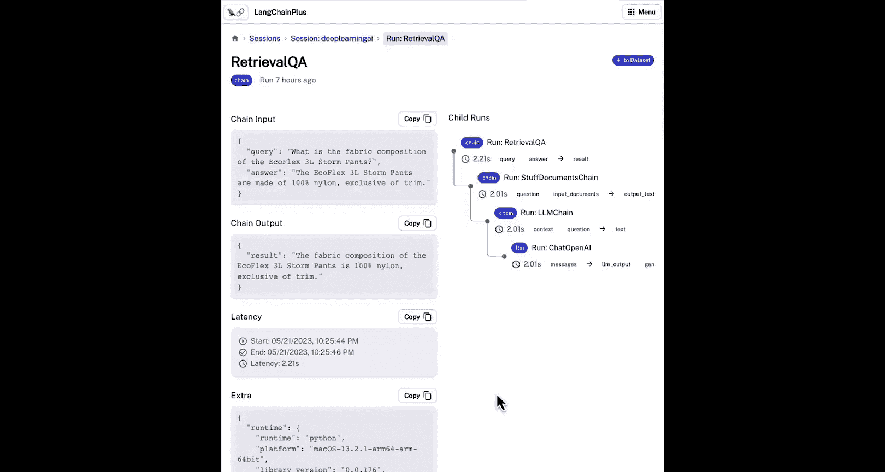

# LangChain for LLM Application Development： 6： 评估LLM应用 📊

在本节课中，我们将学习如何评估基于大语言模型（LLM）构建的复杂应用程序。评估是开发流程中至关重要但有时颇具挑战性的一环，它帮助我们判断应用是否满足准确性标准，并在修改实现（如更换模型、调整检索策略）后，确认改动是优化还是劣化。Harrison将深入探讨评估LLM应用的框架与工具。

这些应用本质上是多个不同步骤组成的链条。因此，首要任务是理解每个步骤的输入与输出。部分工具可视为可视化器或调试器。然而，为了更全面地了解模型在大量数据点上的表现，除了人工检查，一个非常酷的思路是利用语言模型自身来评估其他语言模型、链及应用。随着开发模式向提示工程转变，整个评估流程也在被重新思考。本节包含许多激动人心的概念，让我们开始吧。

## 设置评估环境 🛠️

首先，我们需要一个待评估的链或应用。我们将使用上一课中的文档问答链。

以下是设置步骤：
1.  导入所有必需的库。
2.  加载之前使用的相同数据。
3.  用一行代码创建索引。
4.  通过指定语言模型、链类型、检索器和详细程度来创建检索式QA链。

```python
# 示例代码：创建检索式QA链
from langchain.chains import RetrievalQA
from langchain.llms import ChatOpenAI

# 假设已加载文档并创建向量存储索引
retriever = vectorstore.as_retriever()
llm = ChatOpenAI(temperature=0)
qa_chain = RetrievalQA.from_chain_type(
    llm=llm,
    chain_type="stuff",
    retriever=retriever,
    return_source_documents=True,
    verbose=True  # 开启详细输出以观察内部流程
)
```

现在，我们有了待评估的应用。接下来，需要确定用于评估的数据点。

## 创建评估数据集 📝

我们将介绍几种创建评估数据的方法。第一种最简单，即手动构思我们认为优质的示例。

我们可以浏览部分数据，根据文档内容构思问题及其对应的真实答案（ground truth）。例如，从关于“Cozy Comfort Pullover Set”的文档中，可以提出问题：“Does the Cozy Comfort Pullover Set have side pockets?”，其真实答案是“Yes”。

然而，手动方法扩展性不佳。有没有办法自动化这个过程呢？

一个非常酷的自动化方法是利用语言模型自身。LangChain提供了`QA生成链`，它能接收文档并自动为每篇文档生成问答对。

以下是使用语言模型生成评估示例的步骤：
1.  导入`QAGenerationChain`。
2.  通过传入ChatOpenAI语言模型来创建此链。
3.  使用`apply_and_parse`方法处理文档，以获取结构化的问答对字典。

```python
# 示例代码：使用语言模型生成问答对
from langchain.evaluation.qa import QAGenerationChain

qa_generation_chain = QAGenerationChain.from_llm(ChatOpenAI())
example_pairs = qa_generation_chain.apply_and_parse(docs)
```

这样，我们就快速生成了一批问答对，节省了大量时间。接下来，可以将这些生成的示例与我们手动创建的示例合并，形成最终的评估数据集。

## 调试与检查单个输入 🔍

在评估整个数据集之前，先运行一个示例并观察其输出是有益的。但仅看最终答案通常不足以理解链中可能出错的地方。

为了帮助调试，LangChain提供了`langchain.debug`设置。将其设为`True`后重新运行链，会打印出大量内部信息，例如：
*   进入`RetrievalQA`链和`StuffDocuments`链的流程。
*   传递给语言模型的完整提示词（包括系统消息和上下文）。
*   检索到的具体文档内容。
*   令牌使用情况（对应成本）。

这对于诊断问题至关重要，因为错误往往源于检索步骤而非语言模型本身。

```python
# 开启调试模式
import langchain
langchain.debug = True

# 运行链，将看到详细的内部步骤输出
result = qa_chain.run("Does the Cozy Comfort Pullover Set have side pockets?")
```

观察这些细节，例如问题与上下文的匹配度，能有效帮助定位问题所在。

## 批量评估与语言模型评分 🧪

上一节我们介绍了如何调试单个查询。本节中，我们来看看如何对我们创建的所有示例进行批量评估。

手动为每个示例运行链并判断对错非常繁琐。我们再次请出语言模型来帮忙。

首先，需要为所有示例生成预测答案（关闭调试模式以避免输出混乱）。然后，导入`QAEvalChain`，它使用一个语言模型来评估预测答案的质量。

以下是评估流程：
1.  为数据集中的所有示例生成预测答案。
2.  创建`QAEvalChain`。
3.  调用其`evaluate`方法，传入示例（含真实答案）和预测答案。
4.  遍历返回的评分结果进行分析。

```python
# 示例代码：使用语言模型进行批量评估
from langchain.evaluation.qa import QAEvalChain

# 1. 为所有示例生成预测
predictions = []
for example in evaluation_dataset:
    pred = qa_chain.run(example["query"])
    predictions.append(pred)

# 2. 创建评估链
eval_chain = QAEvalChain.from_llm(ChatOpenAI())

# 3. 进行评估
graded_outputs = eval_chain.evaluate(
    examples=evaluation_dataset,  # 包含'query'和'answer'的字典列表
    predictions=predictions
)

# 4. 分析结果
for i, (example, grade) in enumerate(zip(evaluation_dataset, graded_outputs)):
    print(f"问题 {i+1}: {example['query']}")
    print(f"真实答案: {example['answer']}")
    print(f"预测答案: {predictions[i]}")
    print(f"评分: {grade['text']}")  # 通常是 'CORRECT' 或 'INCORRECT'
    print("-" * 50)
```

使用语言模型进行评估至关重要，因为真实答案和预测答案可能是不问形式的文本字符串。例如，真实答案是“Yes”，而预测答案可能是“The Cozy Comfort Pullover Set does have side pockets”。传统的字符串精确匹配或正则表达式无法判断其语义一致性，而语言模型可以理解其含义并给出正确评分。这正是评估语言模型开放文本生成任务的难点与创新点。

## LangChain评估平台 🌐

最后，我想向你展示LangChain评估平台。它能将我们在Notebook中做的所有工作持久化并在UI中展示。

在平台上，你可以：
*   **追踪运行记录**：查看所有链调用的高级别输入和输出。
*   **可视化调试信息**：以更友好的UI形式展示开启调试模式时的详细信息，允许你逐步深入查看链中每一步的输入输出。
*   **构建数据集**：可以直接从运行结果中将示例（查询和输出）添加到数据集中，便于持续积累评估用例。

这为持续评估和构建评估数据飞轮提供了一个非常强大的工具。

---

**本节课总结**

本节课中，我们一起学习了评估LLM应用的完整流程：
1.  **设置评估环境**，创建待评估的问答链。
2.  **构建评估数据集**，结合手动创建和利用`QAGenerationChain`自动生成问答对。
3.  **使用`langchain.debug`进行单步调试**，深入理解链的内部运作和潜在问题点。
4.  **利用`QAEvalChain`进行批量自动化评估**，依靠语言模型理解语义的能力来评分，克服了传统字符串匹配的局限。
5.  **介绍LangChain评估平台**，它将评估工作流程可视化、持久化，便于团队协作和长期追踪。




通过掌握这些评估方法和工具，你可以更科学地衡量应用性能，并在迭代优化中做出数据驱动的决策。