# LangChain for LLM Application Development：7：Agents 🧠

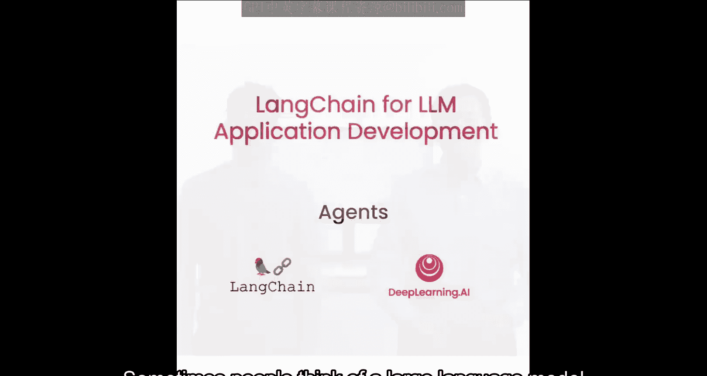

在本节课中，我们将要学习LangChain中一个强大且前沿的概念——Agents（智能体）。我们将了解如何将大型语言模型视为一个“推理引擎”，并利用Agents框架让它连接外部工具和数据源，以完成更复杂的任务。

---

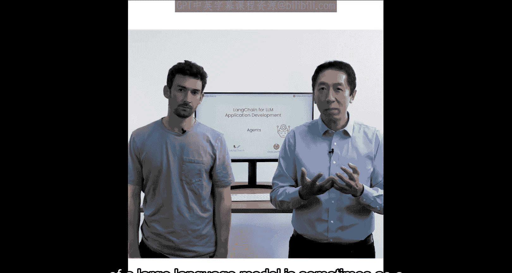


## 概述：将LLM视为推理引擎

有时人们将大型语言模型视为一个知识库，因为它从互联网上学习并记住了大量信息，因此当你提问时，它可以回答问题。

但我认为，一个更有用的方式是将大型语言模型视为一个**推理引擎**。你可以给它提供文本块或其他信息来源，然后大型语言模型可能会利用其从互联网学到的背景知识，但更重要的是，它会使用你提供的新信息来帮助你回答问题、推理内容，甚至决定下一步该做什么。这正是LangChain的Agents框架帮助你实现的功能。

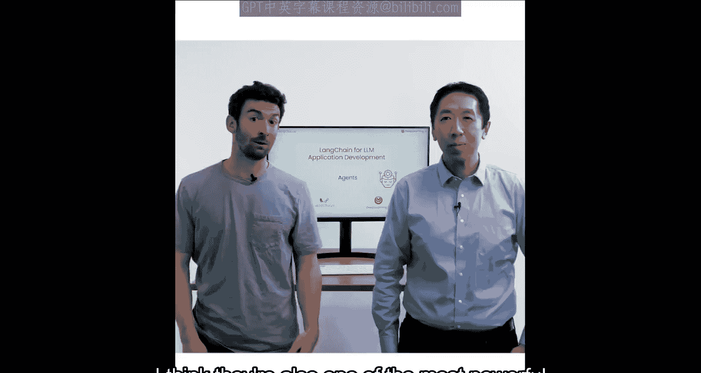


---

## 为什么Agents如此强大？✨

Agents可能是我在LangChain中最喜欢的部分，它们也是最强大的组件之一，同时也是较新的部分。我们正在见证该领域许多全新内容的涌现，因此这将是非常激动人心的一课。

我们将深入探讨什么是Agents、如何创建和使用Agents、如何为它们配备不同类型的工具（例如LangChain内置的搜索引擎），以及如何创建你自己的工具，以便让Agents能够与你希望的任何数据存储、API或函数进行交互。这是激动人心的前沿技术，并且已经涌现出重要的应用案例。

---

## 实践：构建你的第一个Agent 🛠️

上一节我们介绍了Agents的核心概念，本节中我们来看看如何实际构建一个Agent。

以下是构建和运行一个Agent的基本步骤：

1.  **设置环境与导入**
    首先，我们需要设置环境变量并导入后续将使用的一系列模块。

2.  **初始化语言模型**
    我们将使用ChatOpenAI模型，并**将温度（temperature）设置为0**。这很重要，因为我们将把语言模型用作Agent的推理引擎，它会连接到其他数据源和计算工具。我们希望这个推理引擎尽可能优秀和精确，因此设置为0以消除任何可能出现的随机性。

    ```python
    from langchain.chat_models import ChatOpenAI
    llm = ChatOpenAI(temperature=0)
    ```

3.  **加载工具**
    我们将加载两个工具：`LLMMathTool`和`Wikipedia`工具。
    *   `LLMMathTool`本身是一个链（Chain），它结合语言模型和计算器来解决数学问题。
    *   `Wikipedia`工具是一个连接维基百科的API，允许你运行搜索查询并获取结果。

    ```python
    from langchain.agents import load_tools
    tools = load_tools(["llm-math", "wikipedia"], llm=llm)
    ```

4.  **初始化Agent**
    我们将使用工具、语言模型和指定的Agent类型来初始化一个Agent。这里我们使用`chat-zero-shot-react-description`。
    *   `chat`：表示这是一个为聊天模型优化过的Agent。
    *   `zero-shot-react-description`：这是一种提示技术，旨在从语言模型中获取最佳推理性能。
    我们还将传入`handle_parsing_errors=True`，这在语言模型输出无法被解析为“动作”和“动作输入”时非常有用。发生这种情况时，我们会将格式错误的文本传回给语言模型，要求它自行纠正。
    最后，设置`verbose=True`，这将在Jupyter笔记本中打印出大量步骤，让我们清楚地了解发生了什么。

    ```python
    from langchain.agents import initialize_agent
    agent = initialize_agent(
        tools,
        llm,
        agent="chat-zero-shot-react-description",
        handle_parsing_errors=True,
        verbose=True
    )
    ```

---

## 运行示例：数学与维基百科查询 🔍

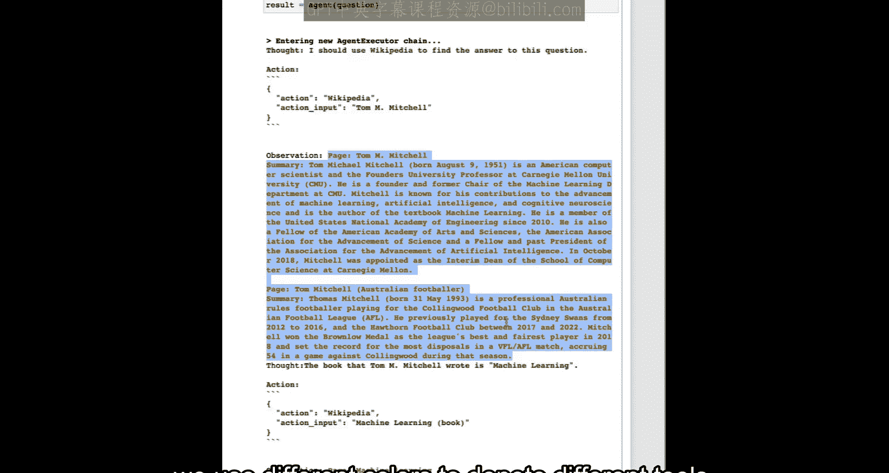

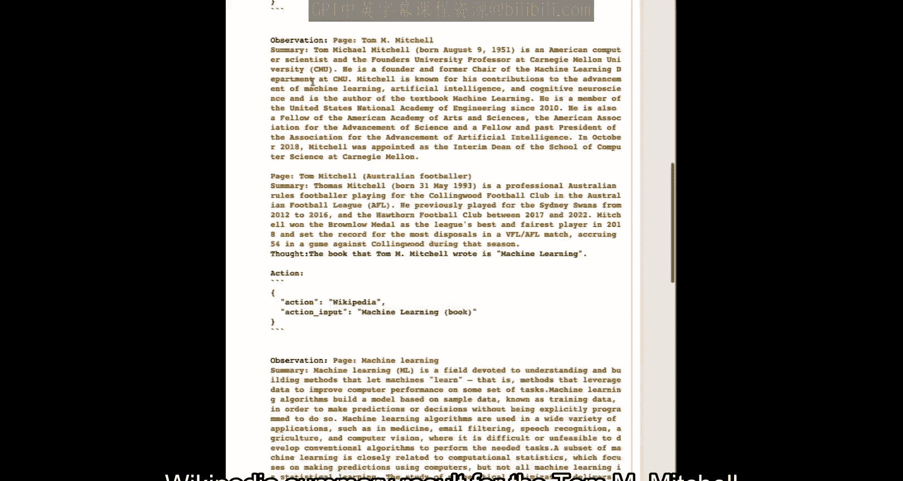

现在我们已经初始化了Agent，让我们通过几个例子来看看它是如何工作的。

### 示例1：数学问题

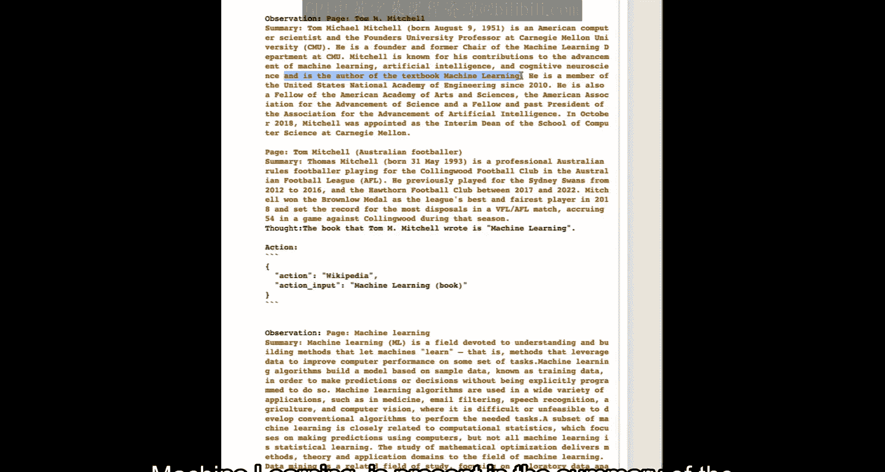

首先，我们问Agent一个数学问题：“300的25%是多少？”。这是一个简单的问题，但有助于我们理解具体发生了什么。

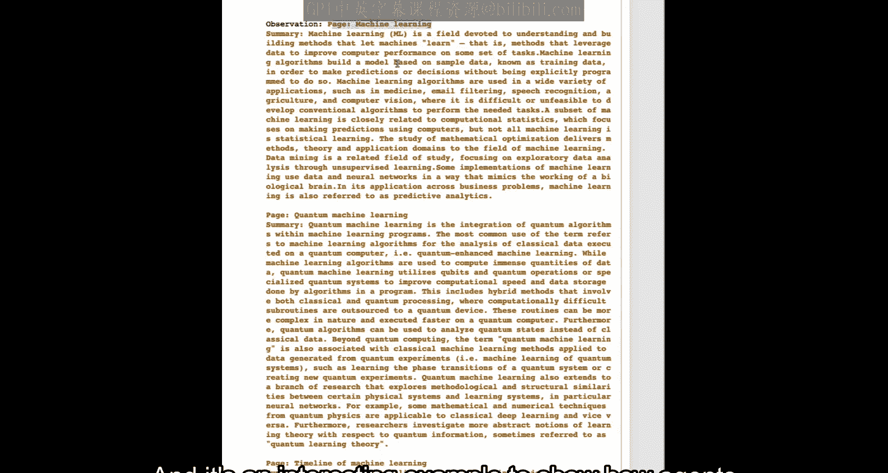

```python
agent.run("What is 25% of 300?")
```

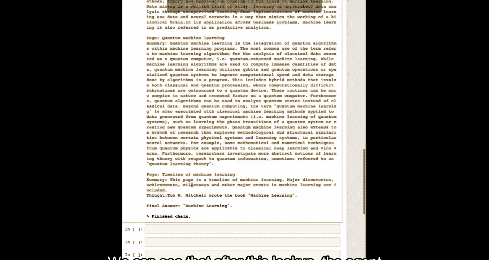

运行后，在详细输出中，你可以看到：
1.  **思考（Thought）**：Agent首先思考它需要做什么。
2.  **动作（Action）**：这是一个JSON块，对应两个部分：`action`（使用的工具，这里是“Calculator”）和`action_input`（工具的输入，这里是字符串“300 * 0.25”）。
3.  **观察（Observation）**：来自计算器工具的结果“Answer: 75.0”。
4.  **最终答案（Final Answer）**：语言模型根据观察得出结论，输出“75.0”。

这是一个很好的时机，你可以暂停并尝试自己的不同数学问题。

### 示例2：维基百科查询

接下来，我们使用维基百科API来查询信息。我们问一个关于Tom Mitchell的问题。

```python
agent.run("Tom Mitchell wrote a book called Machine Learning. What is that book about?")
```

运行后，观察中间步骤：
1.  Agent思考后，正确意识到应该使用维基百科工具。
2.  动作是使用“Wikipedia”，输入是“Tom M. Mitchell”。
3.  观察结果返回了维基百科上两个名为“Tom M. Mitchell”的页面摘要（一位是计算机科学家，另一位是澳大利亚足球运动员）。所需信息（他写的书名《Machine Learning》）出现在第一位Thomas M. Mitchell的摘要中。
4.  有趣的是，Agent随后尝试查找更多关于这本书的信息（查找“machine learning book”），这并非绝对必要，但它展示了Agent目前还并非完全可靠。
5.  在这次查找之后，Agent认识到它已拥有回答问题所需的所有信息，并给出了正确答案。

---

## 进阶：创建代码执行Agent 💻

上一节我们使用了内置工具，本节中我们来看看如何创建一个可以编写和执行代码的Agent，类似于GitHub Copilot或启用了代码解释器插件的ChatGPT。

我们将创建一个Python Agent，并赋予它一个`PythonREPLTool`工具。REPL（读取-求值-输出循环）可以看作是一个交互式代码环境，类似于Jupyter笔记本。Agent可以用它执行代码，获取结果，然后根据结果决定下一步行动。

我们要解决的问题是：给定一个名字列表，让Agent按姓氏然后名字排序，并打印输出。

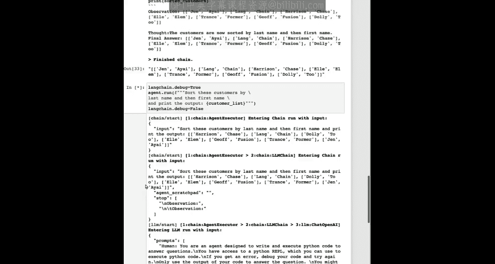

```python
from langchain.agents import load_tools
python_tools = load_tools(["python_repl"])
python_agent = initialize_agent(
    python_tools,
    llm,
    agent="chat-zero-shot-react-description",
    verbose=True
)

names = ["Harrison Chase", "Lane Chain", "LLM", "Jeff Fusion", "Transformer", "Gen AI"]
python_agent.run(f"Sort these customers by last name and then first name and print the output: {names}")
```

运行后，我们可以看到：
1.  Agent意识到它需要使用`sorted`函数。
2.  动作是使用“Python REPL”，输入是一段代码：首先创建变量列出客户名，然后排序，最后遍历并打印。
3.  观察结果是打印出的排序后的名字列表。
4.  Agent意识到任务完成，返回最终结果。

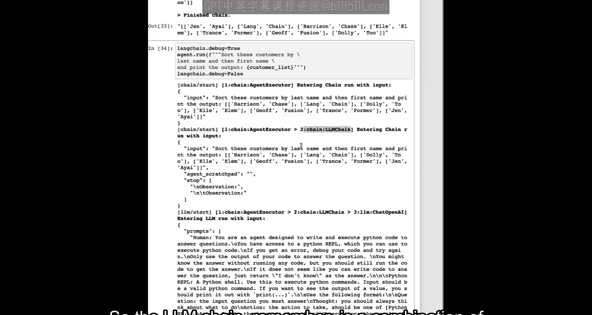

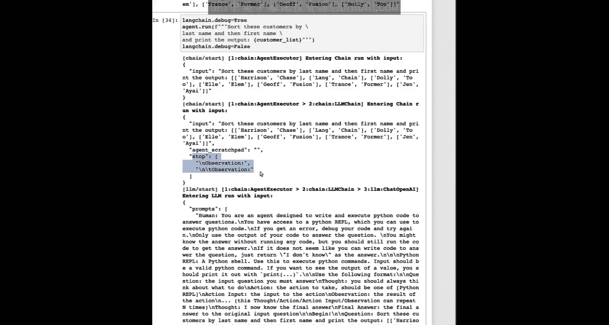

---

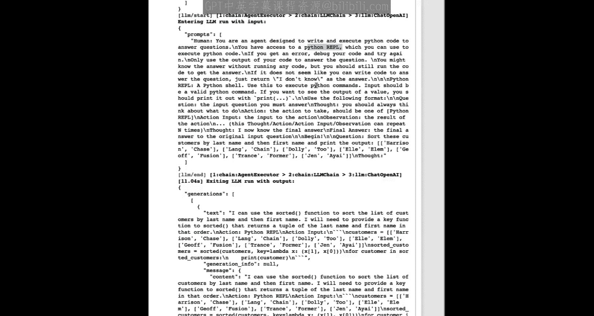

## 深入调试：理解Agent的内部运作 🕵️♂️

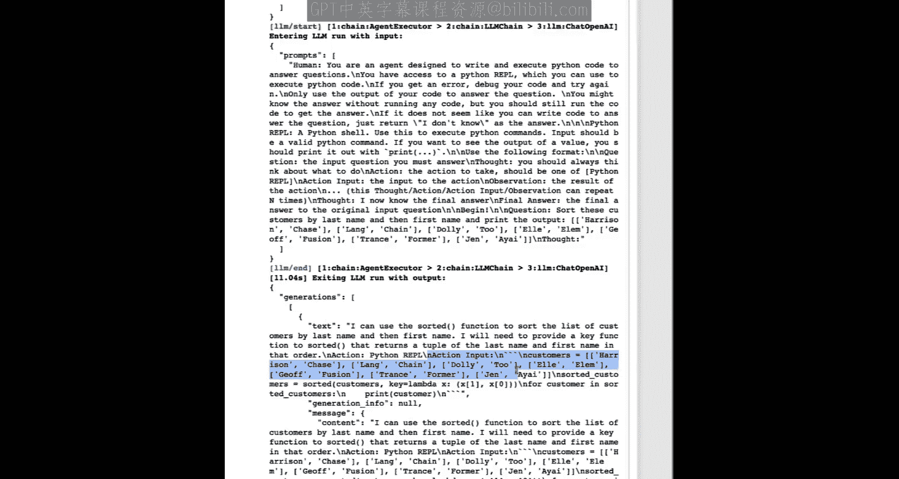

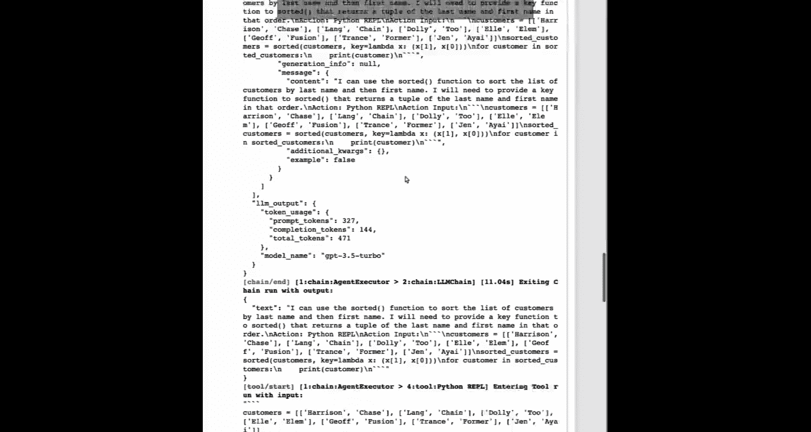

为了更深入地了解幕后发生的事，我们可以将LangChain的调试模式设置为`True`。这将打印出所有不同链层级上发生的详细信息。

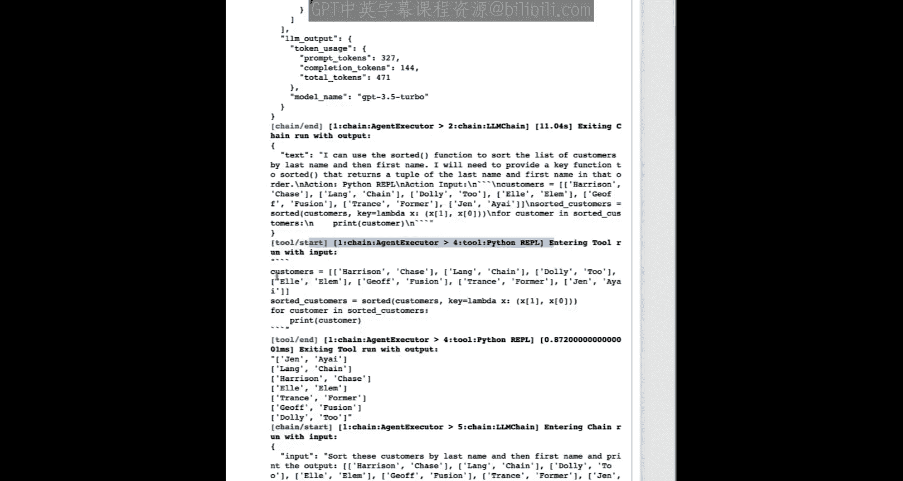

```python
import langchain
langchain.debug = True
# 再次运行上面的Python Agent示例
```

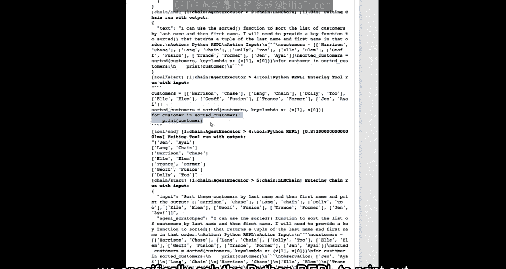

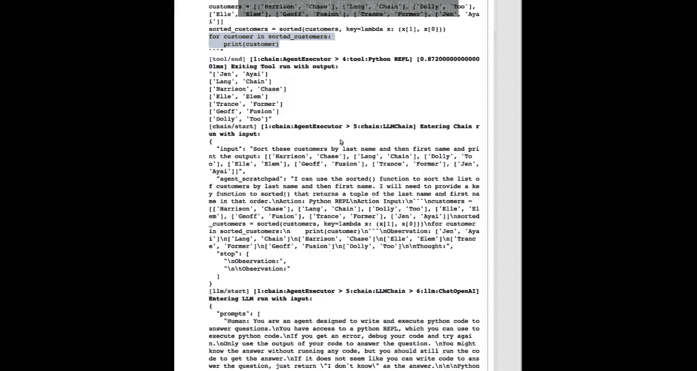

在调试输出中，我们可以看到：
1.  **Agent执行器（Agent Executor）**：这是顶层的Agent运行器，接收我们的输入。
2.  **LLM链（LLM Chain）**：Agent使用的LLM链，它结合了提示词和LLM。
3.  **对LLM的精确调用**：显示完全格式化的提示词，包括它可以访问哪些工具的说明以及如何格式化其输出。
4.  **LLM的精确输出**：显示包含“思考”、“动作”和“动作输入”的文本。
5.  **工具调用**：显示工具的名称（Python REPL）和输入（代码）。
6.  **工具输出**：显示代码执行后打印出的字符串。
7.  **下一轮LLM链输入**：此时`agent_scratchpad`包含了之前的生成内容和工具输出，被传回给LLM，以便它理解之前发生了什么并推理下一步。

这个调试模式对于理解Agent的内部工作原理非常有指导意义，当Agent行为出现异常时，它也能帮助我们发现哪里出了问题。

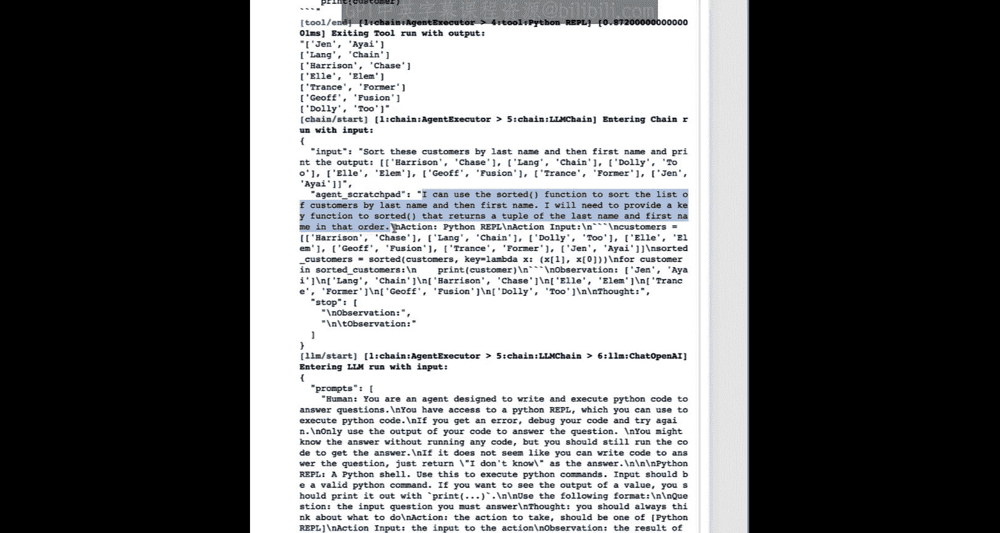

---

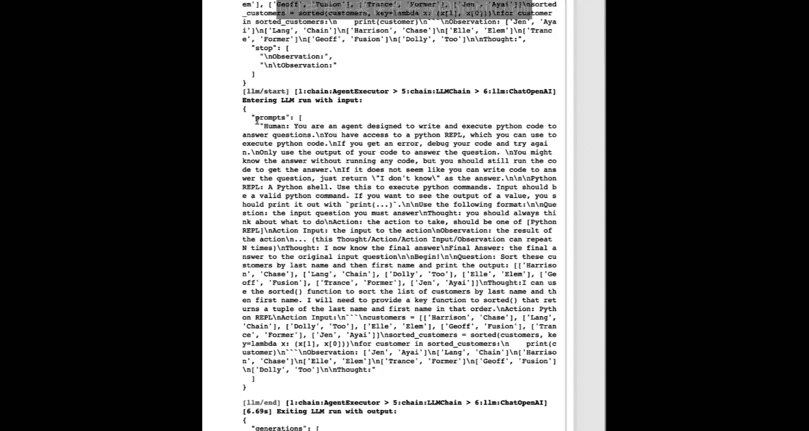

## 自定义工具：连接你的数据与API 🔗

到目前为止，我们使用的都是LangChain内置的工具。但Agent的一大威力在于你可以将它连接到你自己的信息源、API和数据。下面我们来看看如何创建一个自定义工具。

让我们创建一个能告诉我们当前日期的工具。

1.  **导入装饰器并定义函数**
    首先导入`tool`装饰器，它可以应用于任何函数，将其转换为LangChain可以使用的工具。然后，我们编写一个返回当前日期的函数。为函数编写详细的文档字符串至关重要，因为Agent将用它来判断何时以及如何调用此工具。

    ```python
    from langchain.agents import tool
    from datetime import datetime

    @tool
    def time(text: str) -> str:
        """Returns today's date. The input should always be an empty string."""
        return datetime.now().strftime("%Y-%m-%d")
    ```

2.  **创建包含自定义工具的Agent**
    现在，我们创建另一个Agent，这次将`time`工具添加到现有工具列表中。

    ```python
    from langchain.agents import initialize_agent
    custom_tools = [time] + tools # 将自定义工具与之前的工具合并
    custom_agent = initialize_agent(
        custom_tools,
        llm,
        agent="chat-zero-shot-react-description",
        verbose=True
    )
    ```

3.  **运行自定义工具**
    最后，调用Agent并询问今天的日期。

    ```python
    custom_agent.run("What's the date today?")
    ```
    Agent会识别出需要使用`time`工具，动作输入为空字符串（正如我们所指定的），然后返回观察结果（今天的日期），最后语言模型将该观察结果组织成对用户的回复。

你应该在此暂停视频，尝试为这个编码Agent设定不同的目标，并利用调试模式来观察其内部运作。

---

## 总结 🎯

本节课中，我们一起学习了LangChain中关于Agents的内容。这是LangChain较新、更令人兴奋且更具实验性的部分。

我们了解到：
*   可以将大型语言模型视为一个**推理引擎**，而不仅仅是知识库。
*   如何**初始化一个Agent**，并为其配备内置工具（如数学计算和维基百科搜索）。
*   如何创建**代码执行Agent**，让它编写并运行Python代码。
*   如何通过**调试模式**深入了解Agent的决策和执行过程。
*   如何**创建自定义工具**，将Agent连接到任何你想要的函数、API或数据源。

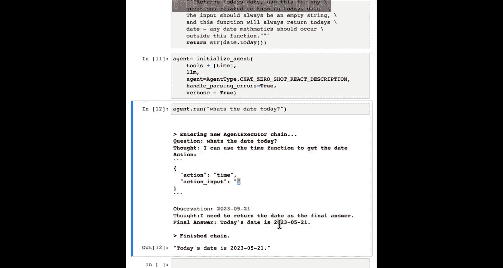

希望本课向你展示了如何利用语言模型作为推理引擎来执行不同的动作，并连接到其他函数和数据源。尽情探索吧！