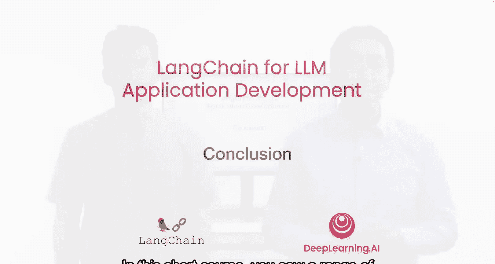
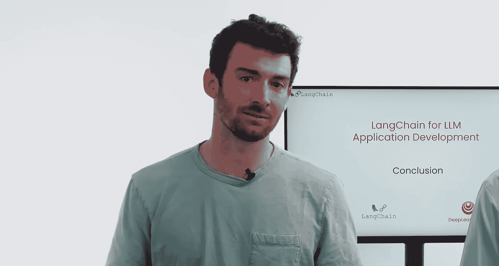

# LangChain应用开发：总结篇：课程回顾与展望 🎯

在本节课程中，我们将回顾整个短期课程的核心内容，并展望LangChain在大型语言模型应用开发中的广阔前景。

## 课程概述

在本短期课程中，我们学习了一系列LangChain的应用实例。

## 核心内容回顾

上一节我们介绍了如何构建复杂的问答链，本节中我们来对整个课程进行总结。

我们看到了多种应用场景。

这些场景包括处理客户评论、构建基于文档的问答应用程序，甚至使用大型语言模型来决定何时调用外部工具（如网络搜索）来回答复杂问题。

如果在一两周前，有人问你需要多少工作量才能构建所有这些应用程序，我想很多人会认为这听起来需要数周甚至更长时间的工作。

但在这个短期课程中，你看到了仅用相当合理的代码行数，就可以高效地使用LangChain构建所有这些应用程序。

我希望你能采纳这些想法。

也许你可以将在Jupyter笔记本中看到的一些代码片段，用于你自己的应用程序中。

## 未来展望与社区力量

这些想法仅仅是一个开始。你可以将语言模型用于许多其他应用程序。

这些模型之所以如此强大，是因为它们适用于如此广泛的任务。

无论是回答关于CSV文件的问题、查询SQL数据库，还是与API交互，都有许多使用链、提示组合、输出解析器以及更多链在LangChain中完成所有这些事情的例子。

这大部分要归功于LangChain社区。因此，我也想向社区中所有做出贡献的人表示衷心的感谢。

无论是文档的改进（让他人更容易上手），还是新型链的开发（开启了全新的可能性世界），都至关重要。

## 行动号召

因此，如果你还没有这样做，我希望你前往你的笔记本电脑或台式机，运行 `pip install langchain`，然后使用这个工具去构建一些令人惊叹的应用程序。

## 课程总结

本节课中我们一起学习了LangChain在LLM应用开发中的核心价值与高效性，回顾了从处理文本到决策调用外部工具的多种应用构建方法，并认识到强大社区支持的重要性。最后，我们鼓励大家立即动手安装LangChain，开始自己的应用开发之旅。