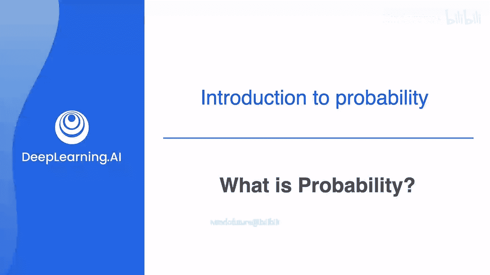
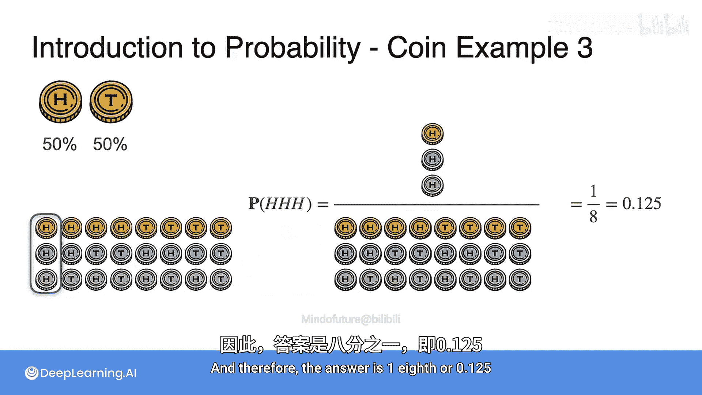

# 【Deeplearning】机器学习和数据科学概率与统计3 ｜ Machine Learning Probability And Statistics 吴恩达 p03 P03_什么是概率_01_01_06 -BV1c86VBrE93_p3-

Welcome to Week1 this week has two lessons in the first lesson you will learn how to calculate probability for different types of random events using rules of probability and base theorem and in lesson two I will introduce you to the concept of a probability distribution and some examples of commonly used probability distributions。

But what exactly is a probability， This is what we're going to be looking at in this video。

 Simplyimp put probability is a measure of how likely an event is to occur。 So， for example。

 if I throw a fair coin， the probability that it lands in heads is 50% or one half。

 And if I throw a dice， the probability of it landing in the number 4 is 1，6。Want to know more。

 let's get started。So to get us started we're going to explore an intriguing problem that will test your probability skills imagine you're in a school with 10 kids and you want to randomly pick a kid from the population in this school three kids play soccer and seven don't。

The question is， what is the probability that the kid you picked at random plays soccer？

So are you ready to find out the answer， let's dive into the world of probability and learn how to solve this problem together。

Recall that you want to find the probability that a child picked random plays soccer。In math。

 we have a way to deny this statement， we will use P of soccer to denote the probability that a kid plays soccer。

To find the probability that a child plays soccer did order by B soccer first。

 we need to know the number of kids who play soccer and the total number of children in the school。

 we will express this in the probability formula number of kids who play soccer divided by the total number of kids。

 so the probability of a random kit playing soccer is 3 over 10 or 30%， can be also written as 0。3。

The numerator is represented by the event， the outcomes favorable to the experiment Re's case is the kids who play soccer so the number of kids who play soccer is 3 that's the size of the event。

The denominator corresponds to the sample space， the total possible outcomes and the number of those is 10。

 That's the size of the sample space。 and there you have it。

 We successfully solve the problem using the basic principles of probability by understanding the simple problem you will be able to apply these concepts in more complex real world situations in machine learning and data science。

Now using the concepts of Venn diagrams， the total population。

 all the children are represented here by the green rectangle this will be 100% of the population。

 the green rectangle including the kids who play soccer and those who don't is the sample space。

30% of the kids who play soccer will be in this circle this is the event。

 the group of items you're interested in。And the kids who do not like soccer will be outside the circle but still in the green rectangle because they're still part of the population so we can calculate the probability by dividing the number of favorable outcomes by the total number of possible outcomes in our next example we're going to be flipping a coin and when we do that the coin can land in heads or tails because this activity of flipping a coin producing an outcome that is uncertain we're going to call this the experiment in probability an experiment is any process that produces an outcome that is uncertain thus in our content throwing a coin is an experiment and we'll determine the probability of the coin landing in heads denoted by P of heads。

We're going to be flipping a fair coin meaning that each outcome heads or tails is equally likely to occur。

 so both of them occur with 50% probability。B of heads is equal2。

 the event of landing in heads divided by the total number of outcomes， and that's 12 or 0。5。

Now let's make the problem a bit more complex and throw two coins whatll be the probability of both of them landing heads to answer this question。

 let's walk through the experiment to determine the total number of outcomes。

 The first coin can land in heads or tails。 Now for each outcome of the first coin the second one can land in heads or tails so our final outcomes are heads。

 heads。Heads， tails。Tas heads。And tail tales。Those are four outcomes now with these outcomes。

 what is the probability of both coins landing and heads that is the upcoming quiz。

Out of these four possible outcomes we're interested in the one where both coins land in heads。

 so there's only one such outcome， which is heads， heads。

So the probability of both coins landing in heads， you notice that b of HH is the number of favorable outcomes。

 which is1 divided by the total number of outcomes which is4 so that's one quarter or 0。

25 also called 25% that's the probability of both coins landing in heads。

Now what if we with three coins， well， let's calculate the probability of the three of them landing in heads when you throw three coins。

😊，We can the first coin and can land in heads or tails。Now。

 the second coin for each outcome of the first coin can land in heads or tails。

AndThe third coin for each outcome of the first and second coins can land in heads or tails。

How many total outcomes we have， we have eight of them， all heads， heads， head tails。

Heads tails heads， heads， tails， tails， tails， heads heads。Daleles had stas。

Tale tails heads and tail tail tales， that is eight outcomes and now question for you is what's the probability of landing and heads three times？

Well， out of these eight possible outcomes we're interested in the one where the three of them land in heads。

 that is one divided by the total number of outcomes， which is 8。

 and therefore the answer is 18th or 0。125。

