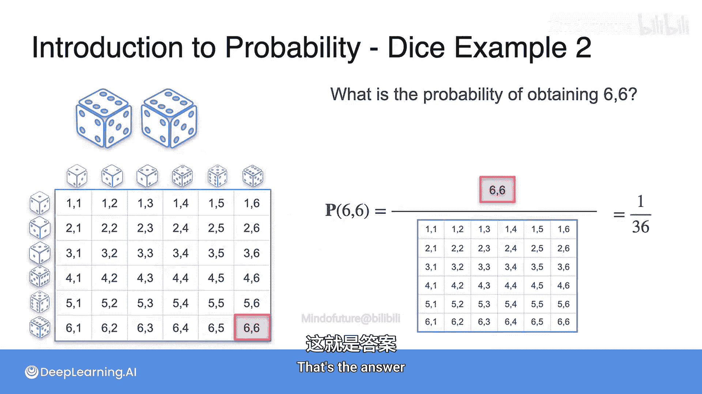
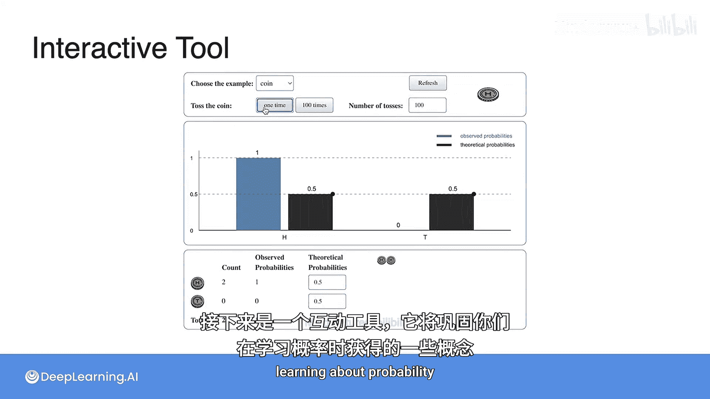
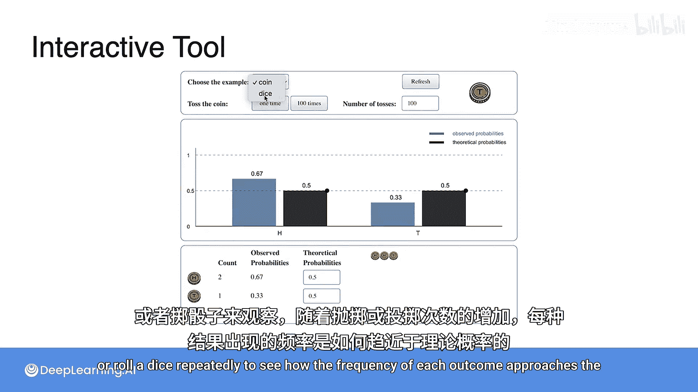
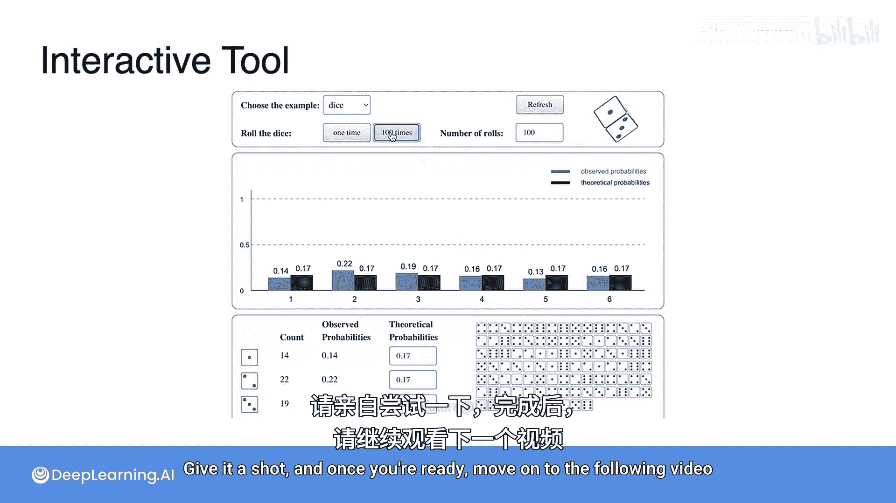

# 【Deeplearning】机器学习和数据科学概率与统计3 ｜ Machine Learning Probability And Statistics 吴恩达 p04 P04_什么是概率--骰子示例_01_01_07 -BV1c86VBrE93_p4-

Now let's reinforce the constant probability， but this time around we're going to use the experiment of rolling a fair six sided dice here's a question for you。

 what is the probability that if you roll this dice you obtain a6？Well。

 given the fact that six things can happen and all of them are equally likely。

 that's the sample space and one of these outcomes is favorable so that's the event。

 then the probability b of6 is1 divided by 6 or 16。Now what if you roll two dice。

 what is the probability of obtaining 66， that's the next quiz for you。Well。

 let's look at the entire sample space。For each role of the first die。

 we can have six possibilities for the second die and we get 36 in total。1，1，12，13。

 etc all the way to 66 that's the sample space of size 36 and the event is just this one over here that's the only favorable outcome so the probability of 66 is one divided by 36 that's the answer Next up as an interactive tool that would reinforce some of the ideas you've been learning about probability you can flip a coin or rollize repeatedly to see how the frequency of each outcome approaches the theoretical probability with more flips or rolls give it a shot and once you're ready move on to the following video。

