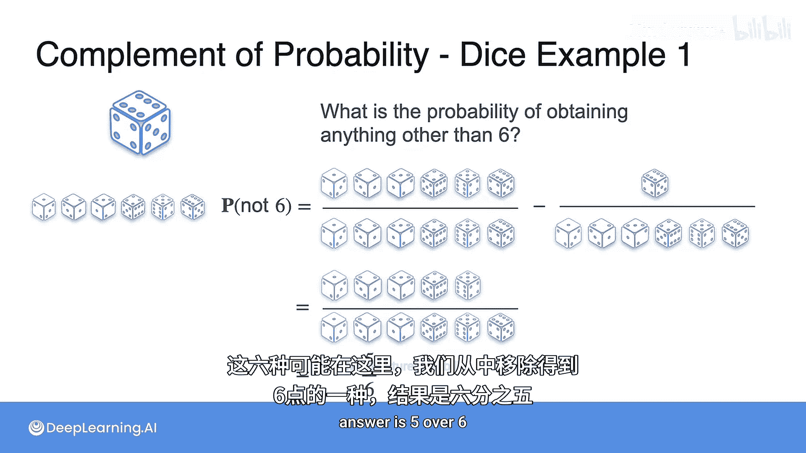

# 【Deeplearning】机器学习和数据科学概率与统计3 ｜ Machine Learning Probability And Statistics 吴恩达 p05 P05_概率的补集_01_01_09 -BV1c86VBrE93_p5-

So in the last video you learn about how to calculate the probability of the occurrence of an event。

 so in this video we're going to talk about the complement of an event and its probability。

So this is the probability that the event does not occur。 For example。

 if an event has a probability of occurring of 75%。

 then the complement event or the probability that the event does not occur is 25%。 Let me elaborate。

So let's go back to our school with 10 kids where three of them play soccer and seven don't。

Here's a question for you， what is the probability that a child does not play soccer if they are picked at random？

Well， to find the probability that chance does not play soccer that's denoted as B of not soccer。

 then we do the same thing as before we count the number of kids who don't play soccer and divided by the total number。

 and that's going to be 7， divided by 10。That is the answer， 0。7。However。

 you may have noticed that that is related to the probability that the kid plays soccer because the probability of not soccer is 0。

7 and the probability of soccer was 0。3 and they add to 1 turns out this always happens and we can rewrite this as 1 minus 0。

3。This is essentially the complement rule， the complements rule states that the probability of an event A not occurring is equal to1 minus the probability of a occurring。

So the probability of not soccer is 1 minus the probability of soccer。

That's going to be the complement rule。And we can formalize this rule as follows P of a prime is1 minus p of a where a prime represents the complement of the event A。

 that's when the event A does not happen。So using this formula。

 we can calculate the probability of an event not happening in a more straightforward manner。

Now as a Venn diagram you can see this in a similar way as before here you have the sample space。

 here you have the event of playing soccer inside the circle and the event of not playing soccer is everywhere outside that circle which is 70% of the circle is 30。

Now， using the experiment of flipping three coins， here's a question for you。

 what's the probability of not obtaining three heads？Well by the complement rule。

 the probability that none of the coins land in heads does p of not three heads is equal to 1 minus the probability of three heads and as you saw in a previous video this probability is 18。

 so we have1 minus18 and that is simply7 over 8， you can also see it as the seven good cases which are all minus the three heads divided by the8 which is a total number of cases。

Now let's apply the comp rule to the dice experiment if you throw one die。

 what is the probability of obtaining anything different than6？Well。

 we know there are six outcomes and the probability of not 6 is equal to 1。

 this one is 6 over 6 minus 1 over 6， the probability of landing in a 6。The6 is over here。

 here we remove one of them which is landing in a6 and the answer is5 over 6。

