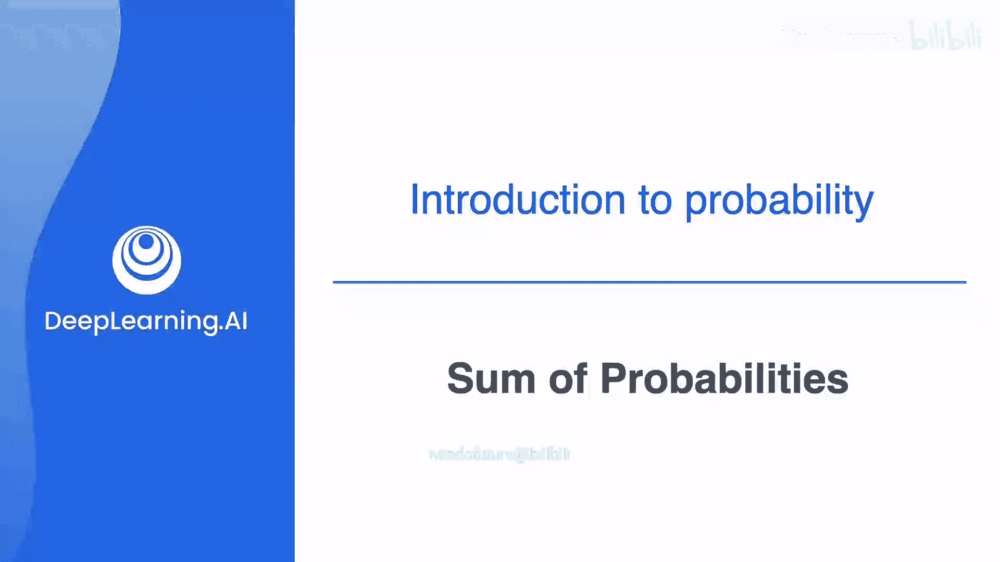
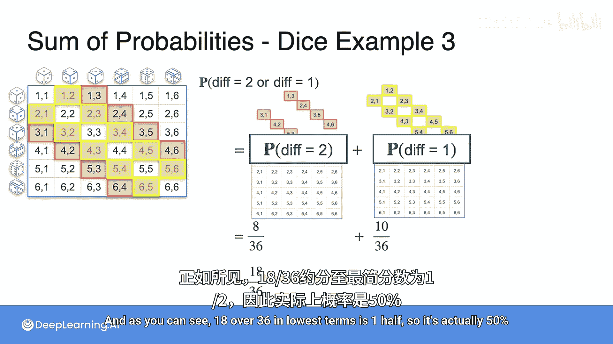

# 【Deeplearning】机器学习和数据科学概率与统计3 ｜ Machine Learning Probability And Statistics 吴恩达 p06 P06_互斥事件的概率之和_01_01_10 -BV1c86VBrE93_p6-

So in this video you are going to learn about the sum of probabilities， which is quite simple。

 Consider the role of a die if you know the probability of getting a2 and the probability of getting a3 and you want to know the probability of getting a2 or a3。

 then all you do is you add these probabilities。However。

 there's a caveat this doesn't work all the time， we need to know if the events are thisjoin。

Let me is explain。So let's go back to the school， but now we have more information。

 we have a school where kids can only play one sport， this is going to be important。

And the sport can be soccer or basketball， the probability that a kid plays soccer is 0。3。

 the probability that a kid plays basketball is 0。4。So here's a question。

What do you think is the probability that a kid plays soccer or basketball and remember at this school kids can only play one sport。

 not two or more？If you want to hint， imagine that there's only 10 kids in this school and do your calculations like that。

So let's remember that the kids can only play one sport。

 so let's say there's 10 kids and if there's 10 kids， then 30% play soccer， that's three of them。

And 40% play basketball， that's four of them， and that makes 70% of the kids。

So the probability that a kid plays soccer or basketball is the number of kids who play soccer or basketball divided by the total number of kids that is 3 plus4 divided by 10 or 0。

7。Notice that we added the probabilities， the probability of soccer was 0。3。

 probability of basketball was 0。4， and the probability of soccer or basketball was 0。7， which is 0。

3 plus 0。4。Now this can be seen in the Venn diagram as follows。

 we're going to use the letter U for union。And if all the children are here and 30 of them play soccer。

 that's over here and 40 of them play basketball， then。

The union is the ones that play soccer or basketball。

 so it' the ones that play soccer and the ones that play basketball。

 so it's written like this A union B and the probability of a union B is the sum of the probabilities P of A and P of B。

Now let's see how the concept of sum probabilities reflect in a die example。

 let's say that your role are a fair six side dice ones what is the probability of obtaining an even number or a5？

So there are two events here， event A is rolling an even number。

That's three of them and event B is rolling a5， so that's one of them here and because the probabilities get added。

 then we have3 over6 plus1 over 6 and so the probability of even number or 5 is probability of even number plus the probability of 5。

36 plus 16， and that is 4 over 6， which in lowest terms is23。Now here's another question。

 if I roll two dis， then what's the probability of obtaining a sum of7 or a sum of 10？

Well let's consider two events， the event A is that you get a sum of 7 and the event B is that you get a sum of 10。

So out of the 36 possibilities how many have a sum of 7。

 well there's this6 over here and out of the same 36 possibilities， how many have a sum of 10。

 there's this 3 over here， 6，4，5，5 and 46。So when you look at the union。

 so a sum of 7 or a sum of 10， then we are looking at all these events that are colored red or yellow。

Sum of 7 that is 6 over 36 and the sum of 10 is 3 over 36 when we add them we obtain 9 over 36。

 which in lowest terms is1 quarter so this one over here is a probability that the sum is 7。

 this one over here is the probability of the sum is 10 and we just added them。

Now let's see yet another example， what's the probability of obtaining a difference of two or a difference of one？

Well， again we have the two events， A is the event that differences is 2 and B is the event that the difference is1。

Which pairs have a different of two these pairs over here， 1，3，24，3，5，46， 3，1，4，2，5。

3 and 64 because the difference can be in any direction can be the first minus is the second or the second minus is the first。

And similarly， for the difference of one， we have all these pairs over here。

And now when we look at the union， they are over here， it's this many。

 so the probability at the difference 2 or the difference 1 is equal to the sum of the 2。

This one over here。Plus this one over here。The first one there's  eight cases out of 36 so it's 8 of 36。

 the second one is 10 cases out of 36 so it's 10 over 36 and when you add them we get 18 over 36 that first one is the probability that the difference is 2 the second one is that the difference is 1 and as you can see 18 over 36 in lowest terms is 1 half so it's actually 50%。

