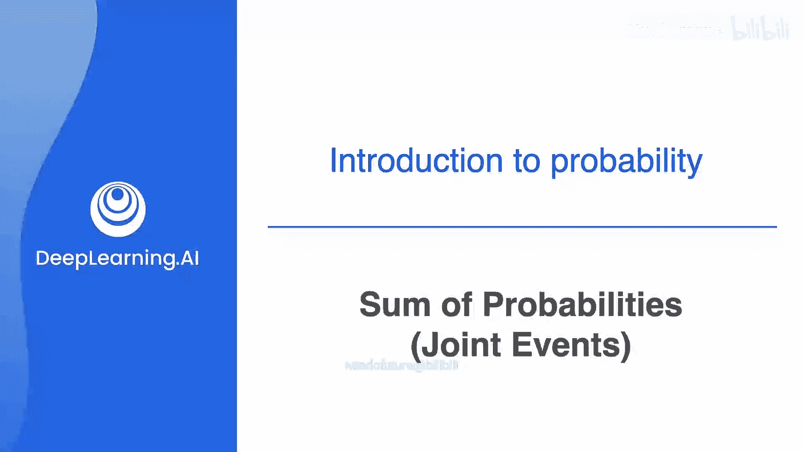
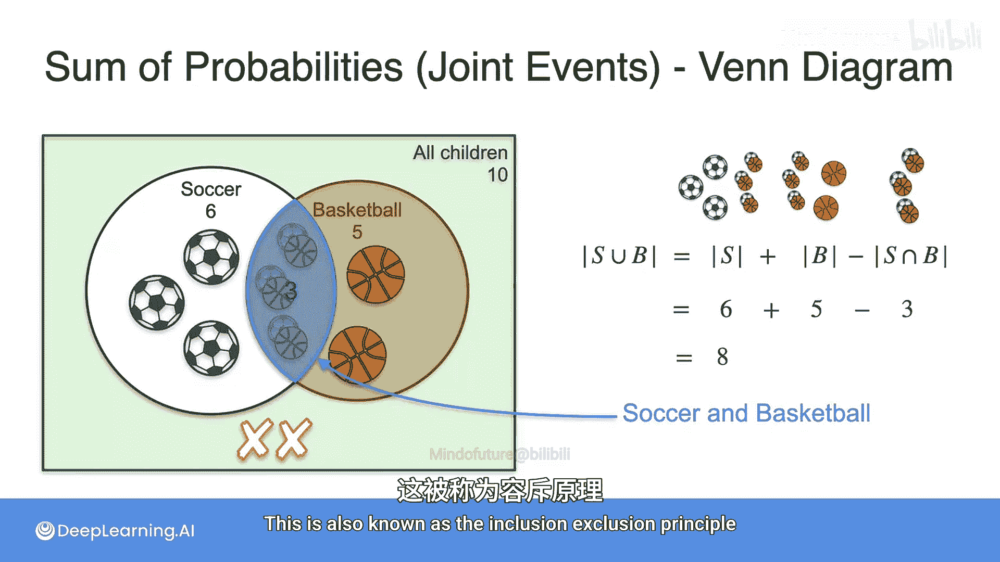
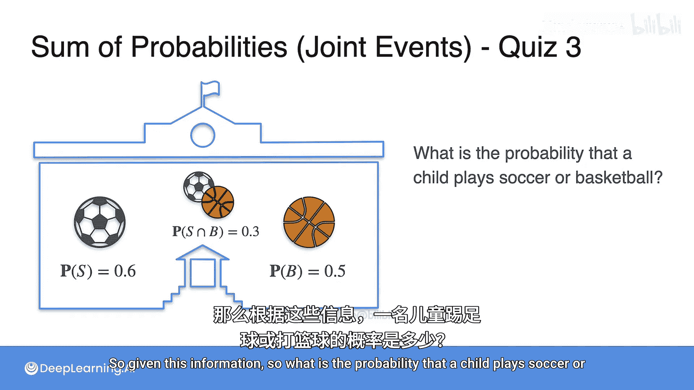
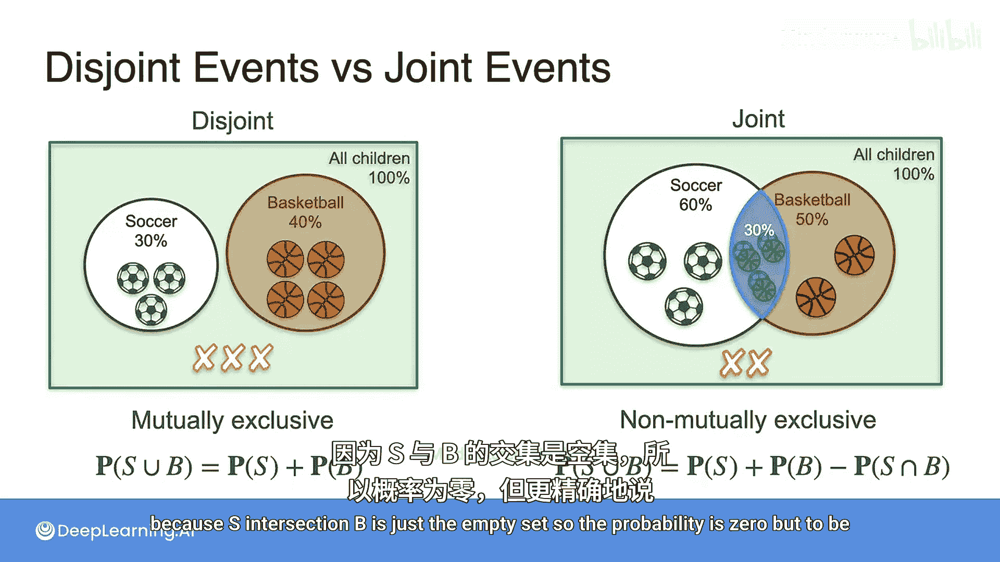
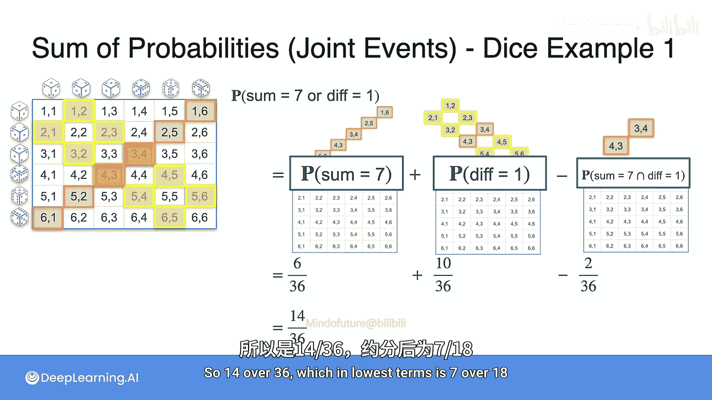

# 【Deeplearning】机器学习和数据科学概率与统计3 ｜ Machine Learning Probability And Statistics 吴恩达 p07 P07_相容事件的概率之和_01_01_11 -BV1c86VBrE93_p7-

Welcome back In our previous lessons。 we talked about the sum of probabilities for disjoint events。

 But what happens when the events are not disjoint。 Well， a problem may happen。

 Let me give you an example。 Let's say that the probability of rain is 80%。

 And the probability of being windy is 70%。 So what's the probability of rain or wind。 Well。

 if you add them， you get 80% plus 70%， and that's 1 50%。 That is way too much。

 and it's completely wrong。 because the events are not disjoint。

 See you could have rain and wind at the same time， and that's the key。In real world situations。

 events are not often disjoin， and we need to account for this possibility of overlapping outcomes。

 The sum rule for joint events allows us to do this and to calculate the probability of combined events。

 So get ready to dive deeper into the world of probability and learn how to use the sum rule for joint events。

So we're back to the school from the previous example except in this one kids can play as many sports as they want。

 they don't have a that restriction that they can only play one sport and the options are still soccer and basketball here's a question for you if the probability of a kid playing soccer is 0。

6 and the probability of a kid playing basketball is 0。

5 what's the probability that a kid plays soccer or basketball and again if you need a hint imagine that there's only 10 kids in the school and do the math like that。

So let's see this one's a bit more complicated here the 10 kids and 60% that play soccer are。

 for example， this six and the 50% that play basketball are， for example， this five。

 but this could change there could be an overlap and when that happens。

 then we don't really know how many children play multiple sports。

So let's look at it in a Venn diagram here's 100% of the kids and here's the 60% that plays soccer and here is the 50% that plays basketball so originally we had this equation PFS union B is PfS plus P ofB but that doesn't work as a matter of fact。

 even if you try to add them you would get 110% which is more than the number of kids in the school so there's something we're overcounting and ro counting is this intersection here that is this one kid who plays both sports。

That is P of S intersection B the intersection of two events is when both of them happen at the same time so the kids who play soccer and basketball。

 and it could be one， but it could also be the different number could be3 for example。

And so what we need is we need the information of how many kids play both soccer and basketball in order to solve this problem。

So here's the information。Same school。And the kids can play soccer or basketball。

 and now let's actually do it with numbers， six kids play soccer。Five kids play basketball。

And three kids play both sports， So the question for you is how many kids play soccer or basketball so it could be soccer or basketball or both。

Well let's break the problemm down， six of them play soccer。

 five of them play basketball and that's all the kids over here now we know that three play both so that's eight because the two over here don't play soccer or basketball。

In the Venn diagram， it's like this。Here's 100% of the kids， here's the ones that play soccer。

 here's the ones that play basketball and the ones that play both are in this extra section here。

 that's the ones that play soccer and basketball and we have the following formula。

The size of the set S of Kissta plays soccer union。

 the set B if Kista play basketball is the size of the set S。

That is this6 over here plus the size of the set B， which is this5 over here。

 but we've overcounted noted that those three kids that play both sports were counted twice so we need to subtract them。

 we need to subtract these three over here and now we have a count of how many kids play soccer or basketball at 6 plus5 minus3 and that's going to be8 this is also known as the inclusion exclusion principle。

And now we can represent the same thing except with probabilities。😊。

Again the same problem with soccer and basketball， but now we're not going to say that six kids play out of 10。

 we're going to say that the probability of a kid playing soccer is 0。

6 and the probability of a kid playing basketball is 0。

5 and the probability that a kid plays both is 0。3 so given this information。

So what is the probability that a child plays soccer or basketball？

And just like before we can do a Venn diagram， we can look at the ones that play soccer and the ones that play basketball and the probabilities follow the same inclusion exclusion rule as before we have P of S union B is P of S plus P of B。

 but we're over counting the intersections over're over counting B of S intersection B so we have to subtract it because we're counting it twice。

And that's 0。6 plus 0。5 minus 0。3， which is 0。8。So with the str or two examples visually and the problem in the left the kit can only play one sport so the events are disjoint。

 it's much easier to calculate probabilities here because all we have to do is add them。

 they don't overlap。In the case over here they overlap so in order to calculate the probability of the union of the events we need to take the intersection into account so the case in the left is called disjoint events or mutually exclusive and for this case the probability of the union is the sum of the probabilities and for the case in the right this one is called joint。

And also called non mutually exclusive and for this we have to follow the formula P of S union B is P of S plus P of B minus P of S intersection B。

Notice that the case in the left follows from the case in the right because as intersection B is just the empty set。

 so the probability is 0， but to be more precise， we can look at both cases。

Now let's see this for a pair of dice question is what is the probability of obtaining a sum of seven or a difference of one？

Well， let's take a look， the sum of7 is all these cases over here as you've already seen。

 and the difference of one is all these cases over here。Now before we used to just add them。

 but this time is a little more difficult， so we're going to call the one on the left A in the one on the right B and we're going to say that A or B is this ones over here except that we have double counted these two the sum equals 7 and the differences1 are double counted so in order to not double countum we have to subtract that probability so the probability of sum equals 7 or differences is 1 is。

This 6 over 36 for the sum is 7。Plus this 10 over 36 where the difference is 1 minus what were overcounting because 4。

3 and 34 are counted twice so we have to subtract2 divided by 36。

 so we get 6 over 36 plus 10 over 36 minus 2 over 36 and that's 14 over 36 and that's p of sum equals 7 plus p of difference equals 1 minus p of sum equals 7 and difference equals 1。

 so 14 over 36 which in lowest terms is 7 over 18。

