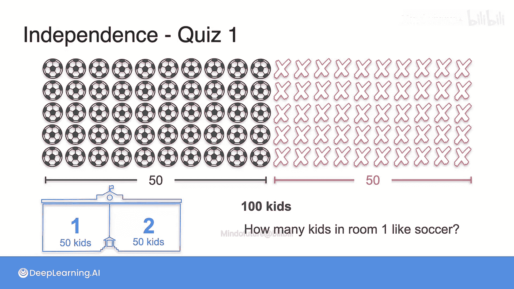
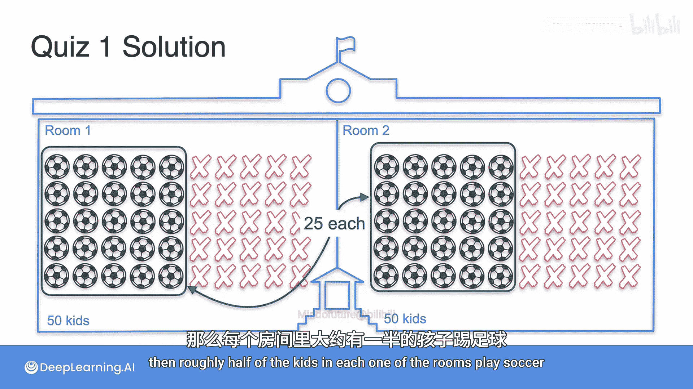
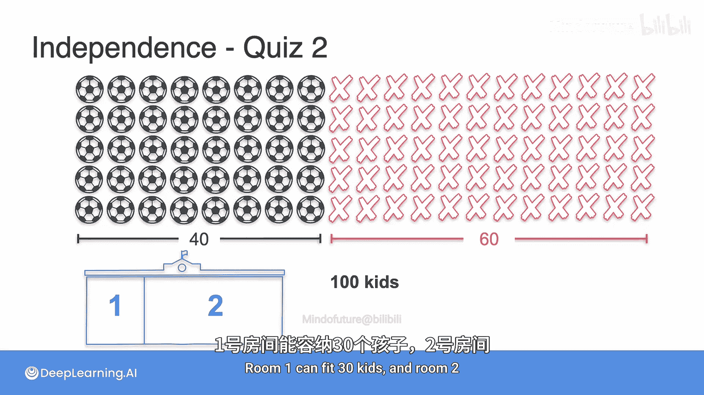
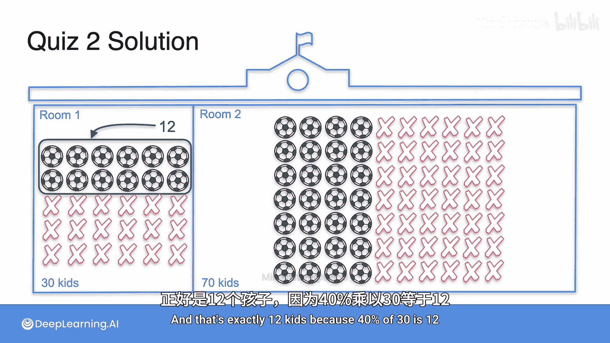
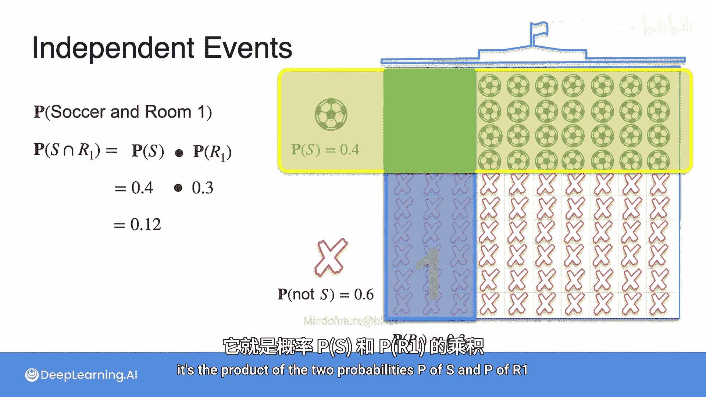
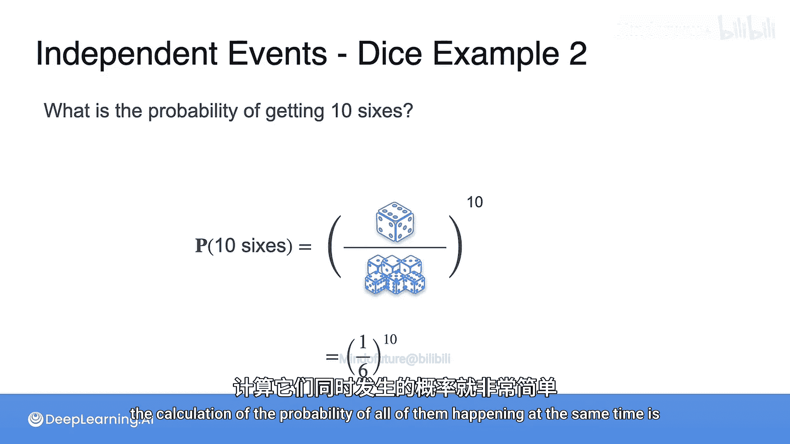

# 【Deeplearning】机器学习和数据科学概率与统计3 ｜ Machine Learning Probability And Statistics 吴恩达 p08 P08_独立性_01_01_12 -BV1c86VBrE93_p8-

In this video， we're going to look at the concept of independence。

 Inence happens when the occurrence of one event does not affect the probability of the occurrence of another event。

For example， if I toss a coin twice， whatever happened on the first throw does not affect the outcome of the second one。

On the other hand， if I'm playing chess， whatever happened on the 10th move affects what happens on the 11th move。

 so these are not independent， but the coinintros are independent。

Understanding independence is very important in probability and in machine learning。

 because assuming that things are independent actually helps us simplify calculations and make predictions。

So let's calculate one more probably in a school there are 100 kids。

 half of them so 50 of them like playing soccer and the other half do not like playing soccer the kids are randomly split into two equal rooms each one of them of size 50 plus's room1 and room 2。

So for this question you're not required to make any calculations， the question is。

 based on your knowledge， what is your best estimate about the number of kids in room1 who would like soccer？

And remember， the kids were randomly split into two equally sized rooms。

So the split will most likely look as follows， roughly 25 kids in the first room will like soccer and roughly 25 in the second room because they were randomly split there was no reason to go to room 1 versus room2 and so that is 25 each。

Obviously something different would have happened， but our best estimate is 25 because if roughly half of the kids play soccer and they are split into two rooms。

 half half， then roughly half of the kids in each one of the rooms play soccer。

Now imagine another school with 100 kids but in this school only 40 of them like playing soccer。

 which means 60 of them don't like playing soccer the kids are randomly split into two sides this time of different size。

 room1 can fit 30 kids and room 270 kidss so same question as before based on your knowledge what is your best estimate about how many kids in room1。

 the smaller room like to play soccer or at least what would you expect this number to be。

Well， since the split is 4060 for soccer and not soccer。

 we expect that since we separated the kids randomly then in each of the rooms。

 the split is going to be 4060 again。So we expect 40% of kids in room one to like soccer。

 and that's exactly 12 kits because 40% of 30 is 12。

More clearly we have 40% of 100 kids playing soccer that is 40 kids and the probability of a kid playing soccer is 0。

4 and then there's 60 kids who don't play soccer so the probability of a kid not playing soccer is 60% or 0。

6。Now we can split them into two rooms， there's 30% of the kidss in room  one。

 so the probability of room1 is 0。3。And the question is what is the probability at a kid plays soccer and is in room1。

 so we have P of soccer which is 0。4 and P of R1 room 1， which is 0。3。

And we're looking for this probability over here， so probability of soccer intersection room 1 and as you can see that the probability of soccer times the probability of room 1 which is over here that's 0。

4 times 0。3 in other words， remember that we took 40% of 30% that means we're multiplying them and we get 12% or 0。

12 what we're talking here is the intersection of two events when you see the word n that's intersection so the probability that a kids play soccer and is in room 1 is because those events are not related are independent of each other then it's the product of the two probabilities P of S and P of R1。

So we get to the product rule， the product rule simply says probability of a intersection B is probability of a times the probability of B this is going to be very useful by remember the events have to be independent and we're going to see more details about this later。

To continue illustrating the intersection of independent events and the probability of that。

 we are going to look at a coin example again， so let's consider tossing a fair coin five times here is a question for you What is the probability that the coin lenss ins all five times。

Well note that each event is independent from all the other ones because one coin landing in heads does not affect any of the other ones。

 therefore the probability is the probability of the first one lands in heads which we know it's1 half times the same thing for all the other ones so it's one half times one half times one half times1 half times1 half and that is going to be one over 32 because it's one over22 to5 and that is。

1 over 32 so this product rule can be extended is not just two events。

 but if you have many independent events all independent from each other。

 then the probability that they all happen is the probability of all of them happening separately so now let's look at some dice recall that when a diceese rule the probability of obtaining a6 is one over 6。

So now when two dies are rolled was a probability of obtaining 66， well we've calculated this before。

 but we can actually do it with the product rule， this was one over 36 because we have one here and 36 cases。

However， if we look at both events separately they're independent events because one rolling of the dice does not affect the other one and what's the probability that the first one lands in6。

 well it's 16 and for the second one， it's again 16。

 so we multiply them and we get 16 squared which is one over 36。

Now what is the probability that if I roll 10 different dis， all of them fair， I get 10 sixes？Well。

 as you can imagine， probability is the probability of getting 16 to the power of 10 because all these roles are independent。

 that's 16 to 10， which is a very， very， very small number。So as you've learned in this video。

 the probability rule says that if you have independent events。

 the calculation of the probability of all inhabitants in time is easy is just a product of all。

