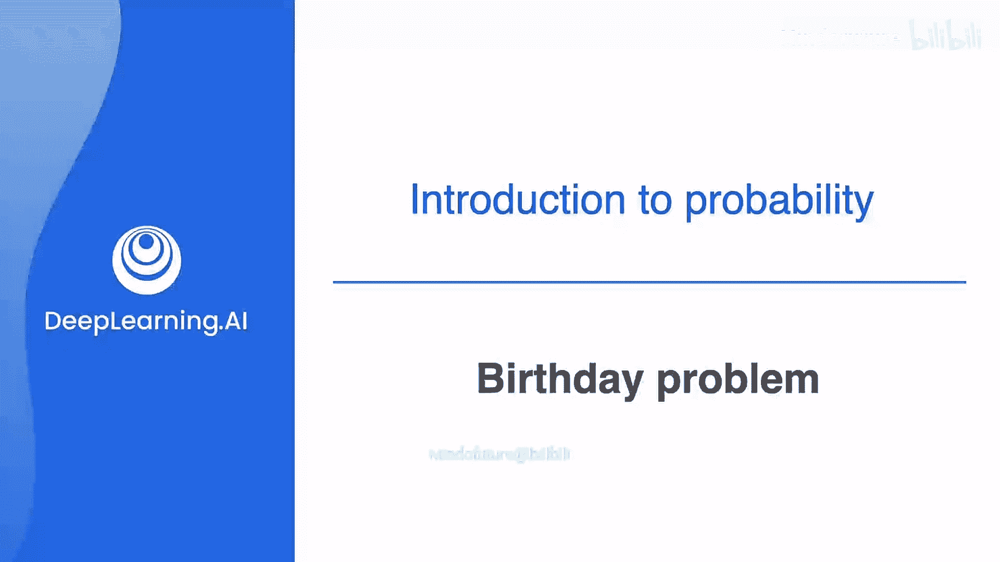
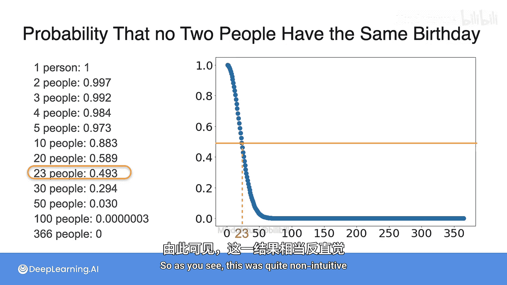

# 【Deeplearning】机器学习和数据科学概率与统计3 ｜ Machine Learning Probability And Statistics 吴恩达 p09 P09_生日问题_01_01_13 -BV1c86VBrE93_p9-

Great work。 so far In this lesson， we're going to talk about one of the most fascinating problems in probability。

 The birthday problem。 So let's say you are with three random people。

 and you're wondering what's the probability that two of you have the same birthday。

 It's probably very low。😊，Now what if you were with 200 random people。

 you would say it's very likely that some two of them have the same birthday。What about 30 people。

 what about 50 people， 100 people。Well， let me show you what happens and the results may surprise you。

So here's the problem you have 30 friends at a party among those 30 friends excluding yourself among those 30 friends。

 what do you think is more likely that there exists two people who have the same birthday or that no two of them have the same birthday and let's assume that this year only has 365 days so there's not going to be any February 29 birthdays just for the sake of this problem。

So the answer， believe it or not， is that it's more likely that two people have the same birthday。

 And in fact， the probability of no two people having the same birthday is only around 0。3。

 So let me show you the math。 and that's not intuitive right because if you think of 30 people。

 it doesn't look that likely that two of them have the same birthday。

 but there's a 70% probability that two of them have the same birthday。

 So let's see why since it's way easier， we're going to focus on the probability that no two people have the same birthday。

 remember that the probability that at least two people share the same birthday can be obtained by taking the compliment。

 So here is the entire year， let's imagine that there's 365 boxes here even though there's less。

 but let's pretend there are。 and let's look at the first friend。

 So we're gonna keep track of the probability that among the group that we're looking at everybody has a different birthday。

 So if it's one person， obviously they will not have the same birthday as anyone else because the group only has one person。

 So the probability is 365。Over 365， that's a one， let me repeat that last thing I said。

So the probability is 365 divided by 365 which is1， in other words。

 this person can have a birthday any day of the year and is not going to overlap with anyone else。

Now let's add a second person。What is the probability that the two of them have at different birthdays or what's the probability that among these two。

 there's no repeated birthdays， Well， the other one has to have pretty much a birthday on any day that's not the same day of the first one。

 So we multiply by 364 divided by 365。 so it's still pretty high because it's unlikely that if you take two people。

 they will have the same birthday。 Now let's add one more person。

 and we want that person not to have a birthday at the same time as any of the other two。

 So they can have a birthday in any of the remaining 363 days out of 365。

 And so the probability that these three have all different birthdays Now it's。

365 times 364 times 363 divided by 365 cubed because every time we have a new event and we multiply by this probability if we add a fourth person。

 well， now they can have a birthday in any of the days that are not taken that's 362 divided by 365。

 and if we add a new person they again can have a birthday in any of the days that are not taken so we multiply by 361 or 35 and if they have more and more person they will multiply by 360 or 365 and one more we multiply by 359 and so on and so forth。

 so if we have this group of nine people。Then what is the probability that they all have birthdays on different days it's the product of all these numbers and that's actually 0。

905 in other words if I have a group of nine people the probability that there's no overlapping birthdays is roughly 90% so it's very high because among nine people most likely they' are no repeated birthdays but now let's actually do the plot for this probability with more people so as we saw among a group of one person the probability has no repeated verdicts is one。

For two people remember that it was 364 divided by 365 that's 0。

997 and we kept multiplying this by other factors by 363 over 365 etc ce ce。

 so when we keep track of this product then as you can see the number starts decreasing for 20 people it's already 0。

589 for 23 people is 0。493 so for 23 people it's already more likely to have a birthday in common then no birthday is in common for 30 people is 0。

294 and for 50 people is already 0。03 so among 50 people it's very very likely that two of them have the same birthday and for 100 people is already very。

 very very small。And for 366 people already it's zero because by then you have to have one repetition and the plot is on the right where in the horizontal axises we have the number of people and in the vertical axises probability notice how quickly it drops and it stops being bigger than 0。

5 around here which is exactly at 23 people so if you are ever in a party with 23 people you can bet that there's a repeated birthday and you would win more than half of the time。

So as you see， this was quite non intuitive， however。

 we calculate the probabilities and that's what we got。

