# 【Deeplearning】机器学习和数据科学概率与统计3 ｜ Machine Learning Probability And Statistics 吴恩达 p11 P11_条件概率第二部分_01_01_15 -BV1c86VBrE93_p11-

So let's apply this rule in a school with 100 kids again。

 let's say 50 of them play soccer and the other 50 don't play soccer now we're going to split them into two rooms of size 50。

And now they can go to any room they want， but here is more information。

 the first room has a TV that is showing the World Cup and the second room has a TV that is showing a movie that is completely unrelated soccer。

And each room fits 50 kidss now out of your intuition。

 how many kids in room one do you expect to like soccer and I'll remind you the first room has a TV playing the World Cup and the second one doesn't so how many kids in room one do you expect will like soccer。

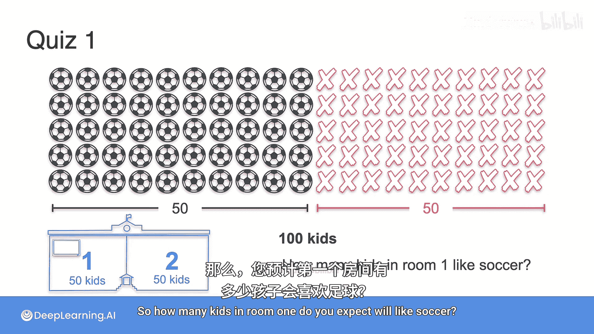

Well， all things being fair， we can imagine that all the kids who like soccer went to the room with the TV that's playing the World Cup as illustrated。

 maybe this didn't happen， but we can assume that that happened。So these two events。

 soccer and room1 are dependent before they were independent but now they are dependent in the example that we did previously the kids were split randomly that made the events independent。

 but here this is not the case they dependent or the probabilities change。

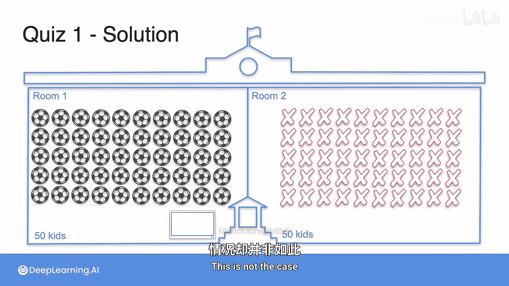

Now let's do a slightly different problem， let's say we have a school of 100 kids。

 40 of them play soccer and the rest don't， and among the kids that play soccer we've noticed that on any given day 80% of them like to wear running shoes so now help me estimate how many kids play soccer and wear running shoes。

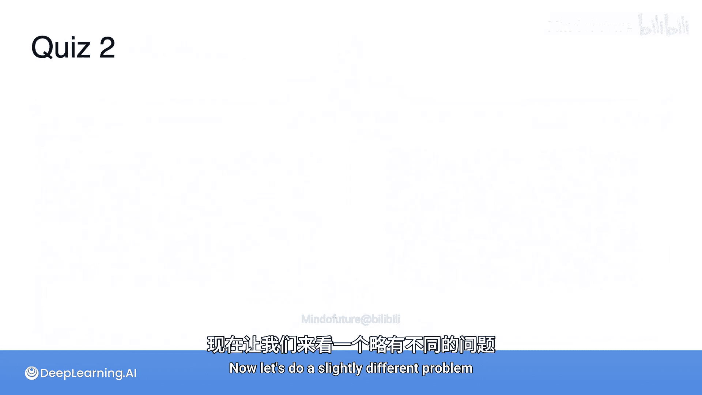

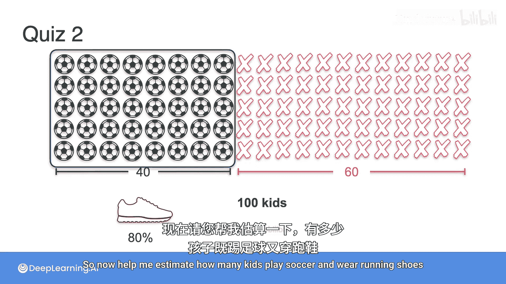

So 40 kids are shown here and let's say that 80% of them are wearing running shoes。

 so let's split them into groups of 20% each and four of these sections are wearing running shoes。

 so that's 32 because 80% of 40 is 32。And 32 is our estimate for how many kids like soccer and are wearing running shoes。

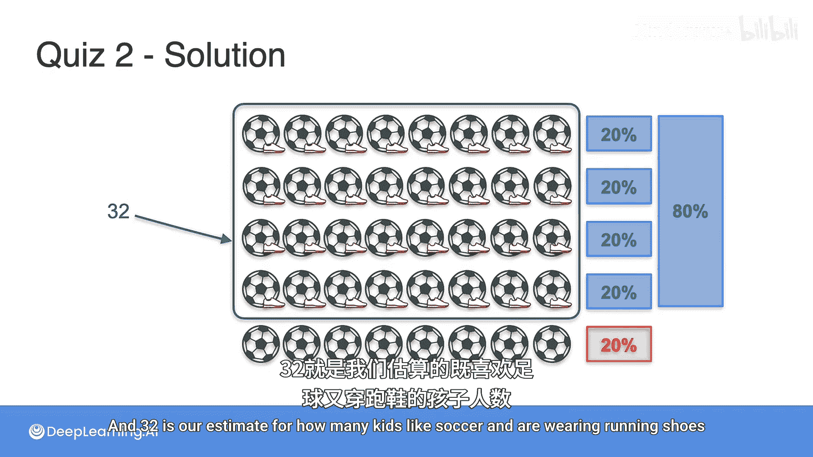

So let's look at the same problem from a different lens。

 The probability that a kid plays soccer is 40% That means if we have 100 kids。

 40 of them play soccer and thats P of soccer equals 0。4 Now the probability of not soccer is 0。

6 or 60% that means that among these 100 kids60 of them don't like soccer Now among the kids that play soccer 80% of them are wearing running shoes therefore the probability of running shoes given soccer is 0。

8。Now we want the probability of soccer and running shoes well for that we need the probability of soccer so that's this 40 over here。

Times the probability of running shoes given soccer， which is this 80% over here， so 80% of 40。

Or 04 times 0。8， that's probability of soccer times probability of running shoes given soccer。

And we get 0。4 times 0。8 and that's 0。32 that is the 32% that we expect that will play soccer and wear running shoes。

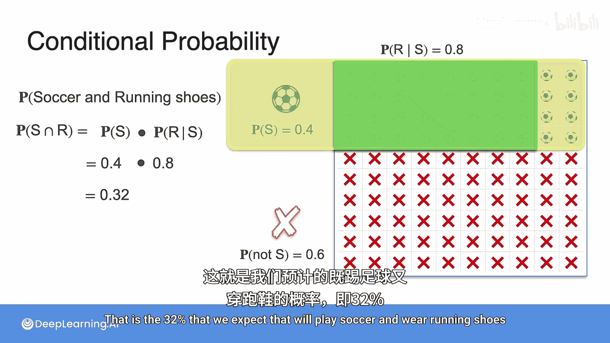

So we say that the probability of S intersection R is 0。32 Now let's look at something else。

 Let's say that somebody tells me the following information。

 the probability that a kid wears running shoes when they don't like soccer is 50% That means that among the kids that are not playing soccer half of them wear running shoes So what's the probability of not soccer and running shoes Well P of not soccer intersection running shoes that means the kids who don't play soccer and are wearing running shoes is equal to P of not soccer which is this 60% over here。

Times P off running shoes given not soccer， which is this 50% over here。And so that's 0。6。

 60% times 0。5， it's 50% of 60%。And that's 0。3， and that is the probability that a kid does not like soccer and is wearing running shoes。

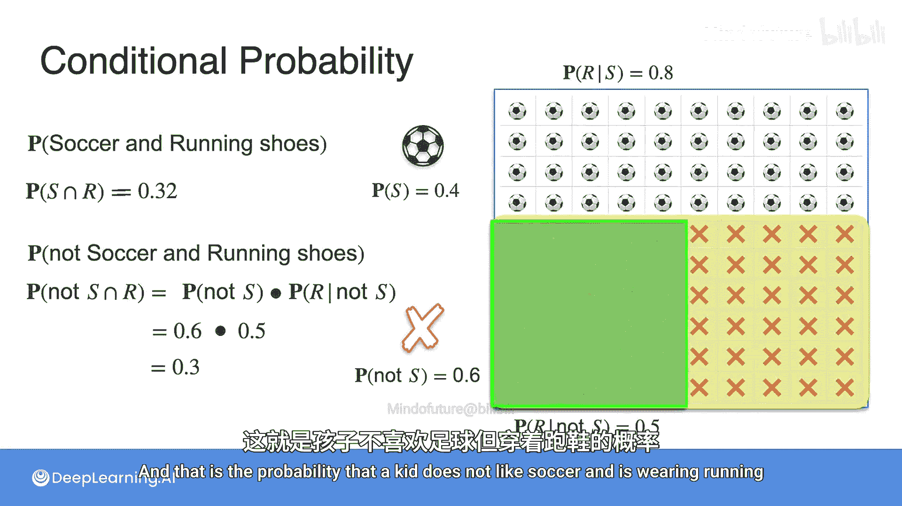

Another way to see things is with a tree of probability。

 so two things can happen the kid can play soccer or not play soccer。

Play soccer with a probability of 40% and doesn't play soccer。

 The priority is 60% now among the ones that play soccer。

Wheres running shoes were probability of 80% that's P of error given S and doesn't wear running shoes a probability of 20% and among the ones that don't play soccer wear running shoes or probability of 50% and doesn't wear running shoes or probability of 50%。

 so there's four scenarios。When they play soccer and wear running shoes。

 play soccer and don't wear running shoes， doesn't play soccer and wears running shoes。

 doesn't play soccer and doesn't wear running shoes。

 and the probabilities are as intersection are 32%， which is 80% of 40%。Or the product？

8ight% for probability of S intersection are prime that's not R。

That is the ones that plays soccer and don't wear running shoes。

 that's 20% of 40% or the product of 20% and 40%， which is 8%。

For the ones that don't play soccer and wear running shoes that's 30% because it's 50% of 60% or 0。

6 10。5 and the same thing for the ones that don't play soccer and don't wear running shoes。

 so these are all the possibilities。So now let's recap the cases that we've seen before since the very beginning first we split the kids into two rooms randomly and that created two independent events In events can be seen graphically when the two lines the one that splits the kids from the。

Room one and room two when the kids that play soccer don't meet at a point so these events are independent Then we had the case when they were running shoes or not wear running shoes and those events were dependent because it's more likely that the kid wears running shoes if they are playing soccer than if they're not so those events are dependent。

And another case was when we sent them into two different rooms。

 but one of them had a soccer game and the other one didn't， those cases were very dependent too。

Because it's much more likely that a kid will go watch the soccer game if they like soccer Now this may not be exactly the same numbers we had before。

 but just to show you that this case is also dependent and so when the lines cross the case are independent like in the left and when they don't cross they dependent like in the right in the following ungraded lab you'll have a chance to see some of the ideas you've already learned about probability in action you'll use Python to simulate the birthday problem I showed you earlier and compare the results you get from those simulations to the results you would get if you solve these problems analytically you will examine several different variations of the birthday problem see visualizations of the simulations used to address each problem and get walk through how to analytically approach them as well I hope you enjoy reinforcing what you've learned and I'll see you when you're done in the next video。

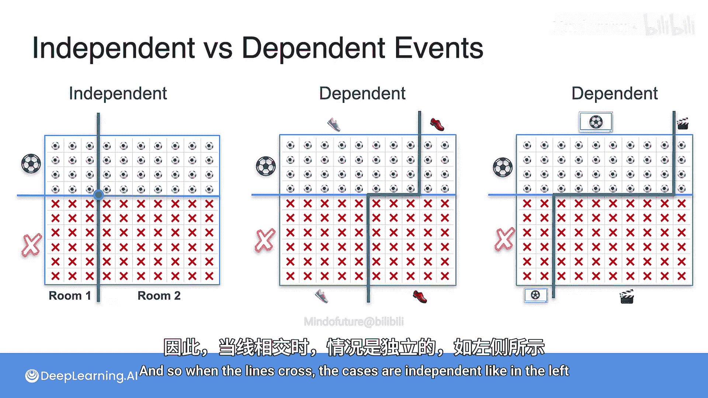

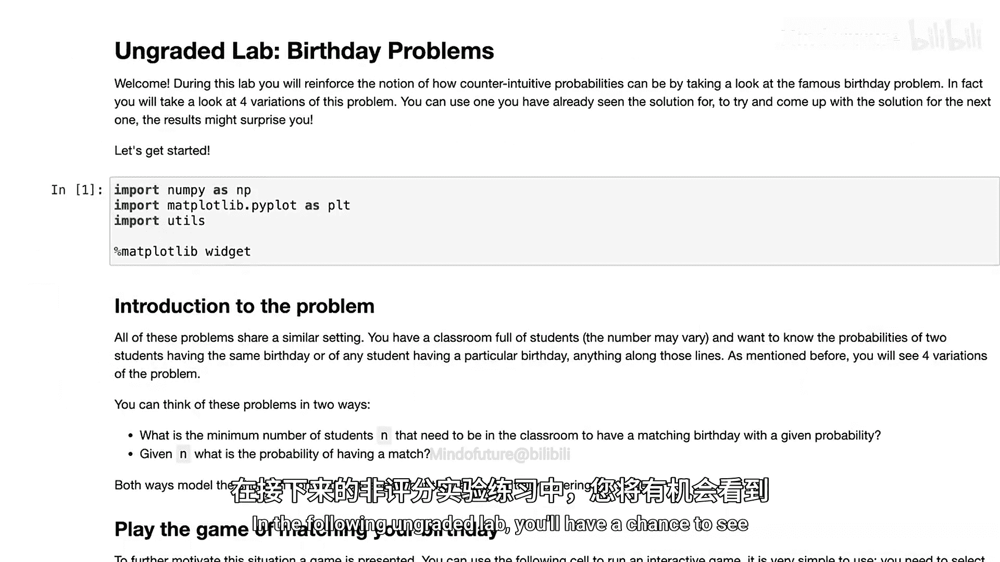

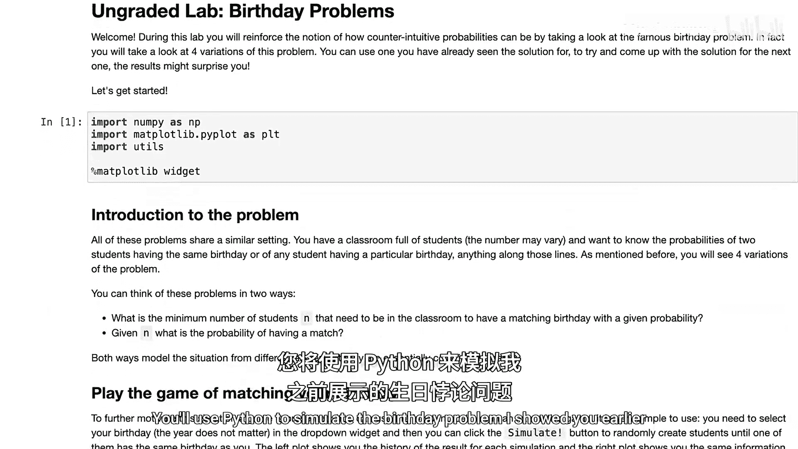

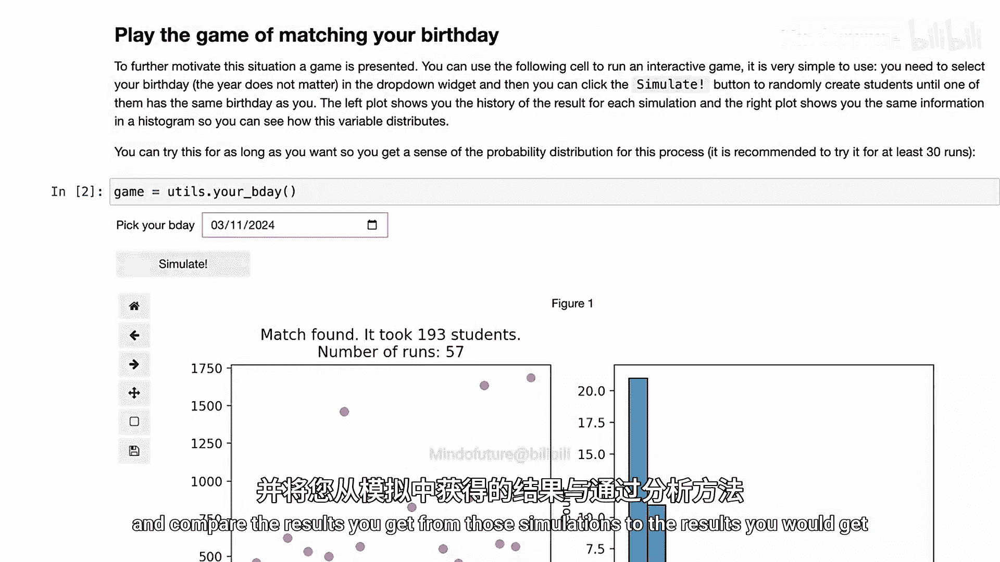

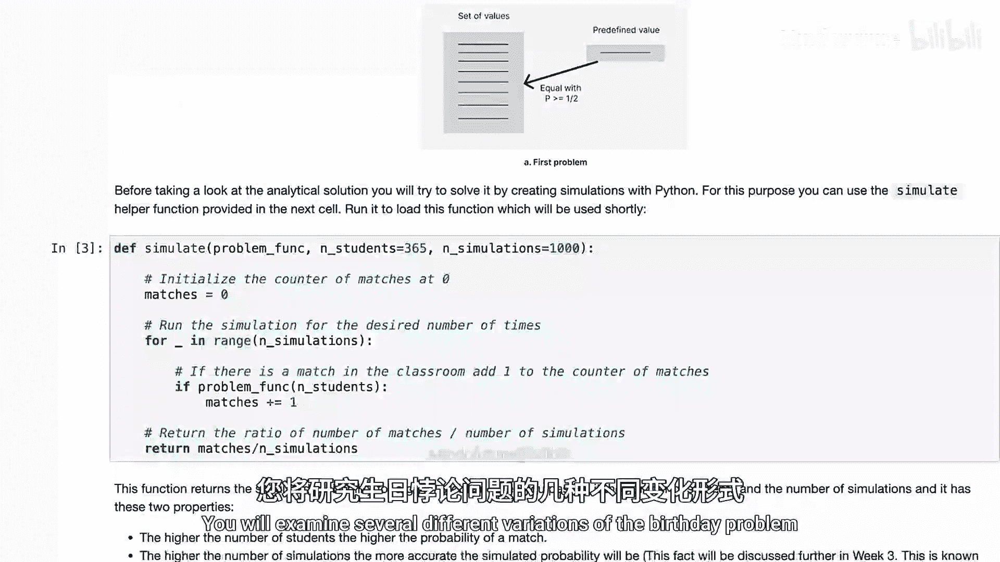

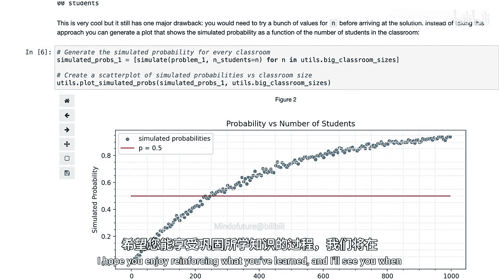