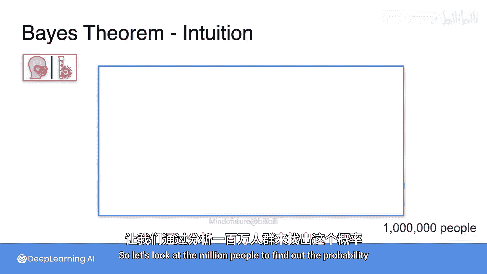
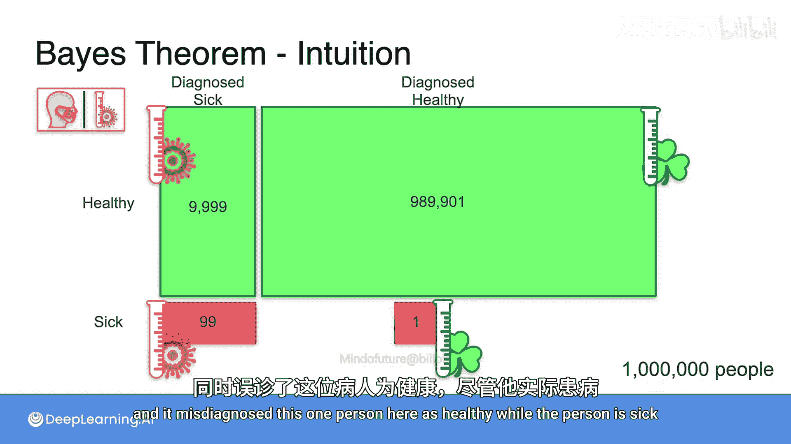
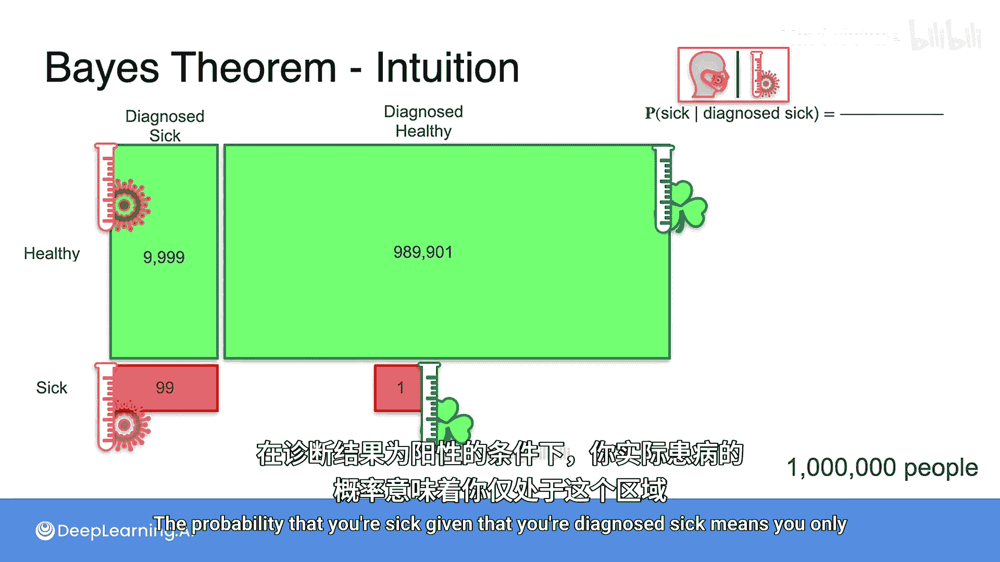
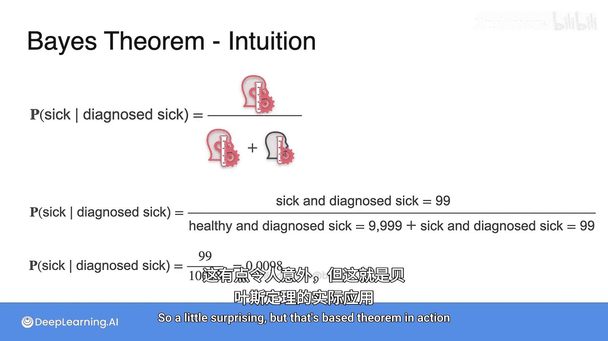

# 【Deeplearning】机器学习和数据科学概率与统计3 ｜ Machine Learning Probability And Statistics 吴恩达 p12 P12_贝叶斯定理直观理解_01_01_16 -BV1c86VBrE93_p12-

So imagine the following scenario， there's a rare disease going on and you want to get tested for it。

 so you go to the doctor and the doctor says I have a very effective test which is correct most of the time。

You take the test and then go home， and then the doctor calls and said you test it positive。

So maybe it's time to panic， but before panicking， I always do some math。

So the idea is to calculate the probability that you have the disease。

Given the fact that you tested it positive。This is an example of base theorem base theorem is one of the most important theorems in probability and is used all over the place。

 including in machine learning。It is used for spam recognition， speech detection。

 and many other things。So let's take a look at basetM in this example with some numbers so let's put some numbers。

 let's say there's a million people in the population and let's say that the illness only affects one of every 10000 people Now the test that the doctor gives you is 99% effective what does that mean that means two things that out of every 100 sick people 99 get correctly diagnosed as sick and one gets incorrectly diagnosed as healthy and among every 100 healthy people one gets misdiagnosed as sick and 99 get correctly diagnosed as healthy。

Now you went to the doctor and you tested sick so now the question is are you really sick or not more specifically。

 what is the probability that you're sick， given that you test it sick。

 let's try to find this probability before panicking。So here's a quiz to test your intuition。

 where do you think that probability lies？So let's look at the million people to find out the probability。

Among the1 million people， only one out of every 10，000 is sick。So 999。

900 are healthy and only 100 are sick。Now let's test every single person。

So here on the left we're going to have the ones that were diagnosed sick and on the right the ones that were diagnosed healthy now since the test is 99% effective。

 then among the many， many， many healthy ones， it only made a mistake in 1% of them and that's this 9。

999 here， so those were healthy people who were diagnosed as sick。

This group over here was 99% of the healthy people that were correctly diagnosed as healthy。

This group over here on the bottom now is the sequence， and since the test again is 99% healthy。

 that means the test correctly diagnosed these 99 out of 100 sin and it misdiagnosed this one person here as healthy while the person is sick。

 Now let's look at the people who are diagnosed sick。

We have to figure out the probability that you're sick given that you were diagnosed sick。

 so we're only looking at the left two rectangles， the probability that you're sick。

 given that you diagnose sick means you only live here because these are the people who are diagnose sick and what is the probability that you're sick among this group。

 well in this group only 99 people are sick？

And what's the total99 plus 9999， so most of them are actually healthy， Can you see again？

Most of the people who were diagnosed sick are actually healthy， there's 9。

999 of them and only 99 who are actually sick， so the probability that you're sick when you belong to this group is simply 99 divided by 99 plus 9999。

 plus 99 divided by 1098， which is 0。0098， which is actually less than 1%。So isn't that astonishing。

 you were diagnosed sick， but the probability that you're actually sick is less than 1%。

The probability that you are sick and diagnosed sick is the number of people who were sick and diagnosed divided by the total number of people who were diagnosed。

 but a lot of people were diagnosed sick because that 1% of the healthy people who were diagnosed sick is a lot bigger than the one out of every 10。

000 who were actually sick and diagnosed sick。And what you saw here was just an example of base Theorem。

 we can look at it as at 3， let's say here's 1 million people。Here are the 100 sins。

 there's not too many， and the 999，900 healthy ones。Now among the sequence。

 some of them are diagnosed sick， that is 99% of them。And some of them are diagnosed healthy。

 which is 1% of them。Now among the healthy ones， 1% are diagnosed sick that's misdiagnosed。

 and 99% of them are diagnosed as healthy， so we have four groups。The sick and diagnosed sick。

 the 99 people， the sick and misdiagnosed is healthy That's one person。

 the healthy and diagnoseds sick， which is a misdiagnosis。

 there's 9999 of them and the healthy and diagnosed healthy。

 which is the majority of the population Now since you went to the doctor and got diagnosed sick then you are in one of these two groups。

 these are the diagnosed sick。 So those are the groups that matter and if you are in these groups most of them are healthy and misdiagnosed so the probability that you are actually sick。

Is 99 divided by 10，098， which is less than 1%。

So a little surprising， but that's base theorem in action。

