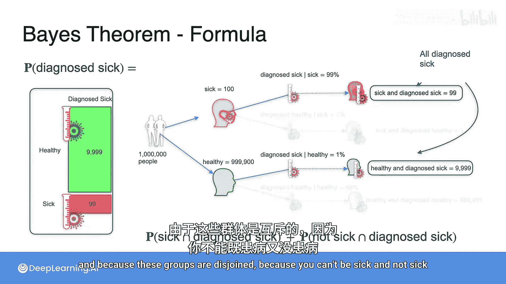
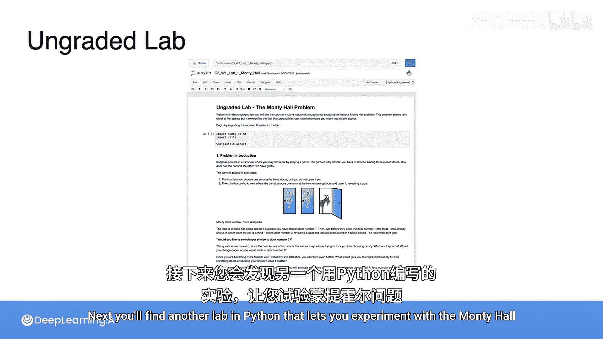
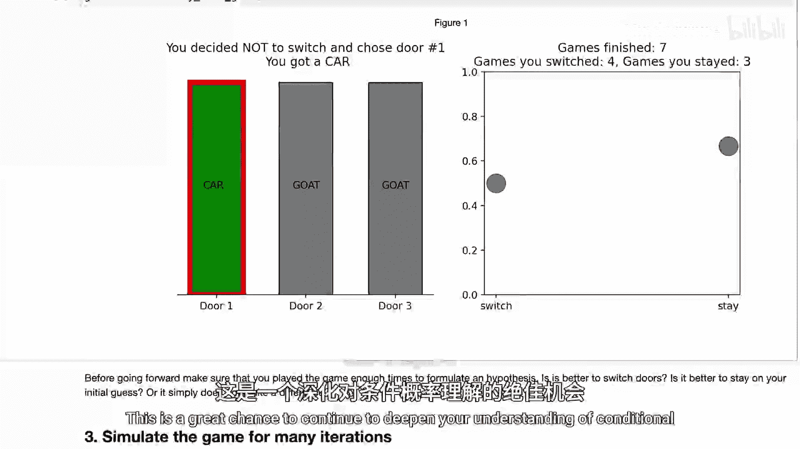
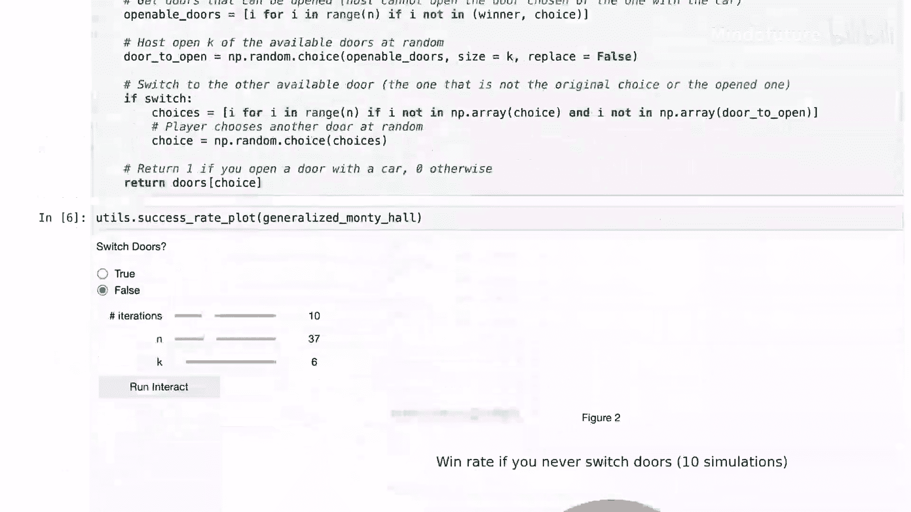

# 【Deeplearning】机器学习和数据科学概率与统计3 ｜ Machine Learning Probability And Statistics 吴恩达 p13 P13_贝叶斯定理数学公式_01_01_17 -BV1c86VBrE93_p13-

Now let's look at some formulas， so remember that we're trying to find out the probability that you're sick given that you tested sick and here's all the information that we had before。

 so we're going to look at the people who were actually sick and diagnosed sick because one the probability that you're sick given that you tested sick。

So what's the probability that you're sick given that you were diagnosed sick。

 well given the fact that there's a million people， one out of every 10，000 is sick。

 then the probability of being sick？Is 1 divided by 10000。 that's 0。01%。 That's a very。

 very small sector of the population， and that's the key of this problem that not many people are sick。

 more people are misdiagnosed than the people that are sick。

 So what's the probability of not being sick Well it's 100% minus is this So 99。

99 that's the probability of being healthy。Now let's throw in the test。

 the test is 99% effective both for sick and for healthy people。

 so the probability that you are diagnosed sick given that you're sick is 99% because that's the probability of a correct diagnosis。

And。😊，100 minus that is the probability that you're diagnosed sick， given that you're not sick。

 that's the probability of a misdiagnosis， so that's 1%。

Now we want to find the probability that you're sick given that you diagnose sick。

So we need to do some math。Let's use some variables。 A is sick and B is diagnose sick。

 so what we want is the property of a given B。 Now from the conditional probability formula。

 P of a given B times P of B is P of a intersection B。 so if we divide by P of B。

 we get that P of a given B is P of a intersection B divided P of B Let's remember what things are P of a given B is P of6 and diagnosis 6 divided by P of diagnosis 6 Let's remember this。

Now we want to find P of sick and diagnose sick， and we also want to find P of diagnose S and we're going to use base theorem。

So how do we find these two expressions， the top one and the bottom one， Well。

 let's look at conditional probability again probability of a and B is probability of a times probability of B given a。

 so the probability of sick and diagnostic sick is going to be the probability that you're sick times the conditional probability that are diagnostic given that you're sick that's simply the conditional probability formula。

 so that's what's going to go on the top。Now， what's going to go on the bottom is a little more complicated。

 but not that much， let's go back to the tree of possibilities。 we have this one over here。

 which is probability of sick and diagnosed sick。This one over here is the product of these two that's exactly the conditional probability formula。

So therefore， when we try to find P of diagnostic6， we have to look at this group over here。

 notice that。The people that are diagnosed sick belong to two groups。

 the ones that were sick and correctly diagnosed sick。

 or the ones that were healthy and misdiagnosed as sick， and this is a formula for the union。

Because the people that are diagnosed sick are the union of those that are sick and diagnose sick and those that are healthy and diagnose sick。

And because these groups are disjoined because you can't be sick and not sick。

 then the probabilities are going to add。 So the probability of being diagnostic is the sum of these two things。

 and that goes in the denominator。 And now all we have to do is apply the conditional rule one more time。

 Pro of sick and diagnostic is probability of a intersection B。 We can use this formula over here。

Which actually gives us exactly this thing over here。

 which is P of sick times P of diagnostic given sick。

Now we can do the exact same thing for P of node6 and diagnostic that' also an intersection is just a prime intersection B and that's probability of not6 temperature probabilityability of diagnostic given not 6。

 so those things can go in the denominator and that's exactly base theorem Now when we plug in the numbers what do we get。

This is 0。01%， this is 99%， this over here is 99。99%， and this is 1%。What do we get here， well。

 it's going to be the following numbers。This over here is P of A。This is P of a prime。

 this is P of B given a， and this is P of B given a prime and those go over here in the formula。

And now when we plug in the numbers， we get 0。0001 times 0。99 divided by 0。0001 times 0。99 plus 0。

9999 times 0。01， and that gives us exactly the number that we wanted。So that formula in the middle。

 P of A given B equals P of A， P of P given A divided by P of A P of P given a plus P of a prime P of B given a prime that is base theorem。

 and that may look confusing， but don't worry， we'll see it again and it'll be very clear Next。

 you'll find another lab in Python that lets you experiment with the Monhal problem。

 A classic problem from probability。 This is a great chance to continue to deepen your understanding of conditional probability as well as another chance to compare the results you get from simulation to those you get from approaching a problem analytically。

 enjoy。

