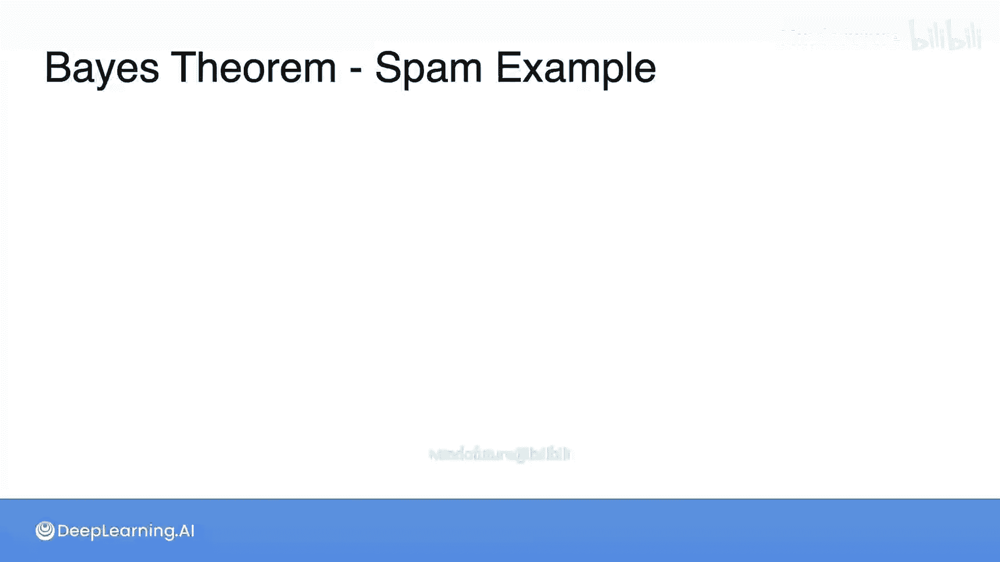
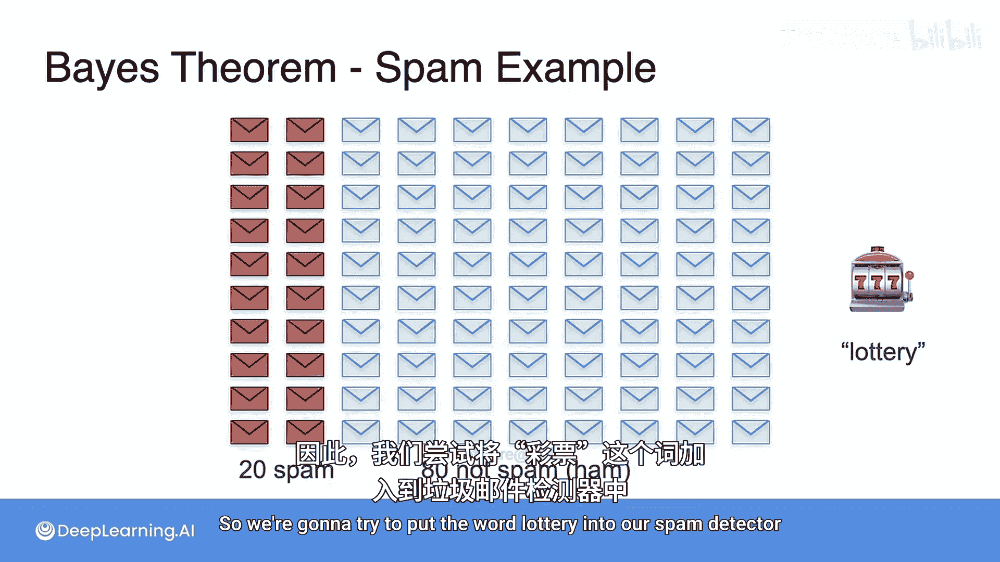
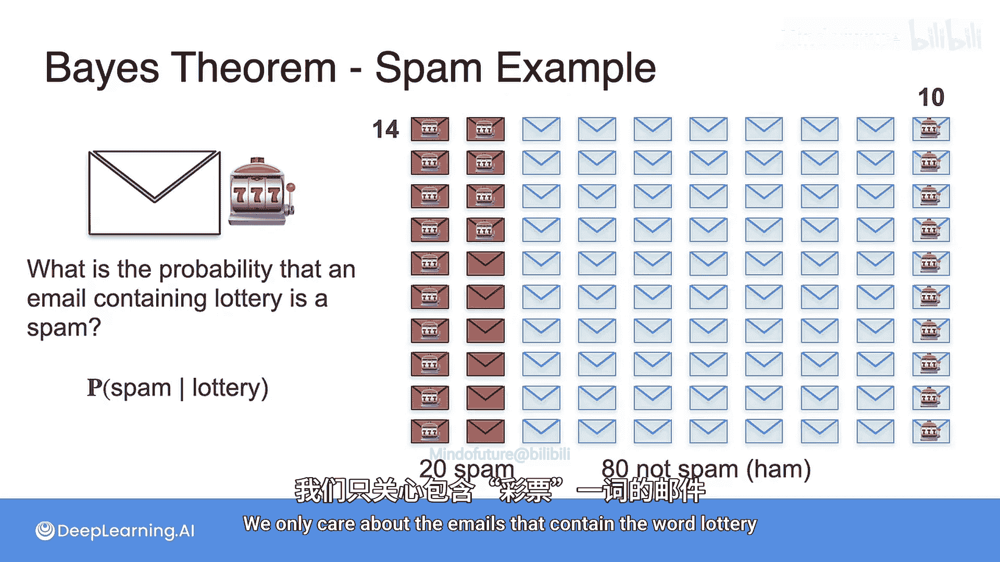
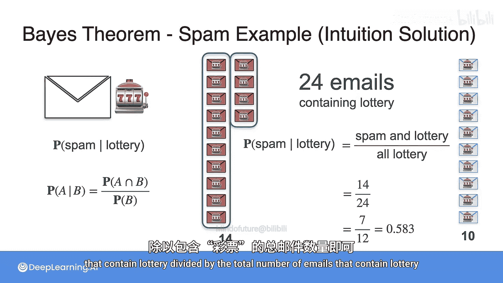
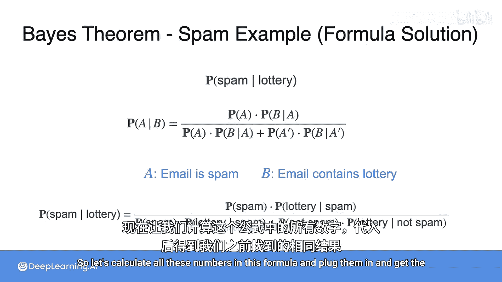
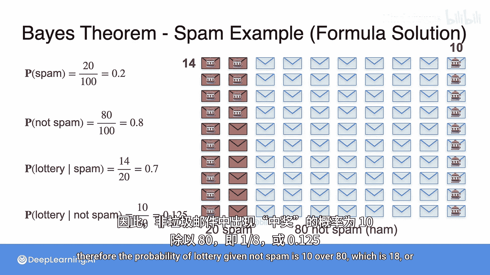
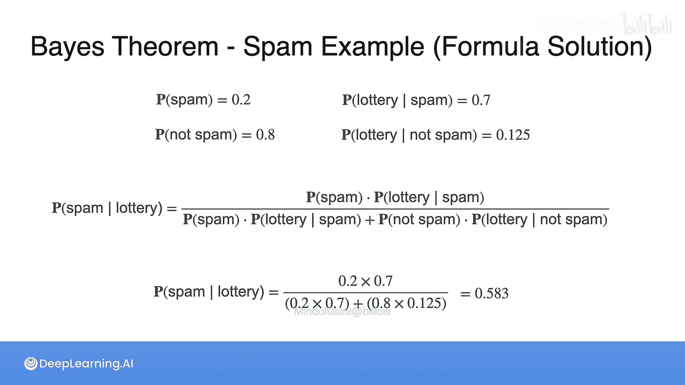

# 【Deeplearning】机器学习和数据科学概率与统计3 ｜ Machine Learning Probability And Statistics 吴恩达 p14 P14_贝叶斯定理垃圾邮件示例_01_01_18 -BV1c86VBrE93_p14-

Let me show you another example of base theorem this time we're trying to find if emails are spam。

So let's say that we have a big data set of 100 emails and 20 of them are actually spam。

So we want to build a classifier。 the easiest classifier that we can find is one that says that everything is spam with a 20% probability because that's all we know so far。

 So that's a pretty simple classifier we want to find something more elaborate and so we're going to look at a feature we're going to start noticing that the spam emails tend to have words like lottery So we're going to try to put the word lottery into our spam detector。

We're going to do the following。We're going to see how many emails among the spam ones contain the word lottery。

 and we notice that there's 14 of them。Now we're going to look at how many of the emails that are not spam that we're actually calling ham that's a way to column have the word lottery。

 so there's 10 of them。 so now what is the probability that an email containing the word lottery is spam。

 in other words， what's P of spam given lottery。Well， take a look at something。

We only care about the emails that contain the word lottery， so all of these emails don't matter。

 We only care about these 24 emails that contain the word lottery。

And remember that we want to find the probability of spam given lottery that's going to be。Well。

 among the 24 emails， how many of them are spam？Divided by how many of them are in total。

 and 14 of them are spam。And there's 24 in total， so the probability in lowest terms is 7 divided by 12 or 0。

583。This is exactly based theorem and if you were to apply the formula from the previous video。

 you would get exactly 0。583。😊，But I really want to make this clear what you're doing when you use base Theorem is deleting all the emails that don't really matter。

Taking a look only at the ones that have the condition which is the word lottery， and among those。

 the probability calculation is easy you simply take the number of spam emails that contain lottery divided by the total number of emails that contain lottery。

 but let's do it with some math。

We want to find the probability of spam given lottery。

 recall that base theorem says this where a means the email in spam B means the email contains lottery。

 so in other words。This is the formula we want to find。

 so let's calculate all these numbers in this formula and plug them in and get the same number we found before。

So what is the probability of spam？Well， we don't know the word lottery yet and so all we know is that among 100 emails there's 20 spam ones and therefore the probability of spam without knowing anything about the email is 20 over 100 or 0。

2 This is called the prior， This is the original probability that you calculate without knowing anything。

 This is the most basic piece of knowledge you have in this problem。

Now what is the probability of not spam， well， it's1 minus the probability of spam。

 so that's 80 over 100 or 0。8。Now what is the probability of lottery given spam Well we are only looking at the spam emails。

 there's 20 of them and 14 of them contain the word lottery。

 so the probability of lottery given spam is 14 divided by 20 which is 0。

7 or 70% and now what is the probability of lottery given not spam well theres 80 knot spam emails。

10 of them contain the word lottery and therefore the probability of lottery given No spam is 10 over 80。

 which is 18 or 0。125， so now let's plug in these numbers。

P of spam is 0。2， P of lottery given spam is 0。7， P of not spa is 0。

8 and P of lottery given not spam is 0。125。And we're going to plug them into this formula。

So we get P of spam given lottery is 0。2 times 0。7 divided by 0。2 times 0。7 plus 0。8 times 0。125。

 which is exactly 0。583， so that coincides with what we got at the very beginning。

