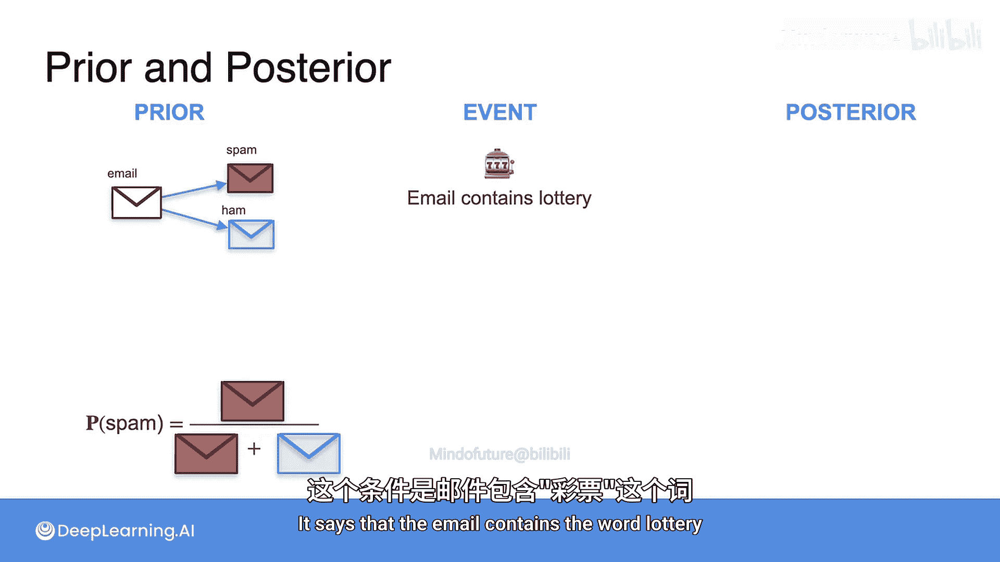
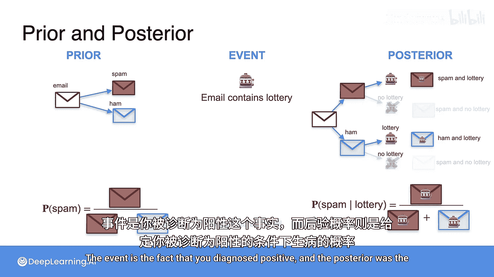
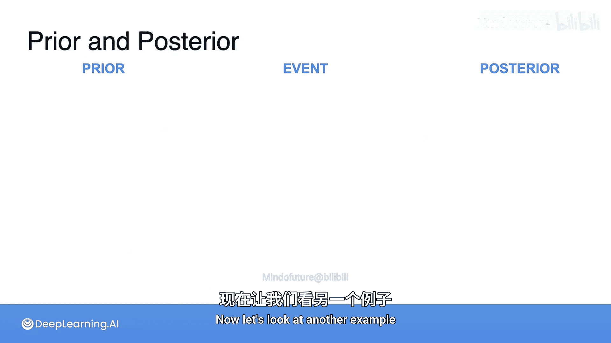
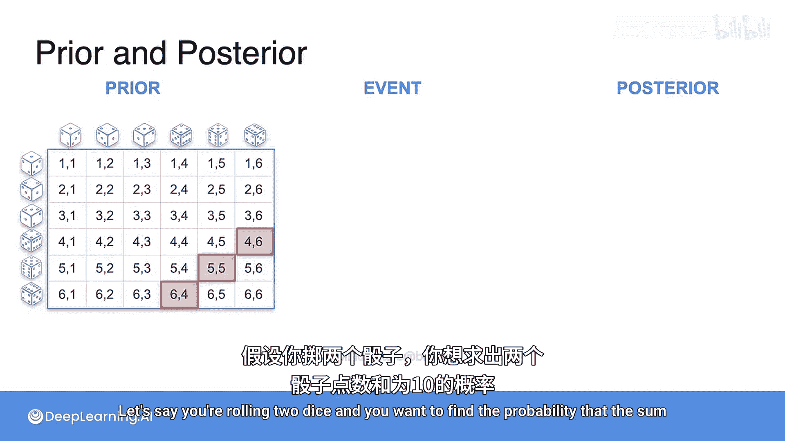
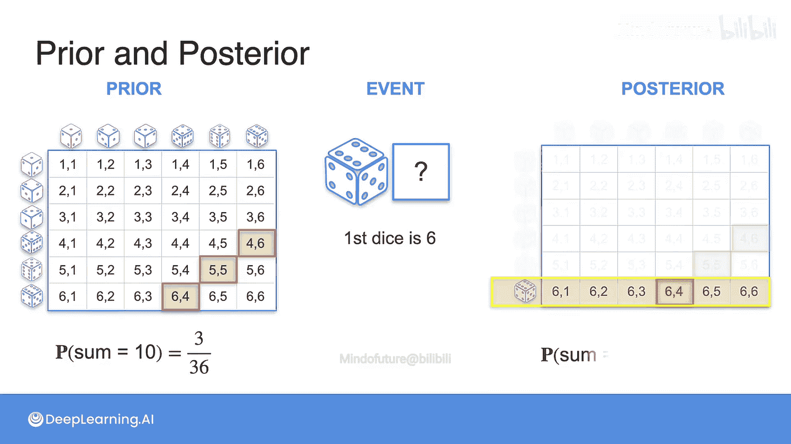
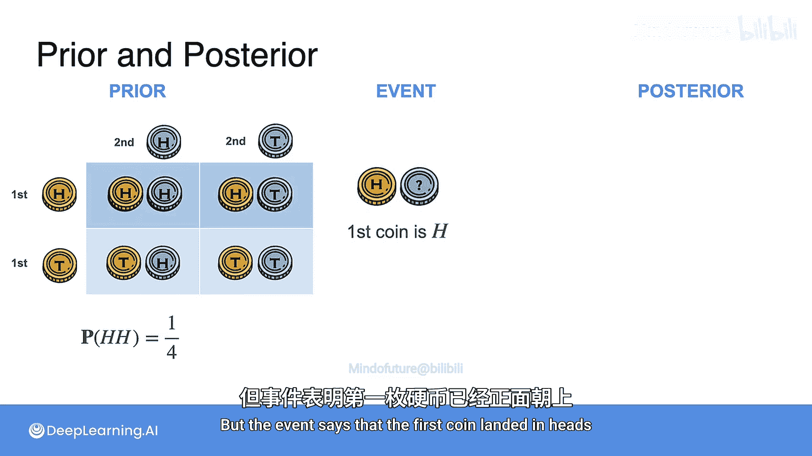
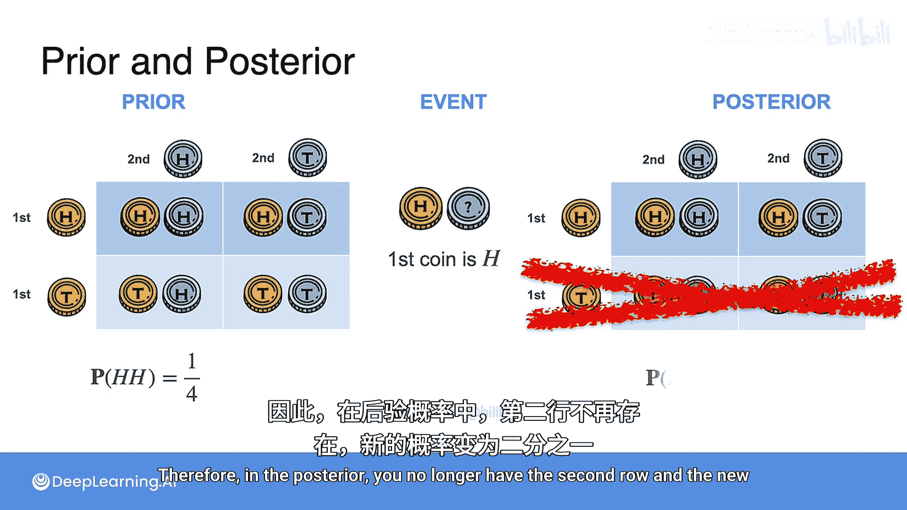

# 【Deeplearning】机器学习和数据科学概率与统计3 ｜ Machine Learning Probability And Statistics 吴恩达 p15 P15_贝叶斯定理先验与后验_01_01_19 -BV1c86VBrE93_p15-

Now this is something I mentioned before， but let me formalize it。

 We have something called the prior that is the original probability that you can calculate not knowing anything else。

 then something happens and that's the event the event gives you information about the probability。

And with that information， you can calculate something called the posterior。

 so we had that the prior was P of a。An event can be called E， and the posterior is P of a given E。

 Now， let me give you some examples。In the spam email the prior was 20%。

 the prior was the number of spam emails divided by the total number of emails。

 the only thing I know about an email if I know nothing else is that it has a 20% probability of being spam because I know how many emails for spam in total that is a very basic unit of information and I need to know a little more so we come up with a condition。

An event， it says that the email contains the word lottery， so now the posterior changes。

Now the probability that the email is spam given that it contains a word lottery。

 is no longer the number of spam emails divided by the total number of emails。

 but it's now the number of spam emails with the word lottery divided by the total number of emails with the word lottery and that's a much better probability that's a much more accurate probability。

 so the posterior is always a better estimation than the prior because we have that event that gave us information。

In the medical example， there was also a prior an event and a posterior。

 the prior was the original probability of being sick；

 the event is the fact that you diagnosed positive and the posterior was the probability that you were sick given that you diagnosed positive。

Now let's look at another example， let's say you're rolling two dies and you want to find the probability that the sum of the values is 10。

 we know that that's 3 divided by 36 now if the event says that the first diece is a6 then all of a sudden your posterior changes now it's 16 because you live in a different space so that is the posterior。

And in another example， the coin example。If you want to find the probability that both coins land in heads。

 then that's one quarter， but the vent says that the first coin landed in heads。

 therefore in the posterior you no longer have the second row and the new probability is12。

