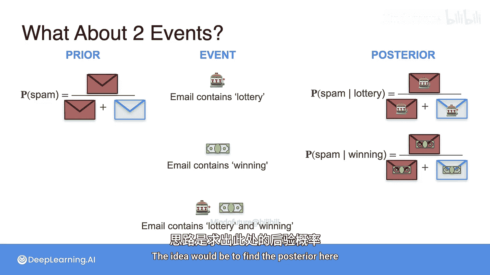
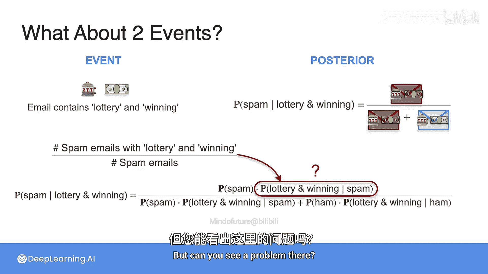
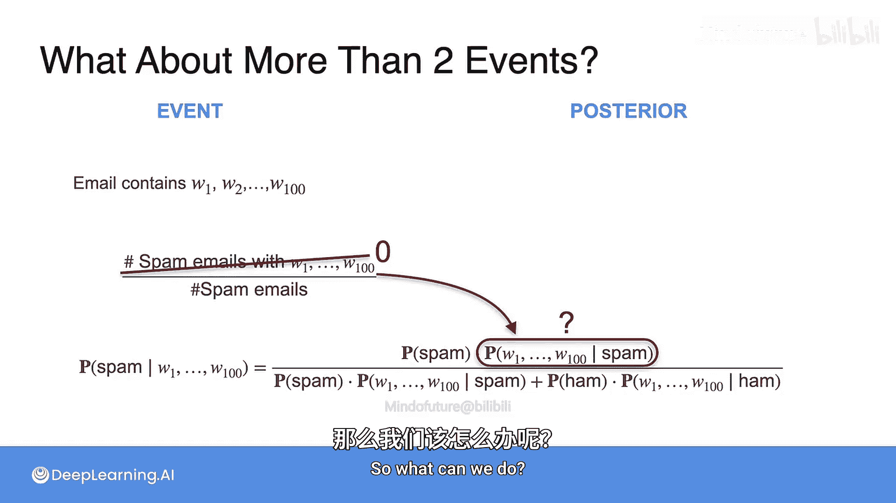
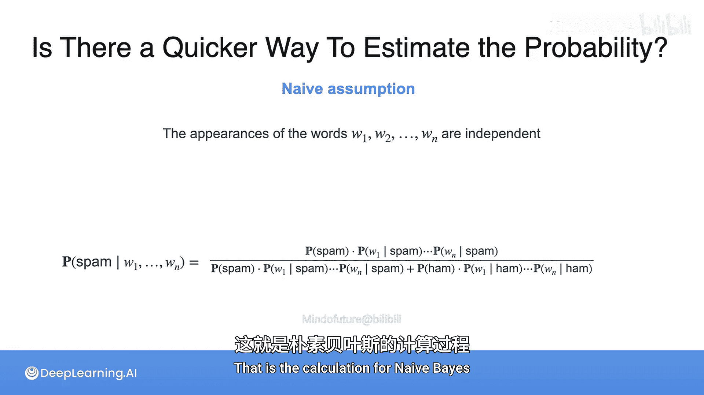
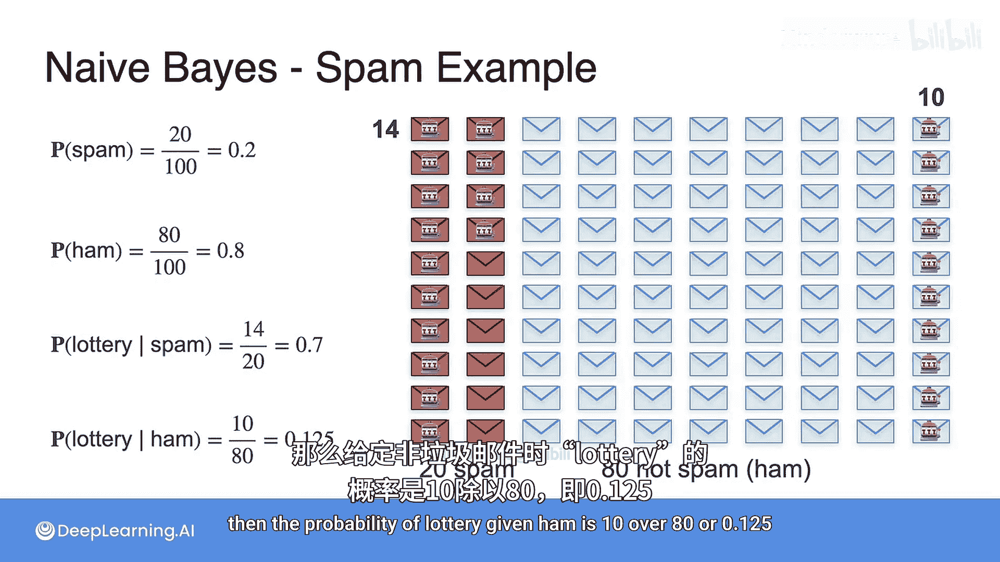
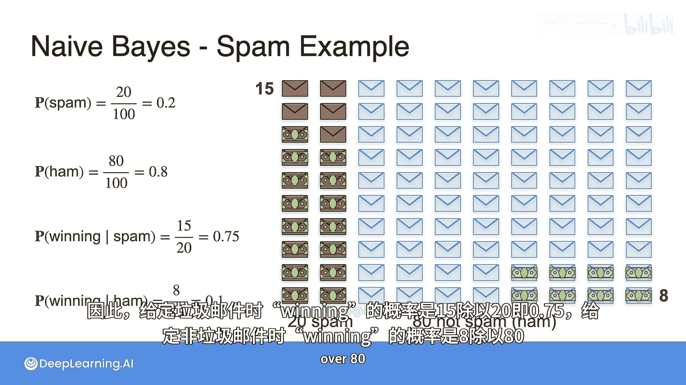
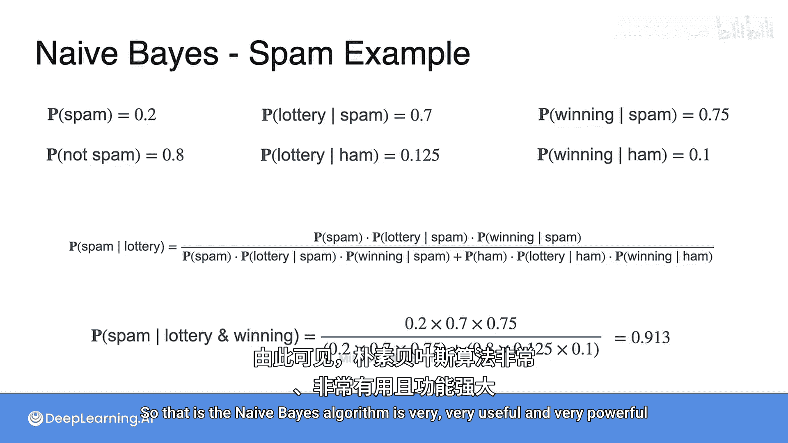

# 【Deeplearning】机器学习和数据科学概率与统计3 ｜ Machine Learning Probability And Statistics 吴恩达 p16 P16_贝叶斯定理朴素贝叶斯模型_01_01_20 -BV1c86VBrE93_p16-

So let's go back to the base theorem example where we have the prior the probability of an email spam。

 the event that gives us information about the email and the posterior， which is a new。

Better probability that the email is spam given the event， which is that it contains the word lori。

 Now， obviously， we're not going to build a classifier with only one word。

 We're going use it with many， many， many words。 So let's look at another one。

 Let's say that we use the word winning and we calculate the posterior probability of an email beings spam given the fact that it contains the word winning。

Now how would we combine these two How would we make a stronger classifier with the words lottery and winning the idea would be to find the posterior here。

 so we can do it in a simple way by simply calculating the probability that an email is spam given the fact that it contains lottery and winning by dividing the number of spam emails that contain lottery and winning by the number of total emails that contain lottery and winning。

In other words， if this is base theorem we be calculating this number as the number of spam emails that contain the two words divided by the total number of spam emails。

 but can you see a problem there well imagine if I don't want to do this with two words but with 100 words w1 up to W100 so here's base theorem and if I want to calculate this then I need to divide the number of emails。

That contain all 100 words divided by the number of spam emails。However。

 asking for an email to contain 100 words is very hard。

 maybe there's no emails like that in our database。

 and so we get zero over zero and that's not a good calculation， so what can we do？

Well， let's go back to the problem with two words and the idea is that we really want to calculate this and if we can't calculate them。

 then we can at least estimate them and we're going estimate them using a naive assumption the naive assumption is the key to naive base and that's why it's called naive base and the assumption says that the appearances of the words later and winning are independent from each other。

 Now this is obviously not true。 Word are not independent from each other。

 wordss depend on each other。If I have the word good appearing。Well。

 the word morning is more likely to appear because good mourn tend to appear together。

 So words are dependent。 but if we assume that they're independent， then the math works out much。

 much better。 and we actually can get some pretty good results by making this naive assumption。

 So that's why we build a naive base classifier。 So when you look at probability of lottery and winning given spam。

 That's the probability of an intersection of two things。 And if they happen to be independent。

 then their probability is the product of the two things。

 So all of a sudden we have probability of lottery and winning given spam。

 we have probability of lottery given spam times probability of winning given spam and the same thing for the denominator for spam and for he。

And the same thing happens with n words n can be huge。

 but the probability of an email containing all these words given that it spam can be estimated as the product of all these probabilities of the email containing each one of the words given that it spam。

And that is the naive base algorithm that is the calculation for naive base。

 let's look at an example， let's go back to the previous example where we had that there's 20 spam emails out of 100 and therefore the prior is that the probability of spam is 20% the probability of he which is not spam is 80% because it's 100 minus20% and because among the 20 spam emails 14 of them contain the word lottery then the probability of lottery given spam is 14 over 20 which is 0。

7 and because there were 10。

Hm emails containing the word lottery out of 80 total ham emails and the probability of lottery given ham is 10 over 80 or 0。

125。

When we do the same thing with the word winning we see that there are 15 spam emails that contain the word winning and only eight ham emails that contain the word winning。

 So P of winning given spam is 15 over 20 or 0。75 and P of winning giving ham is 8 over 80 which is 0。

1 So with these numbers we are going to do the calculation So here is what we had for naive base and we get the calculation with these numbers。

 we get that the probability of an email being spam given that it contains the words lottery and winning is 0。

2 times 。7 times 0。75 divided by 0。2 times 0。7 times 0。75 plus 0。

8 times 0125 times 01 which is 0913 and as you can imagine if an email contains the words lottery and winning is much much more likely to be spam so this 91。

3% is much higher。 So that is the naive base algorithm。

It's very， very useful and very powerful and in a lab you're going to be able to play with it。

