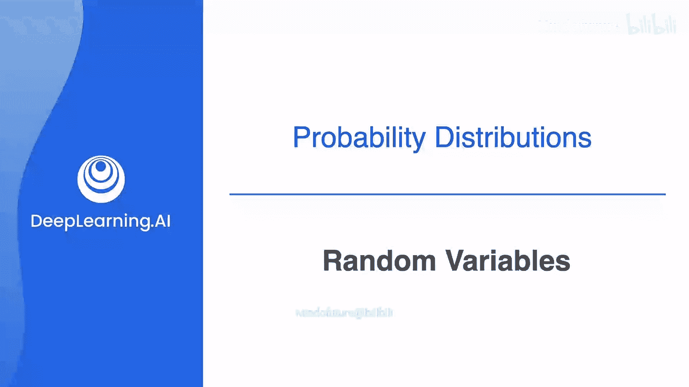
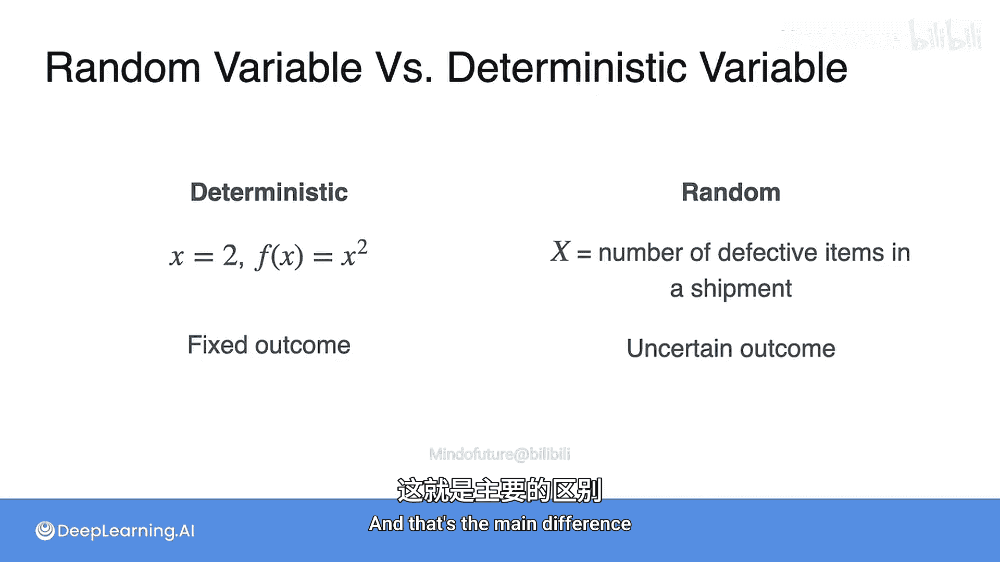

# 【Deeplearning】机器学习和数据科学概率与统计3 ｜ Machine Learning Probability And Statistics 吴恩达 p18 P18_随机变量_01_02_01 -BV1c86VBrE93_p18-

Welcome to lesson2。 Now we get to one of the most important concepts in probability。

 which is the concept of a random variable and it's not something that new you've seen variables before。

 For example， in how we have learned the variable x equals3。 it always has the same value。

 random variables are different they can take many values。 For example。

 the temperature is a random variable that can take many values。

 another random variable is the number of heads I obtain if I toss a coin 10 times that is another random variable。

 So in this video I'm going to show you all of our random variables。

 So let's go back to the coin flipping experiment。 When you flip a coin let's say you can obtain heads or tails and let's say that you can obtain them both a probability of one half like before Now let's change this around a little bit。

 Let's take a variable X and call it the number of heads。

 So what happens now when you flip a coin how many heads can we obtain well， if we obtain heads。

 then we obtain one heads and if we obtain tails then we obtain zero heads。If we look at x。

 then x can be 1， if we obtain heads onces and x can be 0 if we obtain heads0 times。

 and the probability of x equals 1 is the same probability of obtaining heads which is 0。

5 and the probability of x equals 0 is the same probability of obtaining tails which is 0。

5 x is called a random variable and is one of the most important concepts in probability and statistics。

You can think of x as a variable that not always has the same value。

 half of the times it takes a value of 1 and half of the time it takes a value of0 roughly。

Now let's look at another random variable let's look at the number of heads we obtain in 10 coin tossses。

 so let's say we flip at 10 times and all of them are heads so x equals 10 or we flip them and one of them is tails so we obtain x equals9 and we can obtain x equals9 in many different ways and let's say we stick to probability of heads equals 0。

5 so what are the probabilities of these events Well since all of them are independent all of them have probability one half then this is one half to the1 What about the second one it's also one half to the10 but we can write it as one half to the9 for all the heads and one half for the remaining tail and the same thing for the next one however a harder problem is to actually ask what's the probability that we obtain zero heads in total p of x equals0 or p of x equals1 or all the values until p of x equals 10 because on the left we have a particular scenario a particular way to obtain the heads and tails but on the right we're grouping them all as you can see the first one is the same P of x equals 0 is the same as obtaining。

All the heads which is 0。5 to the 10 but the others are a little harder So when I want to calculate things the first thing I do is run an experiment so let's run an experiment so let's say we run this experiment many times and we obtain x equals 5 x equals6 x equals5 again and we run it many。

 many times and what are the possible outcomes while the possible outcomes are0 all the way to 10 because you can obtain 0 heads one heads all the way to 10 and if we stick to probability of heads equals 0。

5 and let's say we're gonna repeat this 500 times and let's see what we obtain the histogram we obtain is this one over here notice this is just a histogram it's not the actual probabilities but it gives us a good estimate of the probabilities because we run it a bunch of times notice that the probability of x equals 0 or x equals 10 are the smallest ones because it's not likely that we're gonna obtain 10 heads or 10 tails the highest one is over here P of x equals5 because it's likely we're going to get roughly half half and we can see all the other ones for example heres P。

Of x equals 8， that when you obtain eight heads and two tails。

So this is a random variable Why do we care about random variables because they allow us to model the entire experiment at once and most problems in probability can be expressed as random variables So for example if you flip a bunch of coins as we saw and x is the number of heads that's a random variable you can roll a bunch of dice and define x as the number of times you obtain a1 or you can see a bunch of patients and say that x is the number of six patients or you can just define random variables。

 let's say I define one that is one with probability 12 but it's also minus7 if probability。

2 and it's also 3。14159 with a probability of 03 I can come up with any random variable I want that takes any values as long as the probability is at to1 I'm good。

Now， here are other random variables， for example。If you are waiting for the bus the wait time until the next bus arrives is a random variable。

 it could take many different numbers， the height of a gymnast jump is also a random variable that has some range of values。

 the number of defect products in a shipment is also a random variable and let's say the number of millimeters of rain in November is also a random variable。

You may be noticing that they behave in different ways and that's because there's two big types of random variables。

 there's discrete and continuous random variables discrete ones are the ones we've been seeing so far the number of ones or six as if I roll the dies the number of heads if I flip coins the number of kidss in a specific group with a particular height from a particular age and the continuous ones could be for example。

 the amount of time till the next bus arrives， the height of a gi jump the number of millimeters of rain in a particular month why are they different I encourage you to take a look and tell me why you think they are different and one thing that happens is that the one on the left can take a finite number of values I can flip a coin 10 times and I could obtain0 all the way to 10 heads on the other hand the ones on the right can take an infinite number of values because the time can be one minute but it can also be 1。

01 minute or 1。00123 minutes there's an infinite number of values they can take but actually this is not true。

Qu ones can also take an infinite number of values。

I'll give you an example if I start flipping a coin until I obtain heads。

 I could do it one time or two times or three times or4。

 I could do it 500 or a million and perhaps not obtain heads。

 the probability is very small but I have an infinite range of values。

 so what really happens is that the discrete ones can only take countable number of values whereas the continuous one take values on an entire interval。

So the values that a discrete random variable can take can be put in a list 1，2，3，4，5， etc。

 whereas the values that a continuous random variable take cannot be put in a list because it's an entire interval Now you may be thinking what's the difference between these random variables and the ones that you see in algebra and calculus and the difference is that the ones you see in algebra and calculus are deterministic and the ones we see here are random what is deter deterministic for example x equals 2 or for example。

 the input of the function f of x equals x squared。

 they always take the same value once it's defined it's like that forever however。

 the random variables not like that， it can take for example， many values。

 they're associated with an uncertain outcome so the deterministic variables are associated with a fixed outcome and random variables with an uncertain outcome and that's the main difference。

