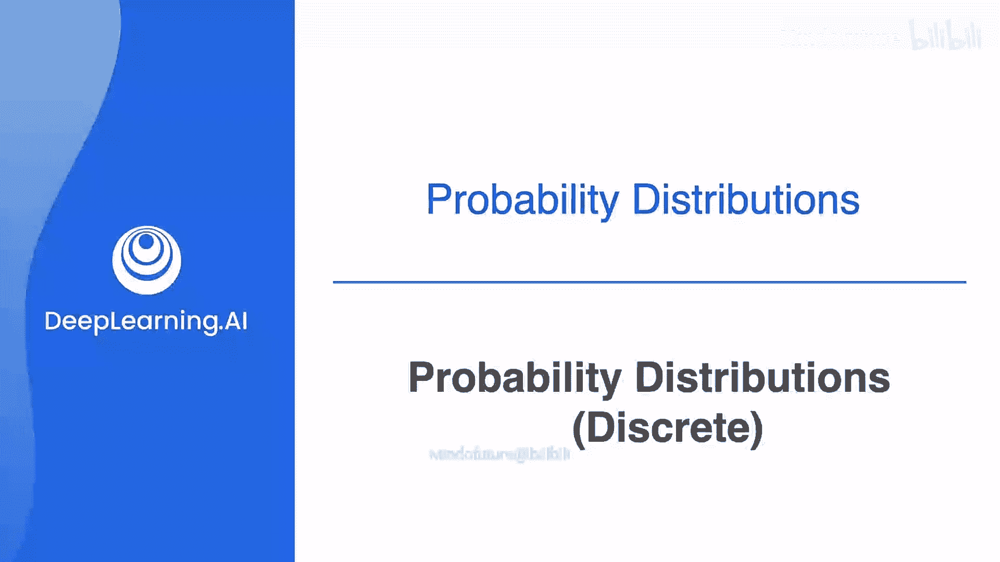
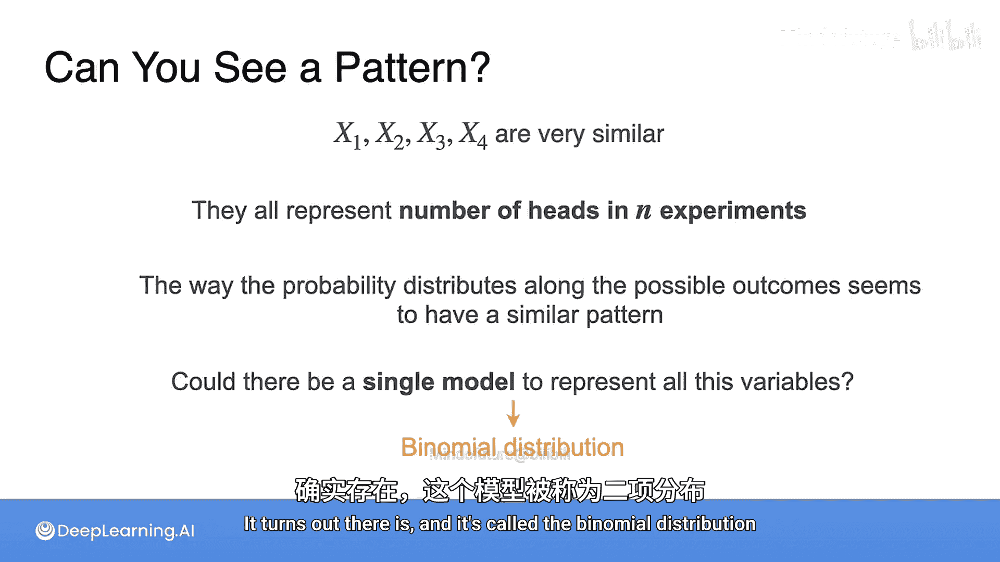

# 【Deeplearning】机器学习和数据科学概率与统计3 ｜ Machine Learning Probability And Statistics 吴恩达 p19 P19_概率分布离散型_01_02_02 -BV1c86VBrE93_p19-

In lesson one you learn how to calculate individual probabilities and how to do math with them。

 but imagine that you have all the possible scenarios that can happen put them on this horizontal axis and for each one of them look at the probability that they happen this forms a probability distribution and that's the topic for this lesson so imagine now that you're tossing three coins and you're interested in the number of heads this will be your random variable how does each outcome of the experiment affect the random variable well the first possibility is that you get no heads the second one is that you get one out of three heads but here you can see that you actually have three options to obtain one heads either on the first the second or the third coin the same is true if you get two heads out of three where you can get tails either on the first second or the third coin。

And again， there's only one option to obtain all three heads Now let's reorder this a bit。

You can see that you just have one way of getting three tails and one way of getting three heads。

 however there are three ways in which you can obtain one heads and two tails or two heads and one tails。

Now you can divide this number by the total number of possible outcomes which is 8。

 and what we get are probabilities for each of the outcomes and from this image you can clearly see why it is much more likely to obtain one or two heads than0 or3。

And it is because of how many different outcomes contribute to each of these options。

And now we can look at this as just a normal histogram。

Now let's look another slightly more complex example where you flip four coins。

 your new variable is a number of heads in four coin tosses and you can see that something similar has happened。

There is only one option when you have all heads or all tails。

 however there are four ways in which you can obtain one heads or one tails。

 and finally this one's a bit more complex but you have six possibilities where you see two heads and two tails。

This gives you a total of 16 possible outcomes for how your coins can land。

 so you assign 116th to  one and 4 heads， four over 16 to one and3 heads。

 and finally 6 over 16 to seeing two heads and those are your probabilities and this is the histogram we obtain for four coin classes。

Now let's look another variable， the number of heads in five coin tosses and again with all heads or tails。

 there's one option out of 32 total with one head or one tail there's actually five options out of 32 with two or three heads。

 there's actually10 options Now it's easy to figure out that for all heads。

 there's only one possibility or for only one head there's as many possibilities as flips because the head can be any of the five flips but how you calculate that there are 10 options for two heads。

 luckily theres system method for that。 stay with me in the next video to find out how it works Each par represents the probability that the variable x3 takes each of the possible values 0。

1，2，3，4 and 5 Now for each x from 0 to 5 you have the probability that x3 is x this is called a probability mass function of x3 and we use a lowercase B to represented All these cr random variables can be modeled by their probability mass function also abbreviated。

PMF since it contains all the necessary information to understand how the probability distributes among all the possible values of the variable。

Now what are the requirements for the PMF， first of all。

 since it's defined as the probability that the random variable takes at a particular value。

 then it always has to be positive Now note that when you sum the PMmf over all possible values。

 they all sum to1， this makes sense since you' are considering the probability of all possible outcomes of the experiment。

 the second condition for the PMmf is that the sum of all its values must be1。By the way， x1。

 x21 x3 are very similar they're all counting the number of heads in a fixed number of coin tosses。

 it was 3 fx1，4 for x21， 5 for x3。Also， the way the probability distribute over all possible values follows a similar pattern。

 could there be a single model to represent all these random variables。

 it turns out there is and it's called the binomial distribution。

 you'll learn about that in the next video。

