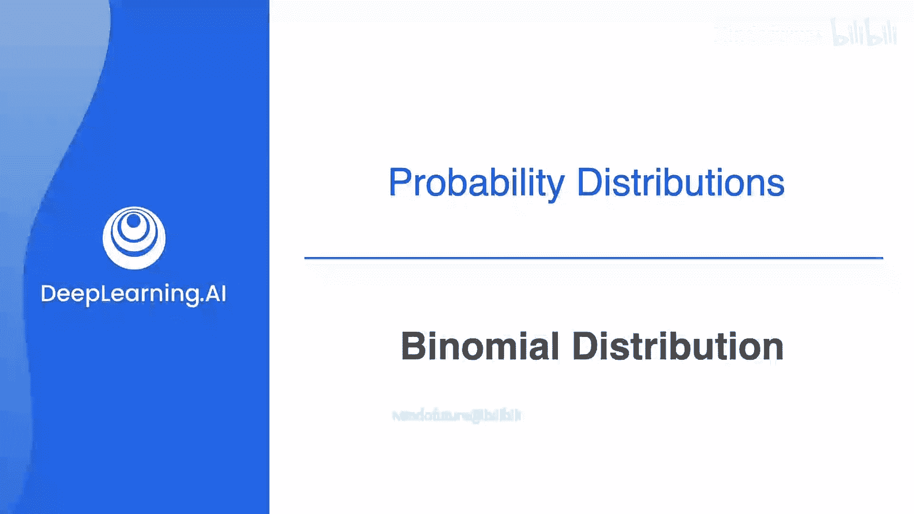
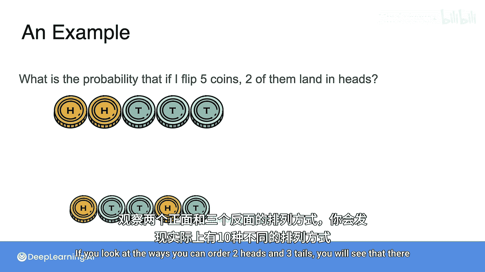
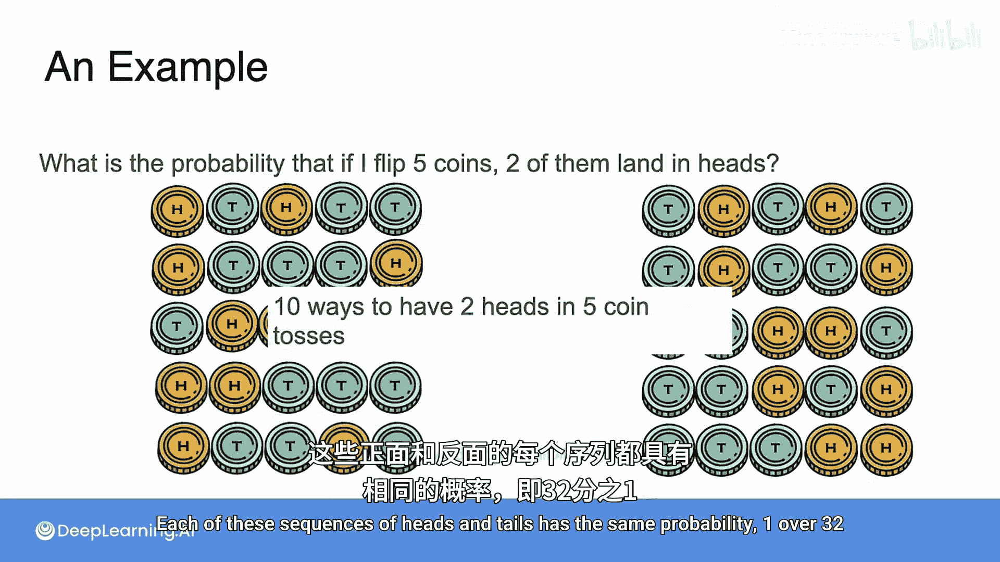
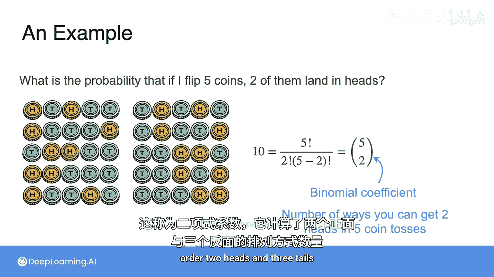
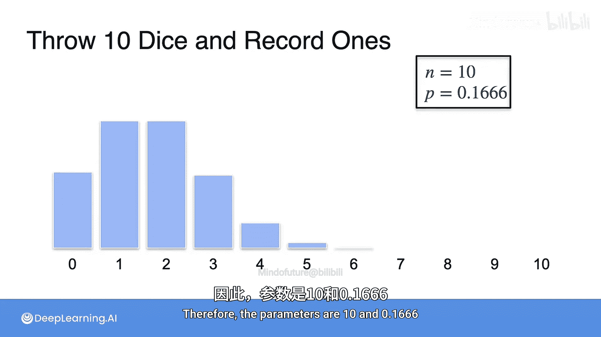

# 【Deeplearning】机器学习和数据科学概率与统计3 ｜ Machine Learning Probability And Statistics 吴恩达 p20 P20_二项分布_01_02_03 -BV1c86VBrE93_p20-

So let's start with one of the simplest distributions out there。 The binomial distribution。

 I like to imagine it with coin tosses。 Let's say I toss a coin 10 times How many heads can I obtain Well。

 it could be 0，1，2，3 all the way up to 10。 Each one comes with its own corresponding probability。

 So we draw the histogram probabilities and that's the binomial distribution the binomial distribution as an example for discrete distributions which are the simplest ones that we'll see first later in the course we learn the continuous ones too but let's get to the binomial distribution now So what is the probability to obtain two heads when you flip five coins for each flip there is a one half chance to get heads or tails and if you multiply this together。

 you get one over 32 which is a probability of this specific outcome。

 but there are more ways to obtain two heads out of five， for example。

 this one here and this one has exactly the same probability to be obtained as the one on top。

 and it turns out that there are actually 10 possibilities to get two heads out of。はい。

If you look at the ways you can order two heads and three tails。

 you will see that there are actually 10 ways to do that。

 each of these sequences of heads and tails has the same probability，1 over 32。

Now is there some general way to find the number of possible combinations。

 this is just ordering a sequence on two heads and three tails。

 so five factorial is a number of ways you can order five coins。

 but this is overkill because these five coins have repeat numbers so you need to account for that。

Divide5 factorial by two factorial to remove all the cases where you have simply swapped the two heads and now also divided by three factorial to remove all the cases where you have simply swapped the three tails。

This is called the binomial coefficient and it counts the number of ways you can order two heads and three tails。

In general， the coefficient n choose k counts all the combinations in which you can have k heads in n coin tosses。

 one from property is that n choose k is the same as n choose n minus k and the reason for this is because obtaining k heads is the same thing as obtaining n minus k tails。

And this is why the PMf of a fair coin has a symmetrical shape。

Now can you find a general way to write the PMF for the number of heads in five coin tosses well。

 for more generality， suppose that the probability of heads is P consider the event capital x equals lowercase x where capital x is a random variable and lower K X is the number of heads in5 tosses which can be 0。

1，2，3，4， or5。What is the probability of this event Well you will need to have x head so that has probability P to the x this is the probability of one particular order and the remaining 5 minus x tails with probability 1 minus b to the 5 minus x however this is just a probability for one particular ordering so you need to take into account all the possible orders which is 5 choose x。

You're missing just one thing this expression is of course valid for x equals 0， 1，2，3，4 and 5。

 since you can have more than five heads and five coin flips。

 this is the PMF for x and we say that x follows a binomial distribution。

We deote it as binomial of5 and p， where 5 is the number of flips and p is the probability of heads。

And in general， this still the symbol means that the variable x follows the distribution to the right of the expression。

If P is 0。5 and n goes 5， then you get the following PMF。

Remember that here you're flipping five coins on the probability of heads is12 and the graph is here。

 notice that since p is 12， then the PMF is symmetrical。In the case where we have a different P。

 so we have a biased coin， for example， p equals 0。

3 then you have greater chances of seeing a small number of heads and this is reflected in the PMF Now in the example you were tossing five coins。

 but if you were tossing the coin any number of times then the model should be the same。

 youre simply changing a parameter。In the case that we toss n coins then we have a PMF like this where the probability mass function is n choose x p to the x1 minus p to the n minus x and we call that binomial of n and P where n and P are the parameters of the binomial distribution N is the number of tosses and p is the probability of obtaining heads Now try to answer this question what is the probability of throwing a dice five times and getting three once the order doesn't matter。

Well， when you throw a dice， you can get a one or not a1。

 which is not that different from a coin in a coin。

 you can get heads or tails and you can think of the die as a biased coin where you get heads if you throw a one and tails if you throw anything else so it's a biased coin Now for a dice the probability of each value is 16。

 So now this coin will have a probability of heads of 16 and tails of。Five， six。

 because that's all the remaining values。And you can draw a similar histogram of before for a different P。

 but the same n this time you have n equals 5 and p equals 16， so in other words。

 we can look at a dice as a bias coin for this experiment。Now let's look at another case。

 let's throw the dice 10 times and just like before we record the number onces。

 this is again a binom probability distribution， can you tell me what are the parameters of this distribution well the above problem can be represented the binom distribution where n equals 10 and 10 represents the number of dice throws and p represents the probability of obtaining a 1 and that is 16。

Therefore， the parameters are 10 and。1666。

