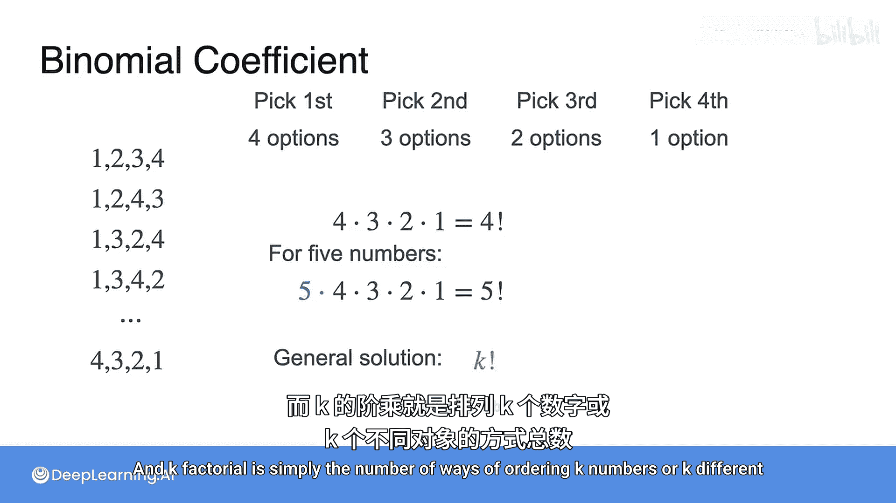
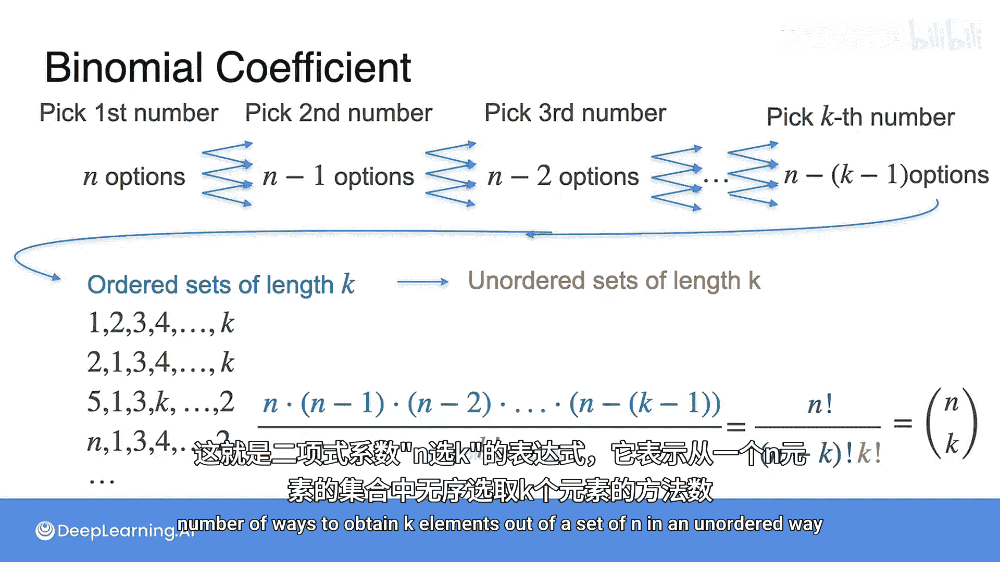
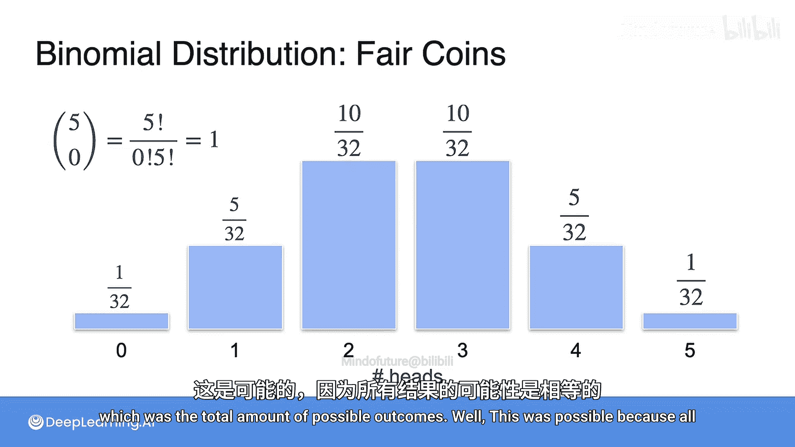
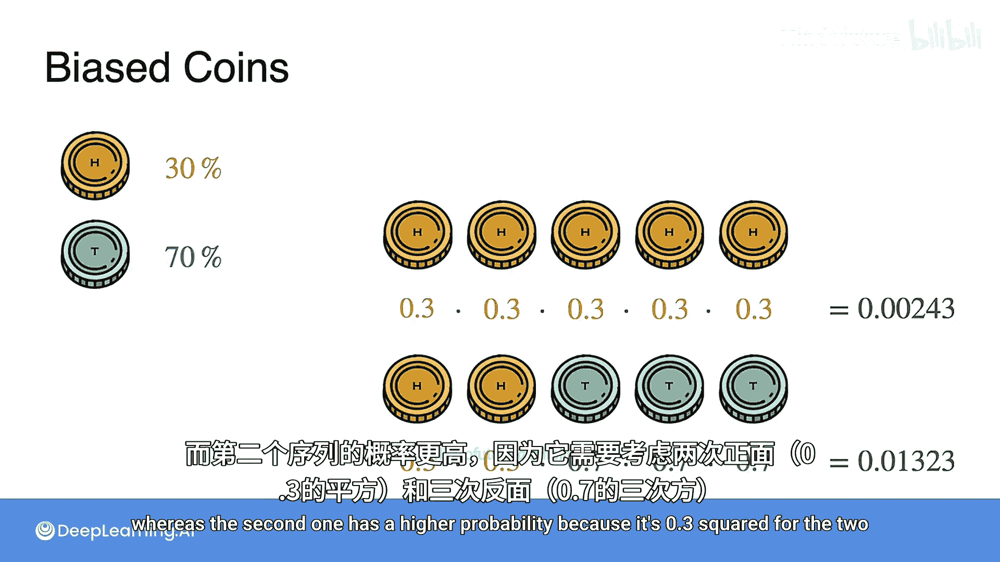
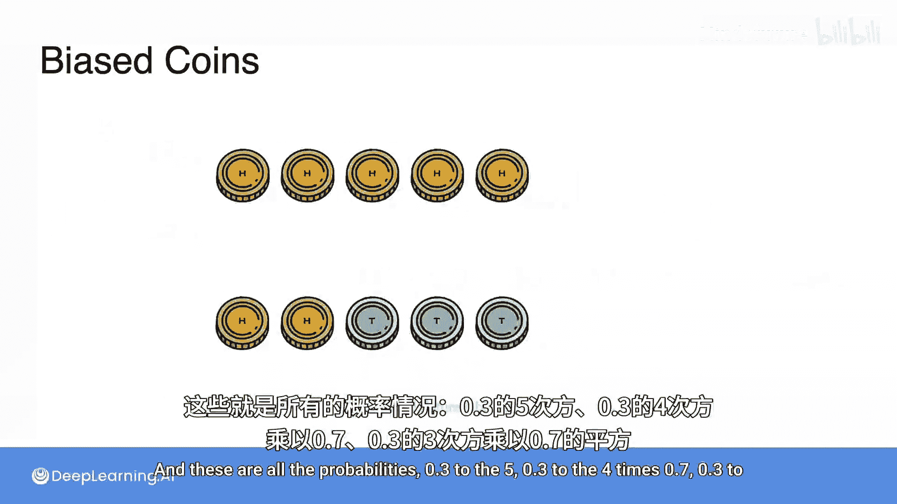
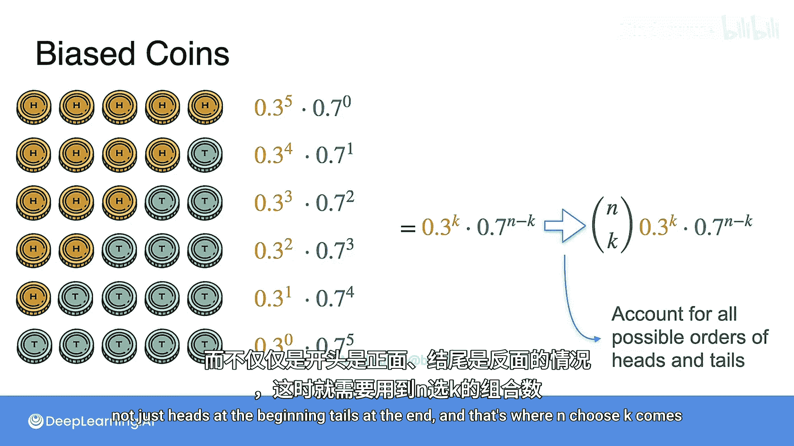
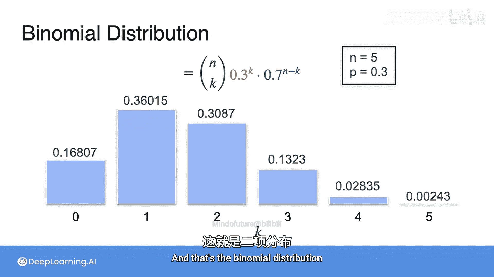

# 【Deeplearning】机器学习和数据科学概率与统计3 ｜ Machine Learning Probability And Statistics 吴恩达 p21 P21_选学二项式系数_01_02_04 -BV1c86VBrE93_p21-

Now this works more generally when you need to pick k out of n numbers。

 you start by picking the first one where instead of five options we have n options。

 then you need to pick the second where we have one less option and it's one less because you've already picked one numbers So for each of the n numbers chosen in the first step you can pick n minus1 in the second step same thing for the third step where you can only pick out of n-2 numbers and so on until the K step where you can only pick from k minus1 numbers less than n this gives you one order sets of length K just like in the previous case So how many sets are actually there well it's a product of all the number of choices you had to make so that's n times n1 times n21 all the way to n K minus1 and the reason is that all these can be taken as independent events。

But as you saw previously many of the combinations actually repeat， but how many of them repeat。

 let's figure this out for a simple case， let's say that the size of the set which we named K is4 and these are some of the possible ways to arrange the numbers in the set how many ways are there to order this set well the problem is actually very similar to the one we did before except that we don't have to go that far so let's start by picking the first number and then we pick the second one and then we pick the third and then we pick the fourth for the first number we have four options for the second one three options because we're already pick the first for the third we have two options and for the fourth one we have one options so in total we have four times three times two times one equals four factorial options。

For five numbers we would have the same thing but times 5 that's a5 factorial in general。

 the solution is k factorial if you haven't seen that number K factorial is very， very。

 very important in probability and combinatorics and it's simply just a rolling product from k all the way down to1 and k factorial is simply the number of ways of ordering k numbers or k different objects so now let's go back to where we were we had that the number of ways of picking k numbers in an ordered fashion was n times n minus1 all the way to times n minus k minus1 but that picked every set many times how many of them well k factorial times because k factorial is a number of ways to order that set of numbers that we picked So since we want them unorder then we have to divide by k factorial and thus we obtain something that can bewritten as n factorial over n minus k factorial if you look carefully that's the blue part because n factorial is a product of n all the way to1 and if I divide。

By the product of n minus k all the way to1， that's n minus k factorial。

 then I obtain the product and I have the numerator n all the way to n minus k minus1 and the denominator still has a k factorial here。

 so that is the expression for n choose k for the binomial coefficient n choose k the number of ways to obtain k elements out of a set of n in an unordered way。

Now going back to our graphics， we can rewrite all these numbers in the case of0 heads。

 we have5 choose0， which is 5 factorial divided by5 factorial times 0 factorial now0 factorial is one y is 5 choose0 to1 because it the number of ways of picking zero things out of0 and there's only one way to do that which is。

Not pegan。Therefore， in general， anything choose zero is always one。

Now let's see how this changes if the coin is unfair or biased。

 Let's recall the case of throwing five coins。 remember we're counting the possible outcomes when we get zero heads one head and all the weight to five heads and then divided by 32 which was a total amount of possible outcomes Well this was possible because all the outcomes were equally likely but as you remember the probability of all these outcomes was 1 over 32 however。

 if the coin is biased and let's say it's padded so it lands on heads with a probability of 30% and entails with a probability of 70% then all these outcomes have a different probability the first one has 0。

3 to the 5 which is 0。00243 whereas the second one has a higher probability because it 0。

3 squared for the two heads and 0。7 cubed for the three tails and these are all the probabilitybabilities 0。

3 to the 50。3 to the 4 times 070。3 to the 3 times 0。7 squared all the way to 0。

7 to the5 and so let's write。

the in general， so if we obtain heads k times then the probabil is 0。3 to the k times 0。

7 to the n minus k。 so here we have 0。3 to the 5 times 0。

7 to the 0 and here we have all the other ones 03 to the 4 times 0。7 to the 1 all the way to 0。

3 to the 0 times 0。7 to the5 so this is the general expression for the probability of each one of these scenarios however。

 we need to account for all the possible orderings of heads and tails。

 not just heads at the beginning tails at the end and that's where n choose k comes in so now we can take a look at how this thing looks in practice you have your biased coin which lands on heads for the probability of 0。

3 and you flip it n times which is5 and you can again plot the histogram for the probabilities for each K just like before except that now you can calculate these probabilities Uni formula that you have learned in the previous light and that's the binomial distribution。

