# 【Deeplearning】机器学习和数据科学概率与统计3 ｜ Machine Learning Probability And Statistics 吴恩达 p22 P22_伯努利分布_01_02_05 -BV1c86VBrE93_p22-

So let's go back to the coin flipping experiment， remember that you used a variable x to denote the number of heads and that's a random variable so when you flip a coin you can obtain heads or tails and the number of heads can be one with probably 2。

5 or 0 it probably 2。5 we're going to call that an experiment where we get a success if it lands on heads and a failure if it lands on tails。

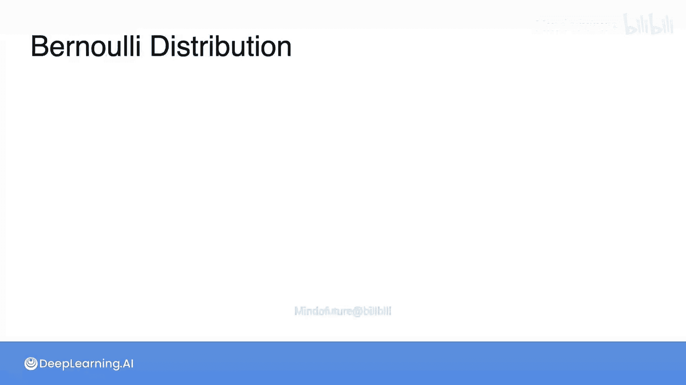

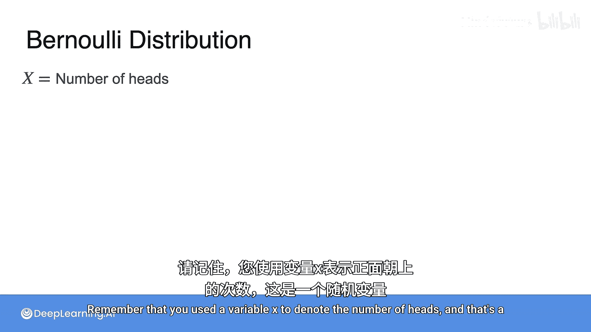

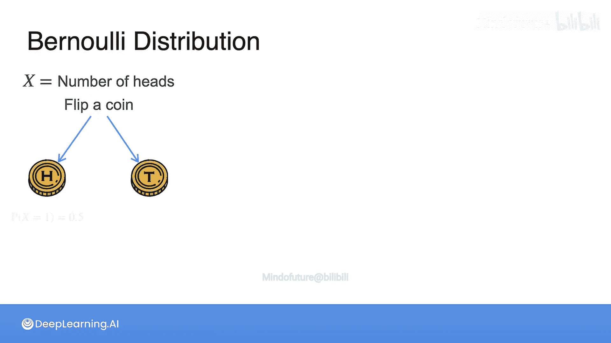

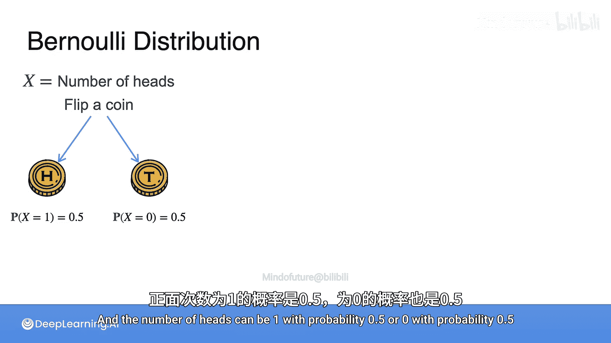

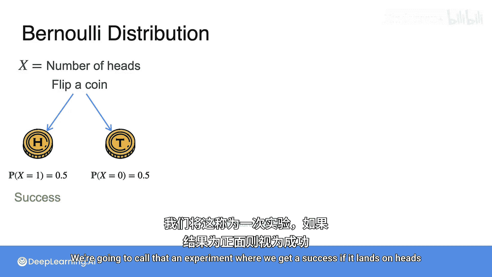

Now we can make different experiments and also have success and failures if we were all at dice and we consider success when it falls on one and failure when it falls on anything different。

 that means our variable is the number ones， then the probability of success is 16 and the probability of failure is 5 or6 and we can also have other experiments。

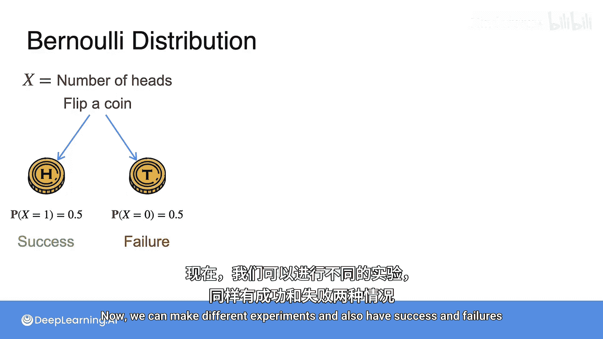

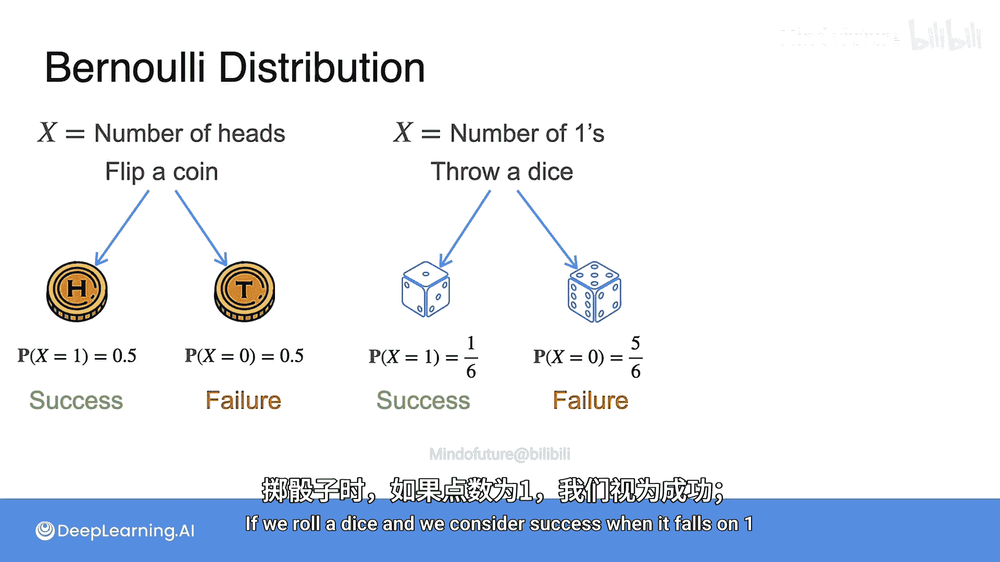

For example， if a patient is sick or healthy， we can say that if x is the number of sick patients。

 then a success is when the patient is sick， which is likely contradictory but since we're counting the number of sick patients then in this case。

 x equals 1 is a success， and the probability for a sick patient let's say it's p and for the healthy patient is 1 minus B。

 these are all examples of the Bully distribution， a very important distribution in probability and statistics which has one parameter and the parameter is B。

 the probability of success。

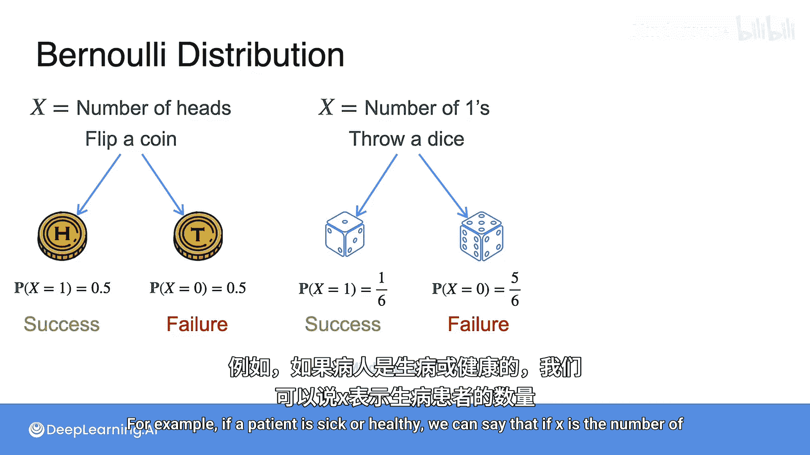

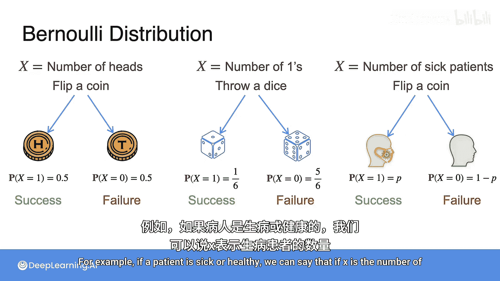

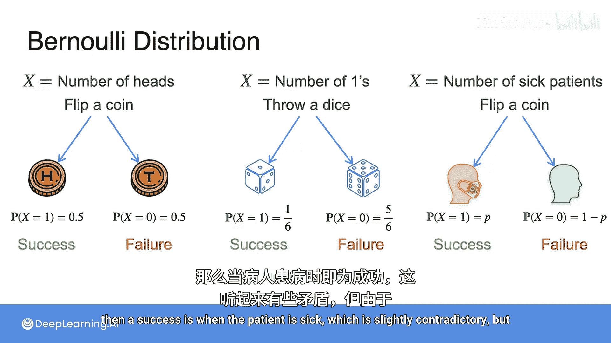

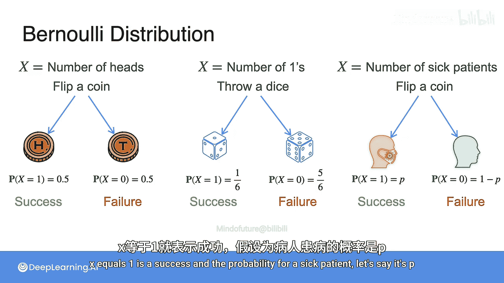

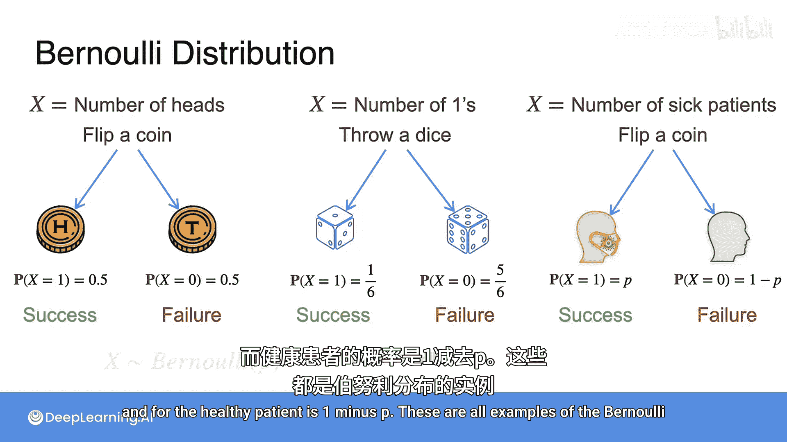

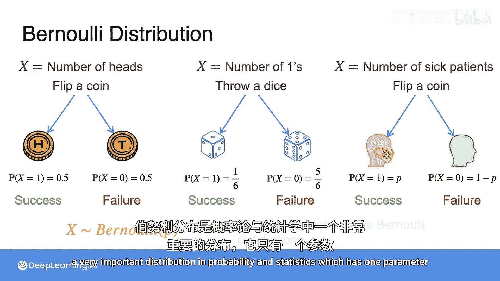