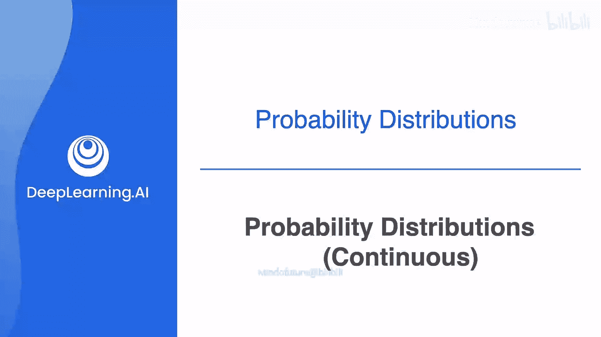
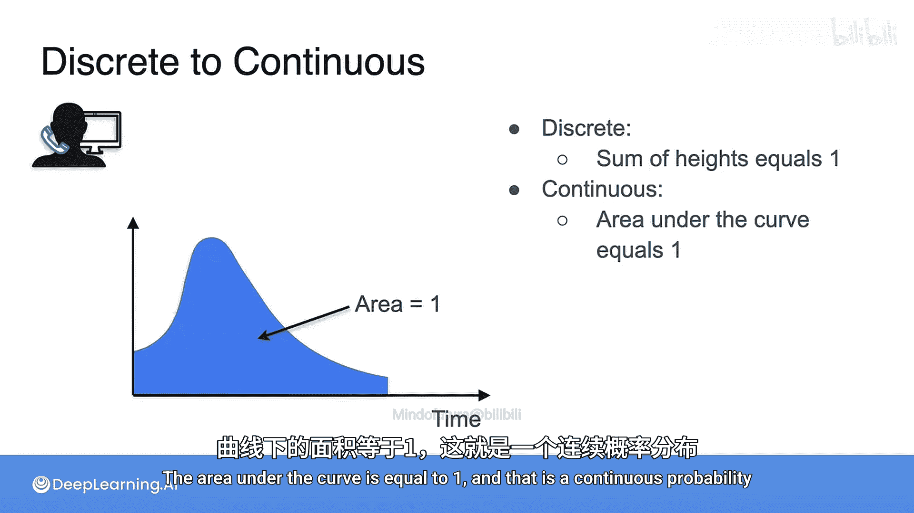

# 【Deeplearning】机器学习和数据科学概率与统计3 ｜ Machine Learning Probability And Statistics 吴恩达 p23 P23_概率分布连续型_01_02_06 -BV1c86VBrE93_p23-

So now that you know about discrete distributions， let me tell you about continuous ones and there's a difference between the two in the discrete distributions。

 your events always form a list， for example， if I toss a coin three times I could get head zero times one times two times or three times I could also think of the number of people in a town it can be zero。

1，2，3， a million， etc， but I can always make a list of it。

What is something that cannot be listed and interval？For example。

 if my random variable is the amount of time that I wait on the phone or the amount of time I wait for the bus。

 that cannot be listed because I could wait one minute， but I could also wait 1。01 minute or 1。

2237 or pi minutes， all these numbers cannot be listed so when your events are a list。

 you have a discreted distribution and when your events are an interval you have a continuous distribution。

Let me elaborate more on that so imagine you're a call with tech support and you're trying to find the probability that you will not wait too long。

 let's say the call can take one minute， two minutes or three minutes for example。

 and we can try to plot the probabilities say like this where the heights of the bars are the probabilities that the call takes one。

 two or three minutes。But they can also take something like 1。0 or1 minutes to respond， right or 2。

43， and you can quickly see that there's infinitely many values that call could take。

And these values are everywhere between the ones you already have and also to the left and to the right。

And if you remember from the last video， the sums of heights of all of them have to be equal to one。

 but you can quickly see that by adding more and more and more of them。

 they have to get smaller and smaller and eventually become zero， so what did we do wrong here？

Well we did nothing wrong the answer is that the distribution is fundamentally different as it is not discrete。

 but it is continuous， so this approach will not really work to try to understand this。

 think of how you would answer the following question what is the probability that a call would take exactly one minute to the dot？

And I encourage you to think about this。 the answer is zero。

Because there are simply too many values for the amount of time a call can take there's actually uncountably many of them it's a whole interval and we're forced to say that the probability that a call takes exactly 1 minute。

00000 forever is0。So we need to describe this problem in a slightly different way so instead of asking what is the probability of the call taking a fixed amount of time。

 let's think of it in terms of windows so we're thinking of what's the probability that the call lasts sometime between a certain of window say between0 and 1 and for that we can have a probability and we can put it as the height of this blue bar over here。

Then we can think of as a probability the call lasts between one and two minutes and that's these other height or between two and three minutes or three and four minutes and four and five minutes and let's assume that the call never takes more than five minutes and now we have a discrete probability distribution where the blue area so the sum of the heights of these bars add to1。

And notice that the majority of the calls take between one and two minutes or between two and three minutes。

 not a lot of them go all the way to five minutes and that's what this probability distribution is telling us。

Now imagine that we want a little more information so want to make these intervals a little more granular so we make them of 30 seconds instead and now we have this distribution over here where we now know the probability that the call is between zero and half a minute between half and minute and one minute all the way to between  four minutes and half and5 minutes and if we want to make them still more granular we can make them off a quarter of a minute。

 15 seconds basically and now we have all this information between0 and a quarter of a minute between a quarter and a half minute all the way between 4。

75 minutes and five minutes。And we can continue splitting these intervals and getting discrete distributions and if we were to do this infinitely many times then what we get is this this is how a continuous distribution looks like imagine just a bunch of very very very skinny bars infinitely many of them that become just a curve now in the discrete distribution we have the sum of heights have to be equal to1 the sum of heights was the same as saying the blue area。

 so in the continuous distribution we have the same condition the area under the curve is equal to1 and that is a continuous probability distribution。

