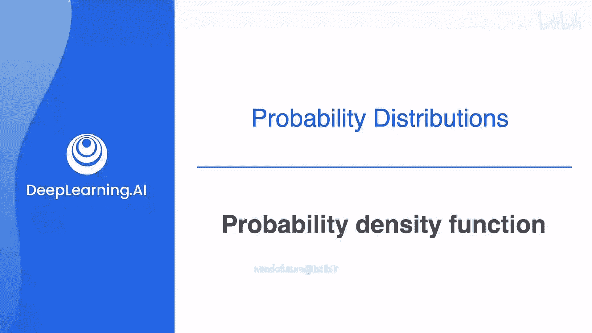
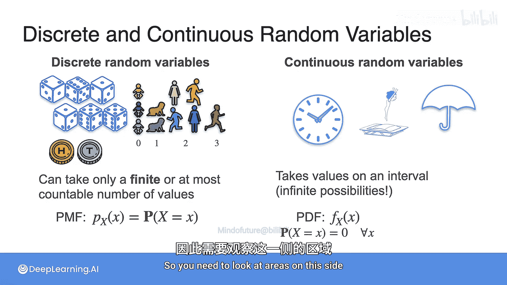

# 【Deeplearning】机器学习和数据科学概率与统计3 ｜ Machine Learning Probability And Statistics 吴恩达 p24 P24_概率密度函数_01_02_07 -BV1c86VBrE93_p24-

So when you learn discrete distributions you learned that each event had a probability， for example。

 the probability that I throw a coin 10 times and three of them landing heads is a certain number when we talk about continuous distributions we cannot talk about those probabilities in the same way for example。

 if I make a phone call the probability that the phone call lasts exactly two minutes to the dot is zero but I can still talk about intervals I can talk about the probability that a phone call lasts between two minutes and three minutes or between two minutes and two minutes 30。

These probabilities are encoded in something called the probability density function let me show you how so before we return to the platform of the previous video let's take a look at another simple case let's say that the call center answers with equal probability and any time window between0 and5 minutes so as you can see here if we divide this area in five different parts then the probability that the length of the call lands in any of the five rectangles is exactly the same so given this information what is the probability that the call is between two and three minutes long。

Well， if you said 0。2 or 20%， that is correct， it's also 15 because there are five equal parts and this area adds to one because of probability distribution。

 so the area of that little rectangle is one fifth and that's the probability that the phone call lasts between two and three minutes。

Now let me ask another question， we're going to split it now in 10 small intervals of 30 seconds。

 what is the probability of the call lies between  two and 2。5 minutes？Well， for the same reason。

 it's 0。1 because it's 110。This time the intervals are shorter。

 so the probability that lies between that interval is smaller。

So what you can notice here is that the height towers doesn't change at all but their width was heald and therefore the probabilities have also been hal。

 this is because now we're not looking just at heights but at actual areas and the base is no longer one so now we can think of heights of towers instead we need to think about areas。

Now let's return to the previous example of the call center where the calls are not equally likely to be of the same length now the call is more likely between one and two minutes or between two and3 and not so likely to be between four and five minutes so what's the probability that a call lasts between one and two minutes well it's this area over here and the probability that it lasts between one and one minute 30 is this area over here。

Now if I have the areas much much more granular like this。

 what's the probability that' is between two and three minutes well it's going to be the sum of all the shaded areas between two and three minutes so we're getting to the continuous distribution what is the probability that the call lasts between one and two minutes well now it's going to be this area over here。

If we were interested in the probability that the call is exactly two minutes。

 then we'll be talking about the area of this segment over here。

 that is a line segment and it has no area， so that's why we say that that probability is zero。

 so now we can only think of probabilitybabilities between different windows of time no longer one particular time。

So to recap as we divide the intervals into smaller and smaller。

 also the areas get smaller and smaller until they get to zero。

 so that's why we have to look into intervals and not just heights。So as I told you before。

 this function is called a probability density function or PDF for short。

 and it's usually denoted as a lowercase F， it is the equivalent of the lowercase P in the discrete distribution。

 equivalent of the mass function is now it's called probability density function。

And for added clarity， you can add a subscript on the variable is representing that's the capital X。

😊，PDFs are function defined only for continuous variables and it represents the rate at which you accumulate probability around each point。

You can use the PDF to calculate probabilities， how do you do that simply by getting the area under the PDF curve between points A and B。

Now what does a function need to satisfy in order to be considered a PDF well first it needs to be defined for all the numbers in the real line that means that it can actually be zero for many values。

 for example before zero or after the cut at the right but it doesn't need to。

 it could be positive for all the numbers and the area still being one if it gets really really really tiny at details。

And it also needs to be positive or0 for all values。

 this is reasonable because otherwise it would get placed in negative probabilities and you know that probabilities cannot be negative and finally the area under the curve has to be1 again this restriction comes from the probabilities the area under the curve is simply the probability of all possible outcomes of the variable and it always needs to add to1。

So here's a small summary， let's take a look at discrete random variables and remember that they can only take a finite or most accountable number of values while continuous random variables are used to model experiments where the outcome can take any value in an interval。

Because of this difference between this query and contains random variables。

 each kind will have their own way of describing the behavior and computing probabilities。😊。

To measure the probability of events in the case of this grid random variable。

 you have a probability mass function， which is defined as the probability that x takes on a particular value。

For the continuous random variable you have the probability density function and remember that for this type of variable。

 the probability that the variable takes on a particular value is always zero。

 so you need to look at areas on this side。😊。

