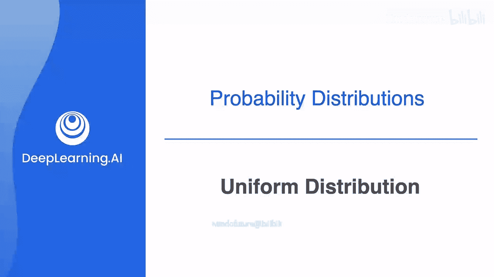
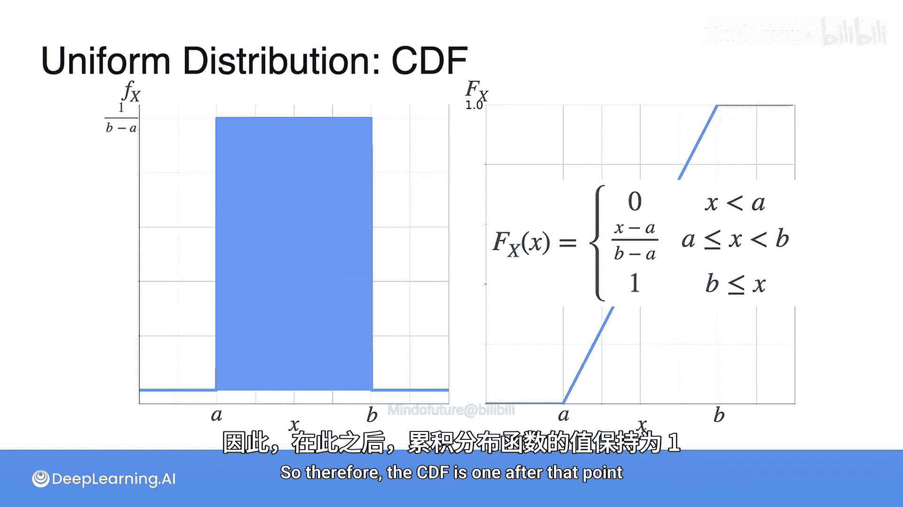

# 【Deeplearning】机器学习和数据科学概率与统计3 ｜ Machine Learning Probability And Statistics 吴恩达 p26 P26_均匀分布_01_02_10 -BV1c86VBrE93_p26-

So now you're ready to learn the simplest continuous distribution of all。

 which is the uniform distribution。I like to imagine it as a bus for example。

 let's say that a bus passes every 10 minutes but I don't know the schedule so I just walk outside and wait for the bus What do you think happens with all the values of the times I wait for the bus sometimes I take one minute sometimes 5974。

53。52 etc and when you look at all these numbers they're pretty homogeneous in the interval from 0 to 10 minutes That's how a uniform distribution looks like let me elaborate So imagine again that the example of a support call center previously we've looked at some different histograms of probability of their answer at different times Now let's name some of these examples and start with a uniform distribution Imagine that the call center can answer in any time from0 to 15 minutes with equal probability and if they don't answer within 1 15 minutes the call is disconnected。

The last 200 times you called them， you made a note of how much time you had to wait and notice that the points seem to be more or less equally distributed over the Y axis。

 That means that there is no particular wait time or window wait times that seems to appear more times than the rest。

In fact， this is what the hissterogram looks like， while it seems that one of the bars is slightly tarred on the rest lesss not forget forget that this is based on measurements。

 so some deviation is expected。Call T the time minutes that you have to wait。

 and any value between 0 and 15 should have roughly the same frequency of occurrence。

Which means that the PDF must be constant on the interval 015 so no value is favored over the others the question is which is the constant well remember that the area over the curve of the density must be 1 so that times 15 which is the length of the interval must be 1 and therefore the height is 1 over 15 or 0。

06。And we can draw it over here。In general， a continuous variable is set to follow a continuous distribution if all possible values have the same frequency of occurrence。

 it has two parameters which are associated to the interval where the variable can take values A is the beginning of the interval and B will be the end of it and the probability density function will be then 1 over B minus a which is1 over the length of the interval since the interval has length B minus a as it goes from a to B and it's 0 otherwise。

 so it is that orange line that is always0， except it's1 over b minus a at the points between a and B。

This animation shows what happens when we change the parameters more specifically the starting and ending point。

 you can see that when the interval AB is bigger than the P is smaller。

 the height of the PDFf is smaller and it quickly increases as the interval gets short。

 Now let's see what the CDf looks like and let's take a simple example the uniform distribution between0 and1 but you can see that this applies to the uniform distribution between AMmb just by changing the parameters a little bit so first let's start by considering some x less than 0 In this case the area under the PDFf until that point from the left until that point x is 0 therefore for any value that is less than0 the CDf is0。

Now take any x between 0 and 1， the probability of the variable being smaller than a particular x is this area over here。

Since it's third rectangle you need to multiply the length of the base。

 which is x by the height which is1， so at that point the CDF is x over 1 which is the same as x。

And the same is valid for any exp to run one， so the CDf is this line here with slopepe1。And finally。

 if you take an E x bigger than one， youve already gathered all the area under the PDF so the probability stays as1。

 so this is how the CD looks a straight line followed by a diagonal and then followed by a straight line and the one at the left at0 and the one on the right is at 1。

For the general uniform distribution between A and B。

 you can see that the CDF is the ratio between the length of the segment AX and the length between the extreme values A and B for by of x between A and B for x less than a you have zero cuuld probability and again for x bigger than B you've already gathered all the probability so therefore the CDF is1 after that point。

