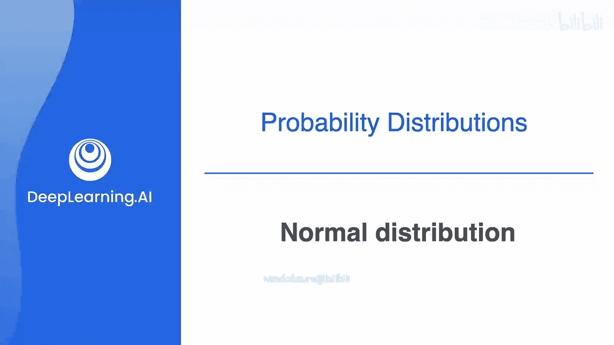
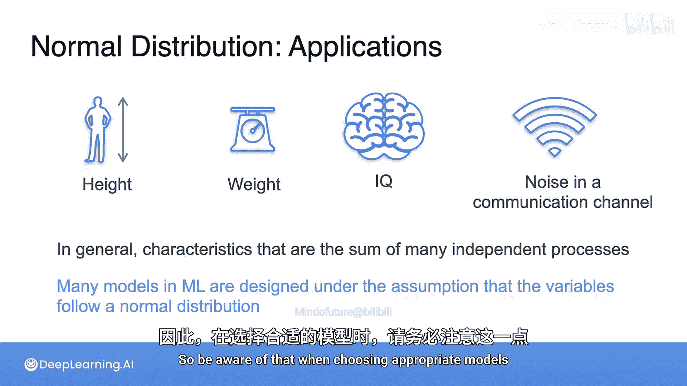

# 【Deeplearning】机器学习和数据科学概率与统计3 ｜ Machine Learning Probability And Statistics 吴恩达 p27 P27_正态分布_01_02_11 -BV1c86VBrE93_p27-

So now let me tell you about one of the most popular distributions out there。

 it's called the normal distribution also named Gaussian distribution after famous mathematician Carl Gauss。

 the normal distribution appears everywhere in statistics， in science。

 in real life and obviously in machine learning it appears all over the place。

Let me show you so now let me show you one of the most used distributions in ML。

 the Gaussian or normal distribution， but let me give you a little bit of intuition first。

 remember in the previous videos you learn about the binomal distribution which counted， for example。

 the number of heads in end coinin tosses and the probability mass function look like this for example。

 for two throws。Now let's see what happens as n the number of throws gets larger and larger and larger。

 let's plotted for all numbers all the way to n equals 100。

 and you can notice that it looks like a bell curve so a continuous bell shape fits pretty well and that bell curve that orange curve is what we called the normal or Gaussian distribution name after the very famous K Frederick Gaus。

 so this means that when n is very large the bin normalmal distribution can be approximated by a Gaussian distribution pretty well。

 Now let me tell you more about this Gaussian distribution。

So let's say that the data looks like this， like a bell curve。

 We're going try to fit it with some curve and the curve E to the negative x square over2 seems to work pretty well because it seems to look like this like a bell curve。

 However， we need to adjust it a little bit。 Let's look at where the blue data is centered。

 It's centered at2， we're going call it mu for the mean and we're gonna to learn these mean more in detail in the next week。

 But for now， let's just think of it as the center of the data。

 The orange curve has this point0 as a center because a symmetric over the x axis。

 So we need to move it to the right and how to we move it to the right。 Well， by subtracting2。

 So that moves it to the right another equally centered。 However。

 the orange one is a little too skinny for the blue1。 It needs to be y and the bit。

 There's something called a standard deviation and we're going learn next week。

 but that tells us how thick the curve is。 and the orange one has standard deviation of one。

 and the blue one of。Let's say three， so what we need to do is to thicken the orange curve and the way we thicken this curve is by dividing the exponent by 3 that gives it the right thickness。

Now another problem we have is that the orange curve is different height than the blue one its actually too high and more specifically the area is not the same the area under the blue curve is one because it's a probability distribution and the area under the orange curve is much higher so what is it well for this number is actually three times square root of2 pi so we need to divide by this number。

In order to get。The right curve and notice that now it fits it really， really well。

 so that's the formula for the Gausian or normal distribution。So it has some parameters as you saw。

 the mean so that's the center， the average of the data is mu。

 the standard deviation which we're going to learn next week。

 but as I told you it a measure of the whiteness of the curve。

 it's a number called sigma and if you want the mean to be mu and the standard deviation to be sigma those are the two parameters then the equation of the Gaussian or the normal distribution is exactly this one over here and mu is the place where the data centered and sigma is a measure of the whiteness as I said before now let me give you a small recap because this is a very important distribution so mu is the center and sigma is the spread。

And the curve is obviously symmetrical and the ranges all the real numbers。

 so it actually is one example of a distribution which its probability density function is always positive that is very。

 very， very small for big and for negative big numbers and the formula is this one over here this part over here is simply a scaling constant and here are some different normal distributions for different means and different sigmas。

So if you have a random variable x with this probability density function。

 you can write it like this x is distributed as n of mu sigma squared。

 n stands for normal and mu stands for the mean or the center of the bell notice that in this notation the standard way to describe the distribution is using sigma squared rather than sigma。

 which is the square of the spread。As you will learn in the next lesson。

 this is called the variance don't worry too much about this change as both Sigma and Sigma squared convey exactly the same information。

 because sigma has to be positive， then there is a  one to one relation between the two parameters。

There's one particular set of parameters of great importance and they are mu equals 0 and sigma equals 1。

When a distribution has these parameters， it's called the standard normal distribution。

 notice that the resulting be shaped curved is center at mu equals0 and itss symmetric with respect to this axis。

Now let's take a look at the density function Fx When we plug in the value for mu equals 0 and sigma equals1。

 the simplified formula makes calculations much easier。

 There is a really easy way to convert any normal distribution to the standard one and it's by doing some small operations So let's say that x has a normal distribution with parameters mules 2 and sigma was 2。

5 So the first thing we do is instead of x consider x minus2 and that moves it all the way to the center and now let's divide by the standard deviation by sigma so x minus2 divided by 2。

5 actually。Puts it off the right height and the right width and it makes it the standard normal with parameter 01 we're normally going to want parameter 010 is the mean and one is the standard deviation。

 and so we're not going to look at x， we're going to look at set equals x minus mu divided by sigma standardization is crucial in statistics because it helps us compare variables of different magnitudes。

 So if one variable， for example， moves in some range of values and another variable moves in a completely different range of values。

 then we can compare them by standardizing both of them。Now let's see what the CDF looks like。

 it looks like this。As usual it starts at0 on the very left which is now the point infinity and ends at one at the very right。

 which is a point at plus infinity but here's a catch this area is actually really hard to compute it can be computed analytically so what do we do to compute these areas well in the old days there were big tables of data that people used to look at Now you can use the help of some software to do the approximate area under the curve for you。

And what are some things that can be model using the normal distribution well that's the great thing about its so many things in nature are modeled by the normal distribution height is modeled by the normal distribution weight。

 IQ things like noise in a communication channel and in general variables can be modeled as some of many independent processes always follow normal distribution so we're going to see that in more detail later also many machine learning models as some variables follow a normal distribution so beware of that when choosing appropriate models。

😊。

